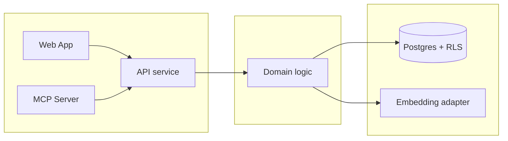

# Canonical Anthara spec skeleton

Use verbatim. Section order is fixed. Read at write time (Step 10 of `SKILL.md`).

Cross-section references: whenever the spec's prose cites another section (`§7.2`, an invariant, a slice), write the citation as a markdown link to that heading's anchor — `[§7.2](#72-architectural-style)`, `[invariant 4.2](#4-invariants)`, `[slice 5.3](#53-verb-led-slice-name)`. Anchor = the heading text, GitHub-style: lowercased, all characters stripped except letters/digits/spaces/hyphens, spaces → hyphens.

````markdown
# Spec: <one-line problem framing>

> Owned by: <author>  ·  Started: <YYYY-MM-DD>  ·  Last revised: <YYYY-MM-DD>  ·  Spec UUID: <uuid>
> Anthara spec — slice-decomposed, categorically-framed. Feeds /anthara:create-ticket and /anthara:plan-implementer.

---

## At a glance

| | |
|---|---|
| **In one line** | <the problem this solves, one sentence> |
| **Slices** | <N>, built in the order listed in [§5](#5-slices) |
| **Architectural style** | <style, from [§7.2](#72-architectural-style)> |
| **Active packs** | <pack names, or "none"> |
| **Open questions** | <N> — <the one that matters most, or "none"> |

## 1. Overview & business context

Four labelled paragraphs, 1-3 sentences each. Ground in the discovery brief if one exists.

**The problem.** <What is broken or missing today, and what it costs.>

**Who it is for.** <The user kinds from [§3.1](#31-kinds-of-users) and what they are trying to do.>

**What this spec commits to.** <The shape of the solution, outside-in. No implementation detail.>

**Deliberately out of scope.** <What a reader might reasonably expect here and will not find — or "nothing deliberately excluded.">

## 2. Sources

| ID | Type | Contributor | Date | Description |
|---|---|---|---|---|
| 1 | Anthara Discovery Brief | <name> | <YYYY-MM-DD> | <doc location, short description> |
| 2 | Public docs (host/path) | Web | <fetch date> | <what it documents> |
| 3 | Codebase (this repo) | n/a | <date> | <stack and primary modules> |
| 4 | Org Memory (mcp__plugin_anthara_anthara-fabric__search_memories: "<query>") | Fabric | <date> | <what it surfaced> |
| 5 | Live spec-writing session with <user> | <user> | <date> | In-session decisions |

## 3. Type ontology

Drawn from corpus language. Categorical, non-overlapping, load-bearing.

### 3.1 Kinds of users
- **<Type>** — <description> [1].

### 3.2 Kinds of data
- **<Type>** — <description, regulated or not> [1].

### 3.3 Kinds of events
- **<Event>** — <when it fires, who triggers> [1].

### 3.4 Kinds of states
- **<State>** — <what it means> [1].

## 4. Invariants

Named, non-trivial, must-always-be-true. One quotable sentence each — the statement a reader could lift verbatim into a test name. Elaboration goes on its own line beneath, and only when the statement alone would mislead.

**4.1 <Invariant name>** — <statement>. Sources: [1, 3].

**4.2 <Invariant name>** — <statement>. Sources: [1].

## 5. Slices

Outside-in, independently testable, sequenced for build. This table is the build order — `/anthara:plan-implementer` executes it top to bottom — and its last two columns are the wiring contract.

- **Entry** — the outermost user-reachable thing the slice exposes: a screen, button, CLI subcommand, HTTP endpoint, webhook subscriber, scheduled job.
- **Reached from** — the Host that contains the Entry: an earlier slice's Entry verbatim with its slice number, or `root` for the legitimate first surfaces (the app shell, the CLI entry point, the public API root). When the same Entry is reachable from several places, list every Host in the cell, one per line. A slice may not be ordered before every Host it names.

| # | Slice | What the user can do once it lands | Entry | Reached from |
|---|---|---|---|---|
| 5.1 | <verb-led name> | <one line, outside-in> | <Entry> | `root` |
| 5.2 | <verb-led name> | <one line, outside-in> | <Entry> | <5.1's Entry> (5.1) |

Filled rows read like: `root` → *the project shell at /<org>/<project>*; *the product detail screen (5.3)* → *"Add to cart" button*; an Entry with two Hosts lists both — *the board screen (5.12)* and *the backlog screen (5.16)* → *"+ File bug" button*.

### 5.1 <Verb-led, user-observable slice name>

<One paragraph, outside-in voice. What the user sees and does. Avoid implementation detail.>

*Types: <from [§3](#3-type-ontology)> · Invariants: <from [§4](#4-invariants)>.*

<Inline diagram if the slice has a UI or non-trivial sequence. ASCII for screens, mermaid for sequences and state changes. Skip if prose suffices.>

**Acceptance criteria** (markdown checklist; mark `[x]` as the AC is implemented and verified)

- [ ] **5.1.1** <Functional AC, observable from outside.>
- [ ] **5.1.2** <Compliance AC tied to an active pack rule.>
- [ ] **5.1.3** <Error-path AC.>

### 5.2 <Next slice>
<...>

## 6. NFRs & regulatory compliance

Pack-derived. Each NFR cites the originating pack rule and (where applicable) a regulatory control ID.

### 6.1 <Pack name>

**6.1.1 <NFR statement>** — derived from rule: <rule name>. Cited control: <e.g. HIPAA §164.312(a)(1)>. Sources: [<pack>].

### 6.2 <Pack name>
<...>

### 6.N Control coverage matrix

| Control | Pack | Slices | Evidence committed |
|---|---|---|---|
| HIPAA §164.312(a)(1) | HIPAA Security & Privacy | 5.1, 5.3 | Audit-log entry on every PHI read; covered by AC 5.1.2 and 5.3.2 |

## 7. Architecture

A deliberate structural choice, named and justified.

### 7.1 Tech stack

| Layer | Choice | Rationale |
|---|---|---|
| Backend runtime | <NestJS / Hono / FastAPI / Go / etc.> | <2-3 sentences> |
| Database | <Postgres (Supabase) / MySQL / MongoDB / etc.> | <...> |
| Hosting | <Supabase / Vercel / AWS / GCP / etc.> | <...> |
| Auth | <Supabase Auth / Auth0 / Clerk / etc.> | <...> |
| Other | <vector store, queue, cache, search, etc.> | <...> |

### 7.2 Architectural style

**Style:** *<one of: layered / hexagonal / onion / clean / DDD / event-driven / CQRS / microservices / modular monolith / SOA / pipe-and-filter / actor / space-based / serverless-FaaS / micro-frontends>*.

**Why this style here:** <2-4 sentences justifying the choice from requirements (scale, slice independence, regulated content, async needs) and tech stack (some stacks naturally favor certain styles).>

**Dependency direction:** <e.g., "outer → inner; UI / API depend on application services; application services depend on domain; domain depends on nothing"; or "events flow forward through the bus; producers do not know consumers"; etc.>

**Anti-patterns the style forbids:** <e.g., "no controllers reaching into other controllers", "no shared mutable singletons", "no cross-bounded-context imports without an anti-corruption layer">.

### 7.3 Module decomposition

Boundaries and dependency direction, by kind of module — never repository paths. The path-level module map is the plan's (Shared conventions) and `ARCHITECTURE.md`'s when extracted.



### 7.4 Data flow (optional)

Include when runtime flow is non-trivial. Mermaid sequence or flow diagram. Reference types from §3 and slices from §5.

### 7.5 Threat model seed (optional)

Adversarial paths, trust boundaries, primary risks. Not full STRIDE; a seed for security review. Mermaid trust-boundary diagram when boundaries are non-obvious.

## 8. Open questions

Genuinely external blockers — never lazy unknowns. Something you decided against is not open; it belongs in §9. Write "None." and one line saying why when nothing is outstanding.

**8.1 <Open question>.** Awaiting: <stakeholder / data / review>.

## 9. Deferred follow-ups and accepted limits (optional)

Include when the work surfaced defects it will not fix, or a limitation knowingly accepted. Omit the section when neither applies — do not pad it with speculative work.

Two kinds of entry, both one paragraph, both citing the code that produces them:

- **A deferred defect** — real, found in passing, deliberately not built here. Say what breaks, when, and what closing it would take. It is not an open question: nobody is awaiting an answer, the answer is "not now."
- **An accepted limit** — a case the chosen design does not cover, where not covering it was the decision. Name the alternative that was rejected and why, so a reader hitting the case later finds the reasoning rather than re-deriving it.

Entries are what stops a discovery being rediscovered. Anything a slice's ACs commit to is not deferred and does not go here.

**9.1 <Deferred defect, stated as what breaks>.** <Mechanism, consequence, candidate fix.> Sources: [3].

**9.2 <Accepted limit> — accepted.** <The uncovered case, the rejected alternative, why.> Sources: [1, 3].

## 10. Established behaviour — documented, not changed (optional)

Include only for behaviour this spec's reader would plausibly mistake for a bug and "fix." Each entry states the behaviour, the code that produces it, and who confirmed it is intended. Omit the section when nothing qualifies.

This is the section that stops a later reader — human or agent — from helpfully reverting a deliberate decision that looks wrong out of context.

**10.1 <Behaviour, stated plainly>.** <Mechanism.> Confirmed intended: <by whom, and the reason>. Sources: [1, 3].

---

## Changelog

- <YYYY-MM-DD> — <author> — Initial spec from discovery brief [1].
````
