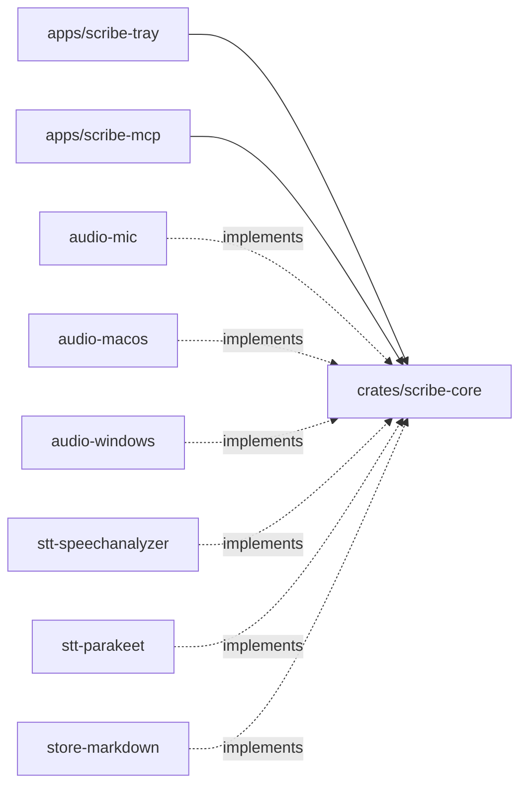

# Scribe — Architecture

Project-wide architectural reference. Seeded from [spec 001 §7](specs/001-scribe-tray-transcriber.md#7-architecture). This file is authoritative for every later spec and plan.

## 1. Style and rationale

**Style:** Hexagonal (ports and adapters).

Scribe is the same product on macOS and Windows, but almost every edge differs by OS: audio capture, the speech engine, permissions and file locations. Hexagonal keeps the recording domain independent of those edges: sessions, segments, the two-lane Me/Them model, echo filtering and the status lifecycle. Each OS plugs adapters into three ports. One core is driven by two primary adapters: the tray app, which writes sessions, and `scribe-mcp`, which reads them.

## 2. Tech stack

| Layer | Choice | Rationale |
|---|---|---|
| App shell | Tauri 2 (tray, popover webview, notifications) | One codebase for macOS and Windows with native access from Rust; proven by Anarlog and Meetily |
| Core | Rust workspace | Real-time audio, OS APIs, ONNX inference; shared by both binaries |
| UI | React + TypeScript (Vite) in the webview | Small surface; matches the org's TS/React standards |
| Mic capture | `cpal` | Cross-platform input |
| System audio | macOS Core Audio process tap (`cidre`); Windows WASAPI loopback (`wasapi`) | Audio-only permission on macOS; no permission needed on Windows |
| STT | macOS Apple SpeechAnalyzer (Swift bridge, English); Windows Parakeet (`parakeet-rs` / ONNX Runtime, auto language) | Best on-device engine per OS, behind one port |
| Storage | One Markdown file per session in `Documents/Scribe` | Human-readable; no schema or migrations |
| MCP | `rmcp` stdio server, separate `scribe-mcp` binary | Official Rust SDK; read-only; local, so no auth |
| CI | GitHub Actions, macOS + Windows runners, mutation testing | Org test-integrity standards |

## 3. Dependency rules

- `apps/*` → `scribe-core` (+ adapters, wired at the composition root only).
- Secondary adapters (`audio-*`, `stt-*`, `store-markdown`) → `scribe-core` ports.
- `scribe-core` → nothing OS-, engine- or Tauri-specific.
- `scribe-mcp` → `scribe-core` (library) + `store-markdown` only.

## 4. Module map

| Module | Responsibility |
|---|---|
| `apps/scribe-tray` | Tray, menu, popover, privacy window; per-OS adapter wiring |
| `apps/scribe-mcp` | `list_transcripts`, `get_transcript`, `search_transcripts` over stdio |
| `crates/scribe-core` | `recording` (Recorder, Session, Segment, EchoFilter) and `library` (list/get/search); ports `AudioSource`, `Transcriber`, `TranscriptStore` |
| `crates/audio-mic` | Mic `AudioSource` |
| `crates/audio-macos` | System-output `AudioSource` via process tap, excluding Scribe |
| `crates/audio-windows` | System-output `AudioSource` via WASAPI loopback |
| `crates/stt-speechanalyzer` | `Transcriber` via SpeechAnalyzer |
| `crates/stt-parakeet` | `Transcriber` via Parakeet + model download and verification |
| `crates/store-markdown` | `TranscriptStore` on Markdown files |

## 5. Cross-cutting concerns

- **Privacy:** no outbound traffic except speech-model asset fetches; audio is memory-only and never on disk.
- **Logging:** session ids and file names only; transcript text is never logged.
- **Errors:** typed `Result` errors; no `null`/sentinel returns; validate and fail fast at boundaries (MCP input, file parsing, device events).
- **Validation:** MCP messages capped at 1 MB; ids rejected if they contain path separators or `..`; search is literal, never regex.
- **File safety:** transcript folder and app data are user-only; files are append-only while recording.
- **Auth:** none; single local user, MCP over stdio.
- **Migrations:** none; the front-matter format is the contract.

## 6. Integration points

| System | Owning module | Contract | Failure mode |
|---|---|---|---|
| macOS Core Audio tap | `audio-macos` | System Audio Recording permission + `NSAudioCaptureUsageDescription` | Silent zero buffers → user notification after 5 s |
| Windows WASAPI loopback | `audio-windows` | Default render endpoint | Device change → reopen within 3 s |
| Apple SpeechAnalyzer | `stt-speechanalyzer` | macOS 26+, en-US asset via AssetInventory | Asset missing → Recorder `Locked` until installed |
| Parakeet model host | `stt-parakeet` | HTTPS download, pinned SHA-256 | Mismatch or network failure → retryable error; Recorder `Locked` |
| MCP clients | `scribe-mcp` | MCP stdio, three read-only tools | Bad input → tool error; malformed file → skipped |

## 7. Forbidden anti-patterns

- `#[cfg(target_os)]` inside `scribe-core`.
- Tauri types below `apps/`.
- `scribe-mcp` depending on capture or STT crates.
- Domain code touching the filesystem directly.
- Shared mutable singletons for recorder state.
- Writing audio to disk, temp files included.

## 8. How to evolve

- **New OS or engine:** add an adapter crate that implements an existing port and wire it in `apps/scribe-tray`. Never branch inside the core.
- **New MCP tool:** add it to `scribe-core::library`, then expose it in `scribe-mcp`. Tools stay read-only.
- **Switching storage (e.g. SQLite):** add a new `TranscriptStore` adapter; the front-matter contract becomes an import path.

## 9. Decision records

**ADR 1 (2026-10-17) — Hexagonal core shared by a Tauri tray app and a stdio MCP binary.** Chosen over pipe-and-filter and layered because two OSes × two engines × two entry points need swappable edges with a stable core. Accepted. Source: spec 001.

## 10. References

- [Spec 001 — Scribe tray transcriber](specs/001-scribe-tray-transcriber.md)
- Fabric org memory: `[ARCHITECTURE incubyte-scribe …]`; prior art your-steno-desktop (Tauri)
- github.com/fastrepl/anarlog, github.com/Zackriya-Solutions/meetily
