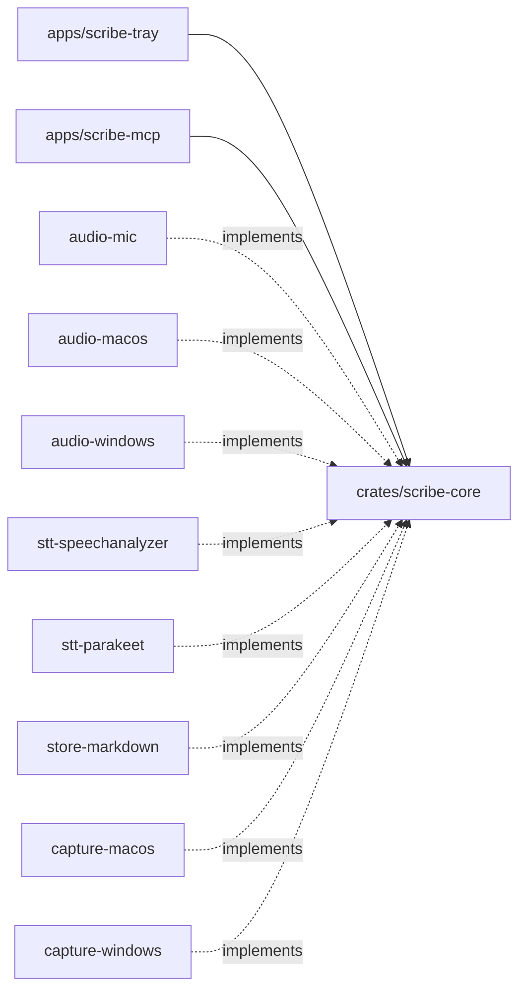

# Scribe — Architecture

Project-wide architectural reference. Seeded from [spec 001 §7](specs/001-scribe-tray-transcriber.md#7-architecture). This file is authoritative for every later spec and plan.

## 1. Style and rationale

**Style:** Hexagonal (ports and adapters).

Scribe is the same product on macOS and Windows, but almost every edge differs by OS: audio capture, the speech engine, permissions and file locations. Hexagonal keeps the recording domain independent of those edges: sessions, segments, the two-lane Me/Them model, echo filtering and the status lifecycle. Each OS plugs adapters into three ports. One core is driven by two primary adapters: the tray app, which writes sessions, and `scribe-mcp`, which reads them.

## 2. Tech stack

| Layer | Choice | Rationale |
|---|---|---|
| App shell | Tauri 2 (tray, popover webview, notifications) | One codebase for macOS and Windows with native access from Rust; proven by Anarlog and Meetily |
| Core | Rust workspace | Real-time audio, OS APIs, ONNX inference; shared by both binaries |
| UI | React + TypeScript (Vite) in the webview | Small surface; matches the org's TS/React standards |
| Mic capture | `cpal` | Cross-platform input |
| System audio | macOS Core Audio process tap (`cidre`); Windows WASAPI loopback (`wasapi`) | Audio-only permission on macOS; no permission needed on Windows |
| STT | macOS Apple SpeechAnalyzer (Swift bridge, English); Windows Parakeet (`parakeet-rs` / ONNX Runtime, auto language) | Best on-device engine per OS, behind one port |
| Storage | One Markdown file per session in `<transcripts folder>/YYYY-MM/` (default `Documents/Scribe`; configurable, stored in the app's `settings.json`) | Human-readable; no schema or migrations |
| MCP | `rmcp` stdio server, separate `scribe-mcp` binary | Official Rust SDK; read-only; local, so no auth |
| CI | GitHub Actions, macOS + Windows runners, mutation testing | Org test-integrity standards |

## 3. Dependency rules

- `apps/*` → `scribe-core` (+ adapters, wired at the composition root only).
- Secondary adapters (`audio-*`, `stt-*`, `store-markdown`) → `scribe-core` ports.
- `scribe-core` → nothing OS-, engine- or Tauri-specific.
- `scribe-mcp` → `scribe-core` (library) + `store-markdown` only.

## 4. Module map

| Module | Responsibility |
|---|---|
| `apps/scribe-tray` | Tray, menu, popover, privacy window; per-OS adapter wiring |
| `apps/scribe-mcp` | `list_transcripts`, `get_transcript`, `search_transcripts`, `get_screenshot`, `get_transcripts_folder` over stdio |
| `crates/scribe-core` | `recording` (Recorder, Session, Segment, EchoFilter, LiveSessionSlot), `capture` (Frame, ScreenshotName, ScreenshotTaker) and `library` (list/get/search); ports `AudioSource`, `Transcriber`, `TranscriptStore`, `ScreenCapturer`, `ScreenshotStore` |
| `crates/audio-mic` | Mic `AudioSource` |
| `crates/audio-macos` | System-output `AudioSource` via process tap, excluding Scribe |
| `crates/audio-windows` | System-output `AudioSource` via WASAPI loopback |
| `crates/stt-speechanalyzer` | `Transcriber` via SpeechAnalyzer |
| `crates/stt-parakeet` | `Transcriber` via Parakeet + model download and verification |
| `crates/capture-macos` | `ScreenCapturer` via ScreenCaptureKit (`cidre`) |
| `crates/capture-windows` | `ScreenCapturer` via `xcap` |
| `crates/store-markdown` | `TranscriptStore` on Markdown files; `ScreenshotStore` as PNG files in each session folder |

## 5. Cross-cutting concerns

- **Privacy:** no outbound traffic except speech-model asset fetches; audio is memory-only and never on disk.
- **Logging:** session ids and file names only; transcript text is never logged.
- **Errors:** typed `Result` errors; no `null`/sentinel returns; validate and fail fast at boundaries (MCP input, file parsing, device events).
- **Validation:** MCP messages capped at 1 MB; ids rejected if they contain path separators or `..`; search is literal, never regex.
- **File safety:** transcript folder and app data are user-only; files are append-only while recording.
- **Auth:** none; single local user, MCP over stdio.
- **Migrations:** none; the front-matter format is the contract.

## 6. Integration points

| System | Owning module | Contract | Failure mode |
|---|---|---|---|
| macOS Core Audio tap | `audio-macos` | System Audio Recording permission + `NSAudioCaptureUsageDescription` | Silent zero buffers → user notification after 5 s |
| Windows WASAPI loopback | `audio-windows` | Default render endpoint | Device change → reopen within 3 s |
| macOS ScreenCaptureKit | `capture-macos` | Screen Recording permission; completion awaited off the main thread for at most 5 s | Declined → `AccessNotGranted`; any other error or timeout → capture-failed notification |
| Windows desktop capture | `capture-windows` | `xcap` monitor at the cursor | Error → capture-failed notification |
| Apple SpeechAnalyzer | `stt-speechanalyzer` | macOS 26+, en-US asset via AssetInventory | Asset missing → Recorder `Locked` until installed |
| Parakeet model host | `stt-parakeet` | HTTPS download, pinned SHA-256 | Mismatch or network failure → retryable error; Recorder `Locked` |
| MCP clients | `scribe-mcp` | MCP stdio, three read-only tools | Bad input → tool error; malformed file → skipped |

## 7. Forbidden anti-patterns

- `#[cfg(target_os)]` inside `scribe-core`.
- Tauri types below `apps/`.
- `scribe-mcp` depending on capture or STT crates.
- Domain code touching the filesystem directly.
- Shared mutable singletons for recorder state.
- Writing audio to disk, temp files included.

## 8. How to evolve

- **New OS or engine:** add an adapter crate that implements an existing port and wire it in `apps/scribe-tray`. Never branch inside the core.
- **New MCP tool:** add it to `scribe-core::library`, then expose it in `scribe-mcp`. Tools stay read-only.
- **Switching storage (e.g. SQLite):** add a new `TranscriptStore` adapter; the front-matter contract becomes an import path.

## 9. Decision records

**ADR 1 (2026-10-17) — Hexagonal core shared by a Tauri tray app and a stdio MCP binary.** Chosen over pipe-and-filter and layered because two OSes × two engines × two entry points need swappable edges with a stable core. Accepted. Source: spec 001.

**ADR 2 (2026-10-18). CI runs most checks on Linux.** The repository is private, so GitHub counts runner minutes with multipliers of 1× for Linux, 2× for Windows, and 10× for macOS. The `portable` job runs on `ubuntu-latest` and covers formatting, the dependency guards, clippy and tests for the platform-neutral crates (`scribe-core`, `store-markdown`, `scribe-mcp`, `stt-parakeet`, `audio-resample`), and the frontend lint and tests. The `macos` job only builds and tests the Mac-specific crates, and the `windows` job only runs clippy on the Windows-specific crates. A newer push cancels the older run on the same branch, changes to only `docs/` or `*.md` files skip CI, and the mutation baseline runs weekly or on demand. As a result, a full run dropped from 10 to 30 minutes per platform to about one minute on macOS and three on Windows. The Linux job creates an XDG `user-dirs.dirs` file, because Ubuntu runners have no Documents folder and `dirs::document_dir()` would otherwise return nothing. Rejected: running the whole workspace on macOS and Windows, which spent about 30 minutes of 10× minutes per push. Accepted.

**ADR 3 (2026-10-18). CI pins Rust 1.93.1.** CI uses `dtolnay/rust-toolchain@1.93.1`, which matches the local toolchain, while the workspace `rust-version` stays at 1.88. An unpinned `stable` pulled Rust 1.99, whose clippy added the `unnecessary_sort_by` lint and failed CI on code that passed locally. The pin is raised deliberately, together with the local toolchain. Accepted.

**ADR 4 (2026-10-18). Releases are built locally.** `scripts/release.sh` runs on a developer's Mac. It builds the macOS `.dmg`, cross-compiles the Windows NSIS installer with `cargo-xwin` (which needs `llvm`, `lld`, and `nsis` from Homebrew), tags `v<version>`, and uploads both files to a draft GitHub Release that a person reviews and publishes. The version comes from `apps/scribe-tray/src-tauri/tauri.conf.json`. This uses no CI minutes, and the Windows build takes about two minutes after the first run. Cross-compiling is experimental in Tauri, so `.github/workflows/release.yml` stays as a manual, Windows-only fallback that builds on GitHub for an existing tag. `tauri.ci.conf.json` removes the bash sidecar step from Tauri's build hook in both paths, because the scripts stage the sidecar themselves and `bash` on a Windows runner can resolve to WSL. Rejected: building releases in CI on every tag, which needed about 30 minutes of runner time per release. Accepted.

**ADR 5 (2026-10-18). macOS builds are ad-hoc signed with the audio-input entitlement.** `bundle.macOS.signingIdentity` is `-`, so Tauri ad-hoc signs the app as `com.incubyte.scribe`. Ad-hoc signing turns on the hardened runtime, which silently blocks microphone capture unless the app holds the `com.apple.security.device.audio-input` entitlement, so `src-tauri/Entitlements.plist` grants it. Windows builds are unsigned. Users therefore confirm the first launch through Privacy & Security on macOS and SmartScreen on Windows. Real signing needs an Apple Developer ID and a Windows code-signing certificate, which are then added as secrets or local signing settings without changing the pipeline. Accepted; superseded for macOS by ADR 8.

**ADR 6 (2026-10-18). The Windows installer installs the Visual C++ runtime.** ONNX Runtime's prebuilt library links against `MSVCP140.dll`, which not every Windows PC has. The installer bundles Microsoft's `vc_redist.x64.exe`, and an NSIS post-install hook (`src-tauri/windows/hooks.nsh`) runs it silently when the registry shows the runtime is missing, then deletes it. `scripts/fetch-vc-redist.sh` downloads the redistributable at build time, so the 25 MB file is never committed. It is referenced only from `tauri.windows.conf.json`, so macOS builds are unaffected. Rejected: listing the runtime as a manual prerequisite, which would leave some users with an app that does not start. Accepted, pending a first install on real Windows hardware.

**ADR 7 (2026-10-18). Work lands directly on `main`.** Scribe has a single developer, so changes are committed and pushed to `main` without pull requests, using Conventional Commits. As a consequence, the pull-request mutation job only runs if a pull request is opened, and the scheduled baseline keeps the mutation score visible. Accepted.

**ADR 8 (2026-10-22). macOS releases are signed with a Developer ID and notarized.** `scripts/release.sh` sets `APPLE_SIGNING_IDENTITY` to `Developer ID Application: Sapankumar Parikh H (V92DDD85J3)`, so Tauri signs the app, the `scribe-mcp` sidecar and the `.dmg` with the hardened runtime and a secure timestamp. The script then submits the `.dmg` with `xcrun notarytool` using the `scribe-notary` keychain profile, staples the ticket, and checks it with `spctl`. Credentials stay in the release Mac's keychain, never in the repository or the environment. `tauri.conf.json` keeps `signingIdentity: "-"`, so local and CI builds work without the certificate. A Developer ID gives the app a designated requirement tied to the team ID instead of one build's hash, so macOS keeps the Microphone, System Audio Recording and Screen Recording grants across updates and certificate renewals, which auto-update depends on. Moving from ad-hoc signing resets those grants once for existing users. The identity is a personal Apple Developer account; moving to an Incubyte organization account later resets the grants once more. Windows builds stay unsigned (ADR 5). Accepted.

**ADR 9 (2026-10-24). Scribe updates itself with the Tauri updater, using signed, version-bound updates from the latest GitHub release.** `tauri.conf.json` embeds the update public key, points `plugins.updater.endpoints` at `releases/latest/download/latest.json`, sets `requireSignedVersion` so an archive's signature is bound to its version, and installs quietly on Windows. `scripts/release.sh` builds the macOS archive and the Windows installer with `tauri.release.conf.json`, the only place `createUpdaterArtifacts` is switched on, so local and CI builds need no key. The script signs with the private key at `~/.tauri/scribe-update.key`, whose password sits in the Keychain service `scribe-update-key`; both are also backed up in the releaser's password manager. Before tagging, it verifies each archive's signature and version with `minisign`, requires the extracted macOS app to pass Gatekeeper as `Notarized Developer ID`, then uploads a versioned macOS archive and `latest.json`. Losing the private key or its password ends updates for every existing install, because installed copies only accept updates signed by the embedded public key; those users would have to reinstall by hand. Accepted.

## 10. References

- [Spec 001 — Scribe tray transcriber](specs/001-scribe-tray-transcriber.md)
- Fabric org memory: `[ARCHITECTURE incubyte-scribe …]`; prior art your-steno-desktop (Tauri)
- github.com/fastrepl/anarlog, github.com/Zackriya-Solutions/meetily
