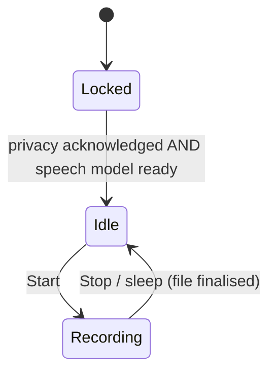
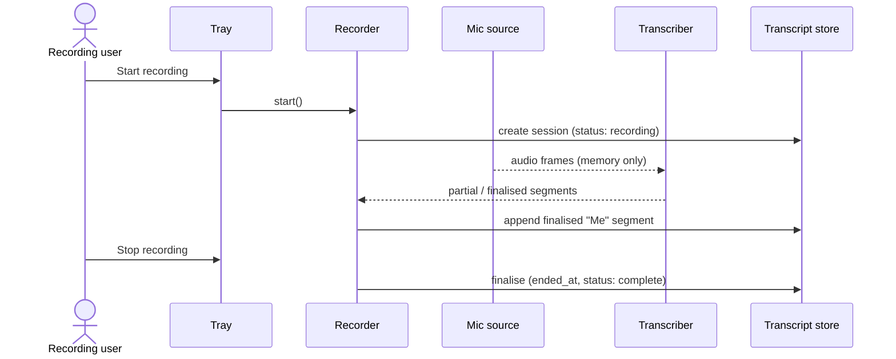
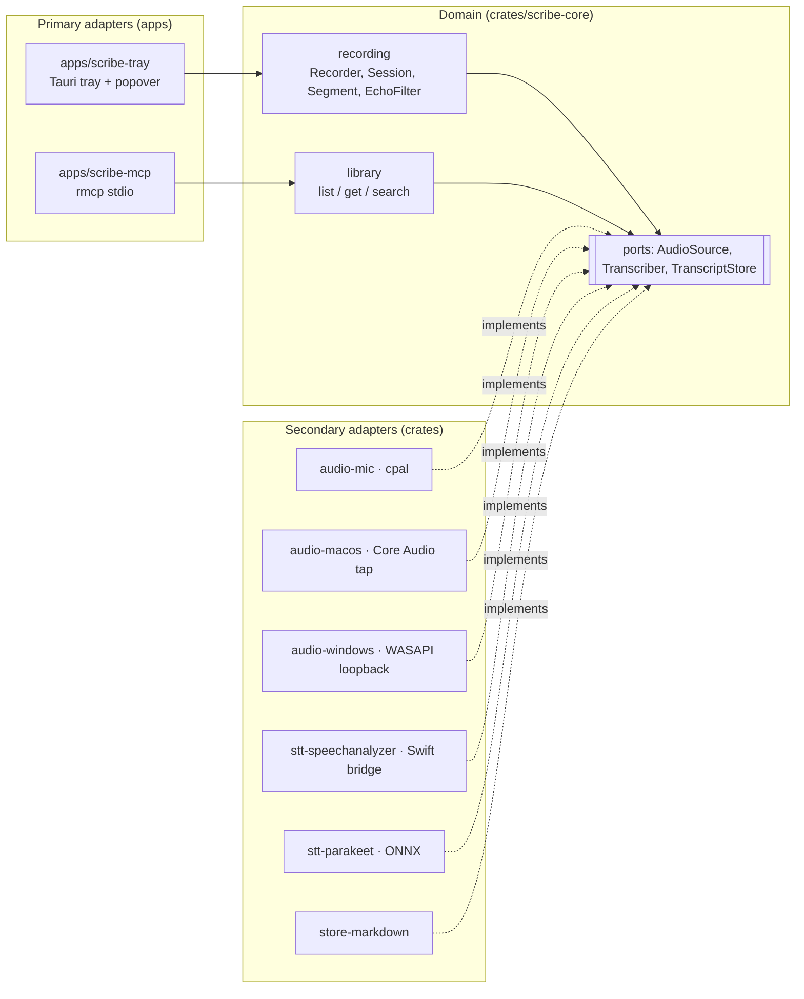
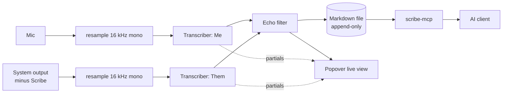

# Spec: Transcribe calls on-device from the system tray, without joining them, and serve saved transcripts to any AI app over MCP

> Owned by: Sapan Parikh  ·  Started: 2026-10-17  ·  Last revised: 2026-10-17  ·  Spec UUID: c154d03d-7c8a-4c10-8baa-c0d1cc880d19
> Anthara spec — slice-decomposed, categorically-framed. Feeds /anthara:create-ticket and /anthara:plan-implementer.

---

## 1. Overview & business context

Scribe is a small macOS and Windows system-tray app. One click starts transcribing whatever call is happening on the machine — Zoom, Teams, Meet in a browser, anything — without a bot joining the call. It captures the user's microphone ("Me") and the machine's audio output ("Them") as two separate channels and transcribes both live, entirely on-device: Apple SpeechAnalyzer on macOS (English), Parakeet on Windows (language auto-detected) [2, 3, 7, 13]. Only the transcript is kept — one Markdown file per call — and no audio is ever stored or sent anywhere [13]. Saved transcripts are exposed through a local stdio MCP server, so any MCP-capable AI app (Claude Desktop, Cursor, …) can list, read, and search them and do its own summarising [8, 13].

Positioning: bot-free capture is now table stakes (Granola, Otter, Fireflies, Fathom), but every well-funded player transcribes in the cloud; a polished, fully local, cross-platform recorder whose output plugs into any AI app via MCP is an open gap [1].

Design direction (from triage probe [13]): balanced density, utilitarian tone, follows system light/dark, subtle motion (pulsing record dot, smooth text append), references Raycast (fast, crisp, keyboard-first) and native menu-bar apps (plain system look). First-use feeling: *effortless and invisible*. Accessibility floor: WCAG 2.2 AA.

## 2. Sources

| ID | Type | Contributor | Date | Description |
|---|---|---|---|---|
| 1 | Competitive research (in-session) | Claude research agent | 2026-10-17 | Bot-free notetaker landscape: Granola, Krisp, Jamie, Bluedot, tl;dv, Otter, Fireflies, Read.ai, Fathom, MacWhisper, Superwhisper, Notion, Wispr, Anarlog, Meetily, platform-native threats |
| 2 | Implementation research (in-session) | Claude research agent | 2026-10-17 | Per-OS system-audio capture, Me/Them channel split, echo, clock drift, on-device STT options, Tauri/Rust references, consent law |
| 3 | Public docs (developer.apple.com/documentation/speech/speechanalyzer) | Web | 2026-10-17 | SpeechAnalyzer / SpeechTranscriber streaming API, locale assets via AssetInventory, macOS 26+ |
| 4 | Public forum (developer.apple.com/forums/thread/818005) | Web | 2026-10-17 | Reported `start(inputSequence:)` nilError on macOS 26.3 |
| 5 | Public repo (github.com/insidegui/AudioCap) | Web | 2026-10-17 | Core Audio process-tap reference; `NSAudioCaptureUsageDescription`; silent zero-buffer failure when key missing |
| 6 | Public docs (learn.microsoft.com — WASAPI loopback / ApplicationLoopback sample) | Web | 2026-10-17 | Windows endpoint and process loopback capture |
| 7 | Public docs (docs.rs/parakeet-rs, v0.4.1) | Web | 2026-10-17 | Rust Parakeet bindings: TDT v3, streaming EOU / Nemotron models, ONNX Runtime or burn backend, MIT/Apache-2.0 |
| 8 | Public docs (docs.rs/crate/rmcp, 3.x) | Web | 2026-10-17 | Official Rust MCP SDK; stdio server transport via `transport-io` feature; `#[tool]` macros |
| 9 | Public repo (github.com/fastrepl/anarlog, ex-Hyprnote, MIT) | Web | 2026-10-17 | Tauri 2 + Rust local notetaker; per-OS audio crates; ships a local CLI + MCP server |
| 10 | Public repo (github.com/Zackriya-Solutions/meetily, MIT) | Web | 2026-10-17 | Tauri + Rust local notetaker; whisper.cpp / Parakeet ONNX |
| 11 | Org Memory (search_memories: "desktop transcription app …") | Fabric | 2026-10-17 | Prior org work: your-steno-desktop (Tauri companion for orara/your-steno); local-first Chrome extension using on-device Web Speech API |
| 12 | Org standards (get_standards: incubyte/scribe) | Fabric | 2026-10-17 | 213 org-wide rules: clean code, secure coding (OWASP-derived), accessibility, test integrity, git/process |
| 13 | Live spec-writing session with Sapan Parikh | Sapan Parikh | 2026-10-17 | All product and architecture decisions in this spec |
| 14 | Legal commentary (uctoday.com Otter.ai litigation; Bloomberg Law AI-notetaking pitfalls) | Web | 2026-10-17 | All-party-consent states; *In re Otter.AI Privacy Litigation* claims |
| 15 | Codebase (this repo) | n/a | 2026-10-17 | Greenfield — only `.anthara/` and `.claude/` config |
| 16 | Architecture reference (docs/ARCHITECTURE.md) | Sapan Parikh | 2026-10-17 | Project-wide architecture extracted from §7 of this spec |

## 3. Type ontology

### 3.1 Kinds of users

- **Recording user** — the person running Scribe on their own machine; the only human who interacts with Scribe's UI [13].
- **Remote participant** — anyone heard through the machine's audio output during a call; never interacts with Scribe and is unaware of it unless told [2, 14].
- **AI client** — an MCP-capable application (Claude Desktop, Cursor, …) that launches `scribe-mcp` and reads saved transcripts [13].

### 3.2 Kinds of data

- **Session** — one recording from Start to Stop. Identified by its file-name stem (`2026-10-17-143005`). Carries title, `started_at`, `ended_at`, status, engine, language. Not regulated, but **confidential**: it contains third parties' speech [13, 14].
- **Segment** — one finalised utterance: offset from session start, speaker (`Me` | `Them`), text. Only finalised segments are persisted [13].
- **Partial segment** — in-flight, still-changing text from the engine. Shown live, never persisted [13].
- **Transcript file** — the on-disk Markdown representation of a Session plus its Segments, in `Documents/Scribe/` [13].
- **Audio frame** — PCM samples from one channel. Exists only in memory, transiently [13].
- **Privacy acknowledgement** — local flag recording that the Recording user has read the local-only statement [13].
- **Speech model** — engine asset: Apple's on-device English asset (macOS, via AssetInventory) or the Parakeet model files (Windows, downloaded on first run) [3, 7, 13].

Transcript file shape (contract, not implementation):

```markdown
---
id: 2026-10-17-143005
title: Call 2026-10-17 14:30
started_at: 2026-10-17T14:30:05+05:30
ended_at: 2026-10-17T15:02:41+05:30
status: complete
engine: speechanalyzer
language: en-US
---
[00:00:04] **Me:** Hi everyone, thanks for joining.
[00:00:09] **Them:** Thanks, can you hear me okay?
```

### 3.3 Kinds of events

- **RecordingStarted** — Recording user clicks Start.
- **PartialSegmentUpdated** — engine revises in-flight text for a channel (UI only).
- **SegmentFinalised** — engine commits an utterance for a channel.
- **RecordingStopped** — user clicks Stop, or the machine goes to sleep.
- **CaptureSilenced** — a channel delivers only exact-zero buffers (permission missing).
- **OutputDeviceChanged** — the system default output device changes mid-recording.
- **ModelDownloadProgressed / ModelDownloadCompleted / ModelDownloadFailed** — Windows Parakeet model fetch.

### 3.4 Kinds of states

Recorder state:



Session status (front-matter `status`):

- **recording** — currently being written by a live Recorder.
- **complete** — finalised by Stop or sleep.
- **incomplete** — found in `recording` state on app launch (the previous run crashed or was killed); never written to again.

## 4. Invariants

**4.1 Nothing leaves the device** — Scribe makes no outbound network request carrying audio or transcript content. The only network traffic is fetching speech-model assets (Apple asset install on macOS, Parakeet download on Windows). Sources: [13].

**4.2 No audio at rest** — audio frames are never written to disk, temp files included. Sources: [13].

**4.3 Every segment has exactly one speaker** — `Me` iff it came from the microphone channel, `Them` iff from the system-output channel. Sources: [2, 13].

**4.4 At most one Recording at a time.** Sources: [13].

**4.5 Transcript files are append-only while recording** — segments are appended in start-time order; earlier lines are never rewritten. Only the front matter changes, and only on finalise or on incomplete-marking. Sources: [13].

**4.6 MCP is read-only** — `scribe-mcp` never creates, modifies, or deletes files, and never serves a session whose status is `recording`. Sources: [13].

**4.7 Recording requires consent context** — the Recorder cannot leave `Locked` until the privacy acknowledgement exists and the speech model is ready. Sources: [13].

**4.8 Scribe never transcribes itself** — Scribe's own audio output is excluded from the `Them` channel. Sources: [2, 13].

## 5. Slices

### 5.1 Show Scribe in the system tray

The user launches Scribe and it appears only as an icon in the macOS menu bar or the Windows notification area. There is no Dock or taskbar window. Its menu offers "Open transcripts folder" and "Quit Scribe". This slice also stands up the repository: Rust workspace, Tauri app shell, and CI on both operating systems.

- **Touches types:** Recording user, Transcript file (folder only).
- **Preserves invariants:** none yet.
- **Affected modules:** `apps/scribe-tray`, workspace root, CI.
- **Active packs:** Clean Code, Secure Coding, Accessibility, Test Integrity.
- **Reachability:** `root` → Scribe tray icon and menu.

**Acceptance criteria**

- [ ] **5.1.1** Launching Scribe on macOS 26+ and on Windows 10 (2004)+/11 shows a Scribe icon in the menu bar or notification area, with no Dock or taskbar window.
- [x] **5.1.2** The tray menu shows "Open transcripts folder" and "Quit Scribe". "Open transcripts folder" creates `Documents/Scribe` if it is missing and opens it in Finder or Explorer. "Quit Scribe" exits the process.
- [x] **5.1.3** `Documents/Scribe` is created with user-only permissions and is never world-writable.
- [ ] **5.1.4** VoiceOver and Narrator announce the tray icon and every menu item by name.
- [ ] **5.1.5** For every PR, CI builds and tests on both macOS and Windows, runs mutation testing that comments on the PR, and blocks merge when tests fail.

**Verification (slice complete when these pass):**

1. **Tests.** Run the full test suite — all tests green. Tests broken by this slice's changes get fixed inside this slice, not deferred. Keeping the test runner in watch mode during slice work surfaces drift early.
2. **User-facing flow.** Launch the built app on macOS and on Windows and confirm what the description and ACs promise. Tray surfaces are native, so this is checked by hand, not through the browser session.
3. **Accessibility.** With VoiceOver (macOS) and Narrator (Windows), check that the tray icon and every menu item are announced by name and can be reached by keyboard.

### 5.2 Acknowledge the local-only privacy statement

On first launch a small window explains in plain words that Scribe transcribes on this device only. Audio is never saved, and nothing (audio or transcript) is sent to any server. The user clicks "I understand" once. The statement can be reopened later from the tray menu.

- **Touches types:** Recording user, Privacy acknowledgement.
- **Preserves invariants:** 4.7.
- **Affected modules:** `apps/scribe-tray` (window + settings persistence).
- **Active packs:** Accessibility, Clean Code.
- **Reachability:** `root` → first-run privacy statement window; `Scribe tray icon and menu` → "Privacy" menu item.

```
┌──────────────────────────────────────────────┐
│  Scribe runs entirely on this computer       │
│                                              │
│  • Speech is transcribed on-device.          │
│  • Audio is never saved.                     │
│  • Nothing — audio or text — is sent to any  │
│    server.                                   │
│  • Transcripts are saved as text files in    │
│    Documents/Scribe.                         │
│                                              │
│                          [ I understand ]    │
└──────────────────────────────────────────────┘
```

**Acceptance criteria**

- [x] **5.2.1** On first launch the statement window opens with the four facts above and a single "I understand" button. Final wording is subject to [§9.1](#9-open-questions).
- [ ] **5.2.2** Clicking "I understand" saves the acknowledgement locally, and the window does not appear on later launches.
- [ ] **5.2.3** Closing the window without acknowledging leaves the acknowledgement missing, and the window opens again on the next launch.
- [ ] **5.2.4** "Privacy" in the tray menu reopens the statement at any time.
- [ ] **5.2.5** Keyboard focus lands on "I understand" when the window opens, Enter activates it, the focus ring is visible, and text contrast is at least 4.5:1 in both light and dark mode.

**Verification (slice complete when these pass):**

1. **Tests.** Run the full test suite — all tests green. Tests broken by this slice's changes get fixed inside this slice, not deferred. Keeping the test runner in watch mode during slice work surfaces drift early.
2. **User-facing flow.** Drive the statement window's web UI end-to-end through the `chrome-devtools-mcp` browser session against the dev frontend, then confirm the first-run and re-open behaviour in the built app on both OSes.
3. **Accessibility.** In the same `chrome-devtools-mcp` session: tab-order traversal, focus-visibility on every interactive control, aria-labels present.

### 5.3 Record my side of a call

The user picks "Start recording" from the tray menu. Scribe transcribes their microphone live on-device and appends each finished utterance to a new Markdown file as a **Me** line. The tray icon shows that a recording is in progress. "Stop recording" finalises the file. If Scribe crashes or the Mac sleeps, everything said up to that moment is already on disk. Mic capture is cross-platform. Transcription in this slice is SpeechAnalyzer (macOS, English); Windows transcription is added later and reuses everything built here.

- **Touches types:** Session, Segment, Partial segment, Transcript file, Audio frame, Speech model; RecordingStarted, SegmentFinalised, RecordingStopped.
- **Preserves invariants:** 4.1, 4.2, 4.3, 4.4, 4.5, 4.7.
- **Affected modules:** `crates/scribe-core` (recording domain + ports), `crates/audio-mic`, `crates/stt-speechanalyzer`, `crates/store-markdown`, `apps/scribe-tray`.
- **Active packs:** Clean Code, Secure Coding, Accessibility, Test Integrity.
- **Reachability:** `Scribe tray icon and menu` → "Start recording" / "Stop recording" menu item.



**Acceptance criteria**

- [x] **5.3.1** "Start recording" is disabled while the Recorder is `Locked`, that is, until the privacy statement from [slice 5.2](#52-acknowledge-the-local-only-privacy-statement) has been acknowledged and the English speech asset is installed. If the asset is missing, Scribe requests Apple's on-device asset install and shows progress in the tray tooltip.
- [ ] **5.3.2** The first Start triggers the OS microphone permission prompt. If permission is denied, a notification explains how to enable it in System Settings, and the Recorder stays `Idle` without creating a file.
- [x] **5.3.3** Start creates `Documents/Scribe/<YYYY-MM-DD-HHmmss>.md` with the front matter from [§3.2](#32-kinds-of-data), `status: recording`, and a default title of `Call <date> <time>`.
- [ ] **5.3.4** Each finalised mic utterance is appended as `[hh:mm:ss] **Me:** <text>` within 2 s of the speaker finishing it, on reference hardware (Apple M1, 8 GB).
- [ ] **5.3.5** While recording, the tray icon changes shape (not only colour), and the menu shows "Stop recording" with the elapsed time.
- [x] **5.3.6** "Stop recording" writes `ended_at`, sets `status: complete`, and returns the Recorder to `Idle`.
- [ ] **5.3.7** If the machine sleeps during a recording, the session is finalised exactly as if the user had pressed Stop.
- [x] **5.3.8** If Scribe is force-quit during a recording, every segment finalised before the kill is still in the file. On the next launch, any file left at `status: recording` is set to `status: incomplete`.
- [x] **5.3.9** "Start recording" is not available while a recording is in progress, so a second concurrent session cannot be started.
- [x] **5.3.10** No audio file is created anywhere on disk (temp directories included), and no outbound network request is made while recording. Both are checked by an automated test.
- [x] **5.3.11** App logs never contain transcript text. Logs reference sessions by id only.

**Verification (slice complete when these pass):**

1. **Tests.** Run the full test suite — all tests green. Tests broken by this slice's changes get fixed inside this slice, not deferred. Keeping the test runner in watch mode during slice work surfaces drift early.
2. **User-facing flow.** In the built app on macOS: start, speak, stop, and confirm the Markdown file. Force-quit during a recording and relaunch to confirm the file is marked `incomplete`.
3. **Accessibility.** With VoiceOver, check that the Start/Stop item, the elapsed time and the recording state are all announced.

### 5.4 Capture the other side of a call on macOS

While recording on macOS, Scribe also captures everything the Mac plays, except Scribe's own sound, and transcribes it into **Them** lines that interleave with **Me** lines in time order. If the system-audio permission is missing, Scribe says so within seconds instead of silently producing an empty "Them" lane. It keeps working when the user switches output device mid-call.

- **Touches types:** Segment, Audio frame; CaptureSilenced, OutputDeviceChanged.
- **Preserves invariants:** 4.2, 4.3, 4.5, 4.8.
- **Affected modules:** `crates/audio-macos` (Core Audio process tap), `crates/scribe-core`.
- **Active packs:** Clean Code, Secure Coding, Test Integrity.
- **Reachability:** `"Start recording" / "Stop recording" menu item` → "Them" lane in the session transcript.

**Acceptance criteria**

- [ ] **5.4.1** During a recording, all system audio output except Scribe's own process is transcribed and appended as `[hh:mm:ss] **Them:** <text>`.
- [x] **5.4.2** Me and Them segments appear in the file in start-time order, measured against a single session clock. Over a 60-minute recording, drift between the two lanes is 1 s or less.
- [ ] **5.4.3** The app bundle declares the system-audio usage description, and the first recording triggers the macOS "System Audio Recording" permission prompt.
- [ ] **5.4.4** If the system channel delivers only exact-zero buffers for 5 s after Start, a notification "Scribe can't hear the other side of the call" appears with an "Open System Settings" action, and the Me lane keeps recording.
- [ ] **5.4.5** When the default output device changes during a recording (for example, AirPods connect), the Them lane resumes within 3 s with no user action.
- [ ] **5.4.6** Them lines are produced for a Zoom desktop call, a Teams desktop call, and a Google Meet call in Chrome. This is checked by hand.

**Verification (slice complete when these pass):**

1. **Tests.** Run the full test suite — all tests green. Tests broken by this slice's changes get fixed inside this slice, not deferred. Keeping the test runner in watch mode during slice work surfaces drift early.
2. **User-facing flow.** On a signed build: run a real call, revoke the permission and confirm the warning appears, then switch output device mid-call and confirm the Them lane resumes.

### 5.5 Watch the transcript live in the popover

Clicking the tray icon opens a compact popover; right-clicking still opens the menu. When idle, the popover shows a Start button and the five most recent sessions. While recording, it shows a status bar with a pulsing dot, an elapsed timer and a Stop button, and the live two-lane transcript underneath. Partial text is shown in a lighter style and is replaced by the final wording as each utterance completes.

- **Touches types:** Session, Segment, Partial segment; PartialSegmentUpdated, SegmentFinalised.
- **Preserves invariants:** 4.4, 4.7.
- **Affected modules:** `apps/scribe-tray` (popover webview UI + event bridge).
- **Active packs:** Accessibility, Clean Code, Test Integrity.
- **Reachability:** `Scribe tray icon and menu` → live popover.

```
┌───────────────────────────────────────────┐
│ ● 00:12:41   Recording         [ Stop ]   │
├───────────────────────────────────────────┤
│ 00:12:30  Them  Sounds good, let's ship   │
│                 it Friday.                │
│ 00:12:36  Me    Agreed, I'll update the   │
│                 ticket.                   │
│ 00:12:40  Them  And the release notes…    │  ← partial (lighter)
├───────────────────────────────────────────┤
│ Recent                                    │
│  Call 2026-10-17 11:00         32 min     │
│  Call 2026-10-16 16:30         48 min     │
└───────────────────────────────────────────┘
```

**Acceptance criteria**

- [ ] **5.5.1** Left-clicking the tray icon opens the popover anchored to it. Esc or clicking outside closes it. Opening or closing the popover never affects a recording.
- [x] **5.5.2** When idle, the popover shows a Start button (enabled under the same rules as AC 5.3.1) and the five most recent sessions with title, date and duration. Clicking a session opens its file in the system's default app for `.md`.
- [x] **5.5.3** While recording, the popover shows the pulsing dot, elapsed timer, Stop button and live Me/Them lines. Partial text is visually distinct and is replaced in place by the final text. The list auto-scrolls unless the user has scrolled up.
- [x] **5.5.4** The popover follows the system light/dark setting, and the pulsing animation is disabled when the OS "Reduce motion" setting is on.
- [x] **5.5.5** Tab order is status bar → Stop → transcript → recent sessions. Focus is visible on every control, contrast is at least 4.5:1, Me and Them are told apart by label (not colour alone), and only finalised segments are announced to screen readers, through a polite live region.

**Verification (slice complete when these pass):**

1. **Tests.** Run the full test suite — all tests green. Tests broken by this slice's changes get fixed inside this slice, not deferred. Keeping the test runner in watch mode during slice work surfaces drift early.
2. **User-facing flow.** Drive the popover's primary flows end-to-end through the `chrome-devtools-mcp` browser session against the dev frontend (with simulated recorder events), then confirm in the built app during a real recording.
3. **Accessibility.** In the same `chrome-devtools-mcp` session: tab-order traversal, focus-visibility on every interactive control, aria-labels present, live-region behaviour, reduced-motion respected.

### 5.6 Drop echoed lines from my side

When the user is on speakers instead of headphones, the mic hears the remote voices, so their words would show up twice: once as Them and once as Me. Scribe drops a Me utterance when it overlaps in time with a near-identical Them utterance. The duplicate never reaches the file or the popover.

- **Touches types:** Segment.
- **Preserves invariants:** 4.3, 4.5.
- **Affected modules:** `crates/scribe-core` (echo filter in the recording pipeline).
- **Active packs:** Clean Code, Test Integrity.
- **Reachability:** `"Start recording" / "Stop recording" menu item` → echo-free "Me" lane in the session transcript.

**Acceptance criteria**

- [x] **5.6.1** A Me segment is dropped if it overlaps a Them segment within ±1 s and its normalised text is near-identical (similarity threshold set in the plan). Dropped segments never appear in the file or the popover.
- [x] **5.6.2** Me speech that overlaps Them in time but uses different words is kept.
- [x] **5.6.3** On a headphones-only recorded fixture, the filter drops no segments.
- [x] **5.6.4** A Me segment can be held back for no more than 1.5 s beyond its normal finalisation while the filter waits for a matching Them segment.

**Verification (slice complete when these pass):**

1. **Tests.** Run the full test suite — all tests green. Tests broken by this slice's changes get fixed inside this slice, not deferred. Keeping the test runner in watch mode during slice work surfaces drift early.
2. **User-facing flow.** Record a real call on laptop speakers and confirm there are no duplicated lines.

### 5.7 Read saved transcripts from any AI app over MCP

Scribe ships a small `scribe-mcp` program. An AI app launches it over stdio, and it lists and reads the saved transcripts in `Documents/Scribe`. It works whether or not the tray app is running. "Copy MCP config" in the tray menu puts a ready-to-paste config snippet on the clipboard.

- **Touches types:** AI client, Session, Transcript file.
- **Preserves invariants:** 4.1, 4.6.
- **Affected modules:** `apps/scribe-mcp`, `crates/scribe-core` (library read side), `crates/store-markdown` (reader), `apps/scribe-tray` (menu item).
- **Active packs:** Secure Coding, Clean Code, Test Integrity.
- **Reachability:** `root` → `scribe-mcp` stdio server; `Scribe tray icon and menu` → "Copy MCP config" menu item.

Tool contracts:

| Tool | Input | Output |
|---|---|---|
| `list_transcripts` | `limit?` (default 20, max 100), `since?` (ISO date) | Newest first: `id`, `title`, `started_at`, `duration_seconds`, `status` |
| `get_transcript` | `id` | The transcript file's full Markdown, front matter included |

**Acceptance criteria**

- [ ] **5.7.1** `scribe-mcp` is bundled with the app, speaks MCP over stdio, and advertises `list_transcripts` and `get_transcript` with input schemas and descriptions.
- [x] **5.7.2** `list_transcripts` returns `complete` and `incomplete` sessions, newest first, and honours `limit` and `since`. Sessions with `status: recording` are never returned.
- [x] **5.7.3** `get_transcript` returns the full file for a known id. An unknown id returns the tool error "Transcript not found: <id>". An id containing a path separator or `..` is rejected before any file access.
- [x] **5.7.4** `scribe-mcp` never creates, modifies or deletes a file. A test checks the transcripts folder is byte-identical before and after a full tool session.
- [x] **5.7.5** A malformed transcript file is skipped (logged by file name only) and never crashes the server.
- [x] **5.7.6** Incoming stdio messages larger than 1 MB are rejected.
- [ ] **5.7.7** "Copy MCP config" copies `{"mcpServers":{"scribe":{"command":"<absolute path to bundled scribe-mcp>"}}}` to the clipboard and shows a brief confirmation.

**Verification (slice complete when these pass):**

1. **Tests.** Run the full test suite — all tests green. Tests broken by this slice's changes get fixed inside this slice, not deferred. Keeping the test runner in watch mode during slice work surfaces drift early.
2. **MCP flow.** Paste the copied config into Claude Desktop (or MCP Inspector), list sessions, and fetch one, with the tray app both running and quit.

### 5.8 Search saved transcripts over MCP

AI apps can find which calls mentioned something by calling `search_transcripts`. It returns the matching lines with timestamp and speaker, so the AI app can then fetch the full transcript.

- **Touches types:** AI client, Session, Segment.
- **Preserves invariants:** 4.6.
- **Affected modules:** `apps/scribe-mcp`, `crates/scribe-core` (library read side).
- **Active packs:** Secure Coding, Clean Code, Test Integrity.
- **Reachability:** `scribe-mcp` stdio server → `search_transcripts` tool.

| Tool | Input | Output |
|---|---|---|
| `search_transcripts` | `query`, `limit?` (default 20, max 100) | Newest first: `id`, `title`, `started_at`, `matches[]` of `{ at, speaker, text }` |

**Acceptance criteria**

- [x] **5.8.1** Matching is a case-insensitive literal substring match on segment text. The query is never interpreted as a regular expression.
- [x] **5.8.2** An empty or whitespace-only query returns a tool error. Sessions with `status: recording` are excluded.
- [x] **5.8.3** Searching 500 one-hour transcripts returns in under 1 s on reference hardware.

**Verification (slice complete when these pass):**

1. **Tests.** Run the full test suite — all tests green. Tests broken by this slice's changes get fixed inside this slice, not deferred. Keeping the test runner in watch mode during slice work surfaces drift early.
2. **MCP flow.** From Claude Desktop or MCP Inspector, search for a phrase from a known call and confirm the matching lines come back.

### 5.9 Download the Windows speech model on first run

On first launch on Windows, Scribe downloads the Parakeet speech model once. Progress shows in the popover and the tray tooltip. Recording stays unavailable until the download has finished and been verified.

- **Touches types:** Speech model; ModelDownloadProgressed, ModelDownloadCompleted, ModelDownloadFailed.
- **Preserves invariants:** 4.1, 4.7.
- **Affected modules:** `crates/stt-parakeet` (model provisioning), `apps/scribe-tray`.
- **Active packs:** Secure Coding, Accessibility, Clean Code, Test Integrity.
- **Reachability:** `live popover` → speech model download progress.

**Acceptance criteria**

- [ ] **5.9.1** On first launch on Windows, Scribe downloads the pinned Parakeet model files over HTTPS with certificate verification on, into the per-user app-data folder. Progress is shown as a percentage in the popover and the tray tooltip.
- [x] **5.9.2** Each file is checked against a pinned SHA-256 hash. On a mismatch the file is deleted and a "Download failed — Retry" state is shown.
- [ ] **5.9.3** If the network fails, the download can be retried and resumes where it stopped. Start stays disabled until the model is verified.
- [x] **5.9.4** Once verified, the model is never downloaded again on later launches.
- [x] **5.9.5** Progress and failure states are announced to screen readers and work by keyboard.

**Verification (slice complete when these pass):**

1. **Tests.** Run the full test suite — all tests green. Tests broken by this slice's changes get fixed inside this slice, not deferred. Keeping the test runner in watch mode during slice work surfaces drift early.
2. **User-facing flow.** Drive the download states (progress, failure, retry, done) through the `chrome-devtools-mcp` session against the dev frontend with a simulated download, then do a real first run on a clean Windows machine.
3. **Accessibility.** In the same `chrome-devtools-mcp` session: tab-order traversal, focus-visibility on every interactive control, aria-labels present, progress announced.

### 5.10 Record a call on Windows

On Windows, Start captures the microphone (Me) and the default output device's audio (Them). Both are transcribed on-device by Parakeet, with the spoken language detected automatically. The transcript format, statuses, crash behaviour, echo filter and popover are the same as on macOS.

- **Touches types:** Session, Segment, Partial segment, Audio frame, Speech model; OutputDeviceChanged.
- **Preserves invariants:** 4.1, 4.2, 4.3, 4.4, 4.5, 4.8.
- **Affected modules:** `crates/audio-windows` (WASAPI loopback), `crates/stt-parakeet`, `apps/scribe-tray`.
- **Active packs:** Clean Code, Secure Coding, Test Integrity.
- **Reachability:** `"Start recording" / "Stop recording" menu item` → Windows two-lane recording.

**Acceptance criteria**

- [ ] **5.10.1** On Windows, every AC from slices 5.3, 5.5 and 5.6 holds, with Parakeet in place of SpeechAnalyzer. The front matter records `engine: parakeet` and `language: auto`.
- [ ] **5.10.2** The Them lane captures loopback audio from the default output device. Scribe produces no audio of its own, which satisfies invariant 4.8.
- [x] **5.10.3** Speech in any language Parakeet supports is transcribed in that language without the user choosing one.
- [ ] **5.10.4** If the default output device changes during a recording, the Them lane resumes within 3 s.
- [ ] **5.10.5** If microphone access is blocked in Windows privacy settings, a notification links to the microphone privacy page, and no file is created.
- [ ] **5.10.6** Finalised text appears within 2 s of each utterance ending on reference hardware (x64, 4 cores, 8 GB RAM, CPU-only).

**Verification (slice complete when these pass):**

1. **Tests.** Run the full test suite — all tests green. Tests broken by this slice's changes get fixed inside this slice, not deferred. Keeping the test runner in watch mode during slice work surfaces drift early.
2. **User-facing flow.** On a signed Windows build, record a real Teams or Zoom call, switch output device mid-call, then run a call in a second language.
3. **Accessibility.** With Narrator, check the Start/Stop item, the recording state and the popover.

## 6. NFRs & regulatory compliance

No regulated packs (HIPAA / PCI / SOC 2 / GDPR) are active for this repo [12]. The NFRs below come from the org-wide standards [12] and from product decisions made in session [13].

### 6.1 Clean Code (org standards)

**6.1.1 Small, single-purpose units** — functions under 20 lines, cyclomatic complexity ≤ 5, nesting ≤ 3, at most 3 arguments. Derived from rules: *Small functions*, *Enforce max cyclomatic complexity of 5*, *Enforce max nesting depth of 3*, *Minimal arguments*, *Single Responsibility Principle*.

**6.1.2 Dependencies point inward** — the domain depends only on its ports, and OS and engine adapters implement those ports. Derived from rules: *Dependency Inversion Principle*, *Dependency direction*, *Separation of concerns*.

**6.1.3 No null, explicit errors** — absence is expressed with `Option` and failures with typed `Result` errors, and every boundary validates its input and fails fast. Derived from rules: *Do not return or pass null*, *Exceptions over return codes* (Rust idiom: typed errors), *Fail fast at boundaries*.

**6.1.4 Naming and code hygiene** — intent-revealing names, no explanatory comments, no dead or commented-out code, YAGNI. Derived from rules: *Intent-revealing names*, *Comment convention*, *Never push dead code*, *YAGNI*.

### 6.2 Secure coding (org standards, OWASP-derived)

**6.2.1 Local files are private** — the transcripts folder and app data are user-only, never world-writable. Derived from rule: *file-permissions*.

**6.2.2 Transcript text never in logs** — logs carry session ids and file names only. Derived from rule: *confidential-information-logging*.

**6.2.3 Untrusted input is bounded and literal** — MCP stdio messages are capped at 1 MB, ids are rejected if they could escape the folder, and search queries are never compiled as regex. Derived from rules: *standard-input*, *regular-expr*, *slow-regex*.

**6.2.4 Model download integrity** — HTTPS only, certificate verification never disabled, and a pinned SHA-256 per file. Derived from rules: *unverified-certificate*, *no-clear-text-protocols*, *hashing*.

**6.2.5 Locked-down webview** — the Tauri webview loads only bundled assets under a restrictive Content-Security-Policy and has no remote content. Derived from rules: *content-security-policy*, *disabled-resource-integrity*.

### 6.3 Accessibility (WCAG 2.2 AA)

**6.3.1** Text contrast ≥ 4.5:1 in light and dark modes — SC 1.4.3.
**6.3.2** Recording state and speaker are never conveyed by colour alone — SC 1.4.1.
**6.3.3** Every control is operable by keyboard, with visible focus — SC 2.1.1, 2.4.7.
**6.3.4** Every tray item, button and status has an accessible name — SC 4.1.2.
**6.3.5** Live transcript and download progress are announced through polite status messages — SC 4.1.3.
**6.3.6** The pulsing dot respects the OS reduce-motion setting (product decision [13]; goes beyond AA).

### 6.4 Test integrity & delivery (org standards)

**6.4.1** Every test asserts something, and test names describe behaviour in business language. Test cases are derived with ZOMBIES. Rules: *assertions-in-tests*, *Write test names in business language*, *Use ZOMBIES*.
**6.4.2** Domain logic is tested with fake adapters. OS capture and engine adapters get thin integration tests behind a platform gate. Frontend tests use `*.spec.ts`. Rule: *Test files must end with .spec.ts*.
**6.4.3** CI runs on macOS and Windows, includes mutation testing that comments on PRs, and blocks merge on failing tests. Rules: *Mutation testing must be configured in CI*, *Cannot merge a PR if unit or integration tests are failing*.
**6.4.4** Conventional Commits, `<type>/<kebab-case>` branches, merge (not rebase). Rules: *Use Conventional Commits*, *Follow the branch naming policy*, *Use merge, not rebase*.

### 6.5 Privacy & performance (product, [13])

**6.5.1** There is no outbound network traffic except speech-model asset fetches (invariant 4.1), checked by test.
**6.5.2** Audio exists only in memory (invariant 4.2), checked by test.
**6.5.3** Live finalised-text latency is ≤ 2 s on reference hardware (AC 5.3.4, 5.10.6).
**6.5.4** Release builds are code-signed: Developer ID and notarisation on macOS, Authenticode on Windows. macOS ties the audio permissions to the signature.

### 6.6 Control coverage matrix

| Control | Pack | Slices | Evidence committed |
|---|---|---|---|
| file-permissions | Secure coding | 5.1 | AC 5.1.3 test on folder mode |
| confidential-information-logging | Secure coding | 5.3, 5.7 | AC 5.3.11, 5.7.5 |
| standard-input / regular-expr | Secure coding | 5.7, 5.8 | AC 5.7.6, 5.8.1 |
| path traversal on ids | Secure coding | 5.7 | AC 5.7.3 |
| unverified-certificate / hashing | Secure coding | 5.9 | AC 5.9.1, 5.9.2 |
| content-security-policy | Secure coding | 5.2, 5.5 | Tauri CSP config reviewed in 5.2 |
| WCAG 1.4.1 / 1.4.3 / 2.1.1 / 2.4.7 / 4.1.2 / 4.1.3 | Accessibility | 5.1, 5.2, 5.5, 5.9, 5.10 | AC 5.1.4, 5.2.5, 5.5.4, 5.5.5, 5.9.5 |
| Mutation testing in CI | Test integrity | 5.1 | AC 5.1.5 |
| No audio at rest / no egress | Product | 5.3, 5.10 | AC 5.3.10, 5.10.1 |

## 7. Architecture

### 7.1 Tech stack

| Layer | Choice | Rationale |
|---|---|---|
| App shell | Tauri 2 (tray icon, popover webview, notifications) | One codebase for macOS and Windows with native access from Rust. Proven for this exact product by Anarlog and Meetily [9, 10] and already used in-org by your-steno-desktop [11]. |
| Core | Rust workspace | Real-time audio, OS APIs and ONNX inference all live comfortably in Rust; shared by both binaries. |
| UI | React + TypeScript (Vite) in the webview | Small surface (privacy window, popover). Aligns with the org's TS/React test and lint standards [12]. |
| Mic capture | `cpal` | Cross-platform input capture. |
| System audio | macOS: Core Audio process tap (`cidre`); Windows: WASAPI loopback (`wasapi`) | Recommended per-OS path [2, 5, 6]. Taps need only an audio-only permission, not Screen Recording. |
| STT | macOS: Apple SpeechAnalyzer via a Swift bridge (English). Windows: Parakeet via `parakeet-rs` / ONNX Runtime (auto language) | Best native engine per OS [3, 7], behind one Transcriber port [13]. |
| Storage | Markdown file per session in `Documents/Scribe` | Human-readable, needs no schema or migrations, and MCP just reads files [13]. |
| MCP | `rmcp` stdio server as a separate `scribe-mcp` binary | Official Rust SDK [8]. Launched by the AI app; read-only; no auth needed because it is local and stdio-only [13]. |
| Hosting | None — local desktop app; GitHub Actions CI on macOS + Windows runners | No backend by design (invariant 4.1). |
| Auth | None | Single local user; MCP over stdio inherits OS user isolation. |

### 7.2 Architectural style

**Style:** *Hexagonal (ports and adapters).*

**Why this style here:** The product is the same on two operating systems, but almost every edge differs: audio capture, the speech engine, permissions and file locations. Hexagonal keeps the recording domain (sessions, segments, the two-lane Me/Them model, echo filtering, status lifecycle) independent of those edges. Each OS supplies adapters for three ports, so Windows support in 5.10 means adding adapters, not reworking the core. The same core is driven by two primary adapters: the tray app (writes sessions) and `scribe-mcp` (reads them).

**Dependency direction:** adapters → ports ← domain. `apps/*` (primary adapters) depend on `scribe-core`; `audio-*`, `stt-*` and `store-markdown` (secondary adapters) implement ports defined in `scribe-core`; `scribe-core` depends on no OS, engine or Tauri crate.

**Ports:** `AudioSource` (mic, system output), `Transcriber` (audio frames → partial/finalised segments), `TranscriptStore` (create, append, finalise, mark incomplete, list, read, search).

**Anti-patterns the style forbids:**
- No `#[cfg(target_os)]` in `scribe-core`.
- No Tauri types below `apps/`.
- `scribe-mcp` never depends on capture or STT crates.
- Domain code never touches the filesystem directly.
- No shared mutable singletons for recorder state.

### 7.3 Module decomposition



| Module | Responsibility | Depends on |
|---|---|---|
| `apps/scribe-tray` | Tray, menu, popover, privacy window; wires adapters per OS | `scribe-core`, adapters, Tauri |
| `apps/scribe-mcp` | MCP tools over stdio | `scribe-core` (library), `store-markdown` |
| `crates/scribe-core` | Recording + library domain, ports | nothing OS-specific |
| `crates/audio-mic` | Mic `AudioSource` | `scribe-core`, `cpal` |
| `crates/audio-macos` | System-output `AudioSource` (process tap) | `scribe-core`, `cidre` |
| `crates/audio-windows` | System-output `AudioSource` (loopback) | `scribe-core`, `wasapi` |
| `crates/stt-speechanalyzer` | `Transcriber` via SpeechAnalyzer | `scribe-core`, Swift bridge |
| `crates/stt-parakeet` | `Transcriber` via Parakeet + model provisioning | `scribe-core`, `parakeet-rs` |
| `crates/store-markdown` | `TranscriptStore` on Markdown files | `scribe-core` |

### 7.4 Data flow



### 7.5 Threat model seed

- **Trust boundary 1: the AI client → `scribe-mcp`.** An untrusted tool caller could attempt path traversal through `id`, ReDoS through `query`, or memory exhaustion through oversized messages (mitigated by AC 5.7.3, 5.7.6, 5.8.1). The read-only invariant 4.6 means the worst case is disclosure of transcripts, which the user deliberately grants when connecting the client.
- **Trust boundary 2: the network → model download.** A tampered model is mitigated by HTTPS plus a pinned SHA-256 (AC 5.9.1, 5.9.2).
- **Local disclosure.** Transcripts are plaintext in `Documents/Scribe`, so their protection is OS account isolation plus user-only file permissions (6.2.1). Encryption at rest is out of scope for v1 (see 9.4).
- **Legal exposure, not technical.** Remote participants are transcribed without in-app notice (see 9.1).

## 8. Codebase impact map

Greenfield — every module is new.

| Module | Slices that touch it | Likely change shape |
|---|---|---|
| workspace root, CI | 5.1 | New Cargo workspace, Tauri config, GitHub Actions (macOS + Windows, mutation testing) |
| `apps/scribe-tray` | 5.1, 5.2, 5.3, 5.5, 5.7, 5.9, 5.10 | New Tauri app + React webview |
| `crates/scribe-core` | 5.3, 5.4, 5.6, 5.7, 5.8 | New domain crate with ports |
| `crates/audio-mic` | 5.3 | New adapter |
| `crates/stt-speechanalyzer` | 5.3 | New adapter + Swift bridge |
| `crates/store-markdown` | 5.3, 5.7, 5.8 | New adapter (writer, then reader/search) |
| `crates/audio-macos` | 5.4 | New adapter |
| `apps/scribe-mcp` | 5.7, 5.8 | New binary |
| `crates/stt-parakeet` | 5.9, 5.10 | New adapter + model provisioning |
| `crates/audio-windows` | 5.10 | New adapter |

## 9. Open questions

**9.1 Privacy-statement wording vs all-party-consent law.** All-party-consent states (CA, FL, IL, MD, MA, MT, NH, PA, WA, among others) can cover live transcription itself, not only audio sent to the cloud [14]. The statement in 5.2 should describe what Scribe does ("processed and stored only on this device") and should not claim the transcript is legally the same as hand-typed notes. Awaiting: legal review of the final wording and of whether to add a "tell others you're transcribing" reminder.

**9.2 Parakeet streaming model with automatic language detection — resolved 2026-10-17.** Chosen design: VAD-chunked Parakeet TDT v3 INT8, with no partial text on Windows (plan Decision 5). Verified on 2026-10-18: English and German transcribed correctly with auto-detect, at about 160 ms decode per utterance on an Apple Silicon CPU. Still open: timing on the reference Windows CPU (AC 5.10.6).

**9.3 SpeechAnalyzer streaming-input bug — resolved 2026-10-18.** `start(inputSequence:)` works on macOS 26.6.2, and no fallback was needed.

**9.4 Encryption at rest and Intel Macs.** Both are out of scope for v1 and not yet decided. Awaiting: product decision.

**9.5 Code-signing identities.** An Apple Developer ID (signing and notarisation) and a Windows Authenticode certificate are needed for 6.5.4. Awaiting: Incubyte account owners. Also blocks the manual checks for system-audio permission (AC 5.4.1, 5.4.3, 5.4.4).

**9.6 Deferred LOW review findings (end-of-spec review, 2026-10-18).** Recorded, not fixed:
- Provisioner rename and marker write are not atomic; re-hash a pinned-size file with no marker instead of re-downloading it.
- In Windows model setup, a Retry during the Failed→idle window is dropped; call `end_attempt` before showing the failure.
- `TranscriptLibrary::search` fails the whole search on one unreadable file; skip and log it instead.
- Capture adapters emit `OutputDeviceChanged` directly to the UI listener; route it through the Recorder.
- The device-change recovery and debounce loop is duplicated across audio-mic, audio-macos and audio-windows; extract a shared helper.
- The Windows suspend handler stops synchronously, including the Parakeet flush; bound the stop.
- The WASAPI loopback watermark stalls when nothing is playing; advance it on event timeouts.
- Thread-based recorder tests poll wall-clock time; wait on listener events instead.
- `stage-sidecar.sh` is bash-only (on Windows, `bash` may resolve to WSL); add a PowerShell or xtask twin.
- CSP lacks `object-src`, `base-uri`, `form-action` and `frame-ancestors 'none'`.
- The fixed 360×440 popover may clip at large text sizes; make its body scroll.
- The locked Start button gives no reason; recent-sessions list has a duplicate `aria-labelledby`; the popover has no initial focus target.
- The live region announces only the latest line per render batch.
- Small clean-code items: functions of 21–22 lines (`build_menu`, `create_tap`, `run_capture`), repeated `allow(needless_pass_by_value)`, `useElapsed.ts` file name, the duplicated "1 to 100" limit description, discarded `let _` results, `drop_aggregate` wrapper, CQS in `change_view`.
- Process: confirm branch protection requires the `build-and-test` and `mutation` checks; add a note recording the post-merge E2E exemption for a desktop app; wrap commit bodies at 72 columns; prefer domain grouping for the theme, ports and testing files where practical.
- CI has never run: `main` is 10+ commits ahead of origin. AC 5.1.5 stays unproven until a PR passes on both runners.

**9.7 Findings from the re-review of the fixes (2026-10-18).** The ordering HIGH is closed, within the accepted trade-off: on macOS, finished lines may lag up to about 6 s. Still open:
- Resolved 2026-10-18 (commit "fix(windows): keep shared parakeet decode from stalling lane order"): a lane now reports when it starts transcribing, and the sequencer never treats a lane that is mid-transcription, whether decoding or waiting for the shared model, as stalled. **MED (Windows):** both lanes share one Parakeet model behind a single mutex, so while one lane decodes, the other lane's heard position stops advancing. The 1.5 s stall rule can then misread it as stalled and release lines out of order. Fix by giving each lane its own decode session, or by not counting time spent waiting for the lock as a stall.
- **LOW:**
  - `aria-label` on the status live region;
  - a repeated start failure of the same kind is not re-announced;
  - start-failure wording is duplicated in TS and Rust (send the advice text in the event);
  - there is no test for the concurrent-start claim;
  - a Stop or sleep requested while Start is still capturing is lost (add a `Starting` state);
  - the per-read stall timeout never fires on a very slow but steady trickle.
- **Windows:** loss of the other side's capture mid-call, after a device change, only logs; raise `CaptureUnavailable` there too. Silence on the other side is deliberately not alerted on Windows, because loopback delivers silence whenever nothing is playing.

---

## Changelog

- 2026-10-17 — Sapan Parikh (with Claude) — Initial spec from in-session research [1, 2] and the decision session [13].
