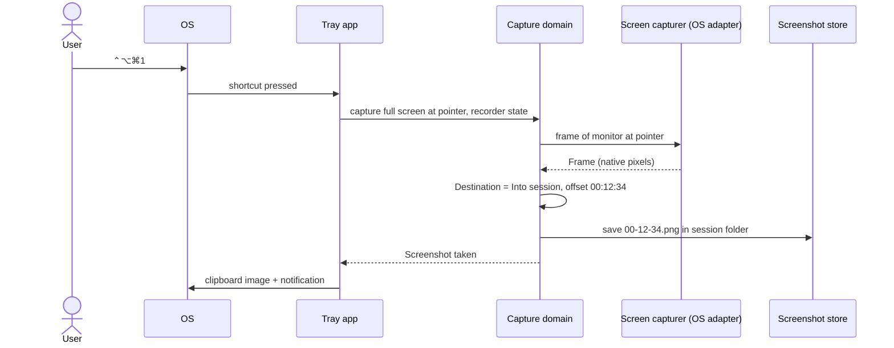
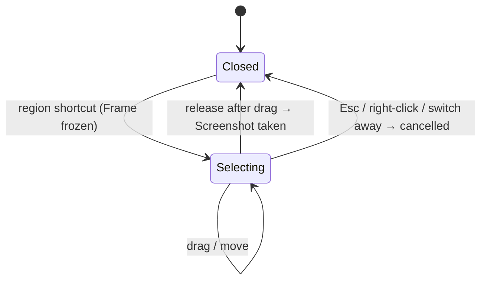
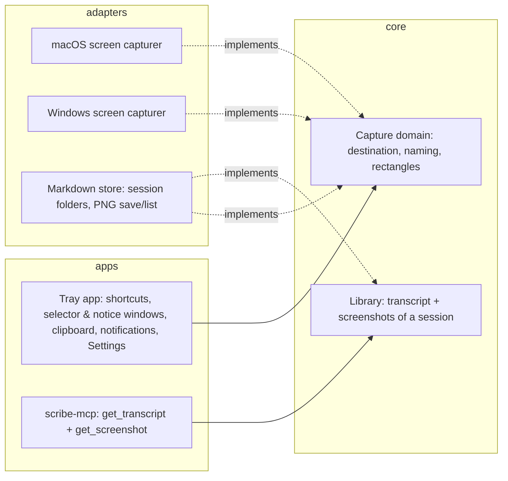
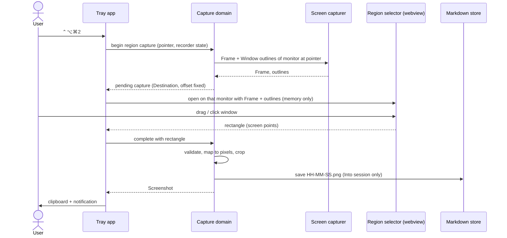

# Spec: Take screenshots with a global shortcut and file them beside the meeting they belong to

> Owned by: Sapan Parikh  ·  Started: 2026-10-20  ·  Last revised: 2026-10-20  ·  Spec UUID: 23d939cb-9d39-48e9-853f-16d3a57fb442
> Anthara spec — slice-decomposed, categorically-framed. Feeds /anthara:create-ticket and /anthara:plan-implementer.

---

## At a glance

| | |
|---|---|
| **In one line** | Two global shortcuts capture the full screen or a selected region of the monitor under the cursor; during a recording the image is saved into that meeting's folder, named by its offset, and every capture is copied to the clipboard. |
| **Slices** | 8, built in the order listed in [§5](#5-slices) |
| **Architectural style** | Hexagonal, inherited from `docs/ARCHITECTURE.md`, see [§7.2](#72-architectural-style) |
| **Active packs** | Clean Code · Incubyte Engineering Standards · SonarJS Violations (JS/TS) · Design Standards: Global Component |
| **Open questions** | 3 — whether macOS 26 needs a relaunch after Screen Recording access is granted |

## 1. Overview & business context

**The problem.** During a call, what is on screen (a slide, a dashboard, a diagram) is often what is being discussed, but Scribe captures only what is said. Today a user has to take the screenshot with another tool, and the image ends up with no link to the moment in the meeting it belongs to [1].

**Who it is for.** The [Scribe user](#31-kinds-of-users) who wants a quick screenshot tool, and the [AI client](#31-kinds-of-users) that reads transcripts through `scribe-mcp` and should be able to see what was on screen at a given moment [1].

**What this spec commits to.** One shortcut captures the whole monitor under the cursor, and another opens a region selector on that monitor, which can also snap to a window. While Scribe is recording, the image is saved into the session's own folder as `HH-MM-SS.png`, the offset into the meeting, so it lines up with the transcript line `[HH:MM:SS]`. Every capture is copied to the clipboard. `get_transcript` ends with the names of the session's screenshots, a new `get_screenshot` tool returns any of them as an image scaled to 1568 px on the long edge, and both shortcuts can be rebound in Settings [1].

**Deliberately out of scope.** Saving a capture when nothing is recording, because it then goes to the clipboard only. Annotation and editing, scrolling capture, video, regions that span monitors, and serving full-resolution originals over MCP are also out [1]. See [§9](#9-deferred-follow-ups-and-accepted-limits) for the limits this accepts.

## 2. Sources

| ID | Type | Contributor | Date | Description |
|---|---|---|---|---|
| 1 | Live spec-writing session with Sapan Parikh | Sapan Parikh | 2026-10-20 | Every in-session product decision: session folders, offset names, clipboard-only when idle, the idle notice, `⌃⌥⌘` defaults, freeze-frame, window snap, configurable shortcuts, build order |
| 2 | Codebase (this repo) | n/a | 2026-10-20 | `docs/ARCHITECTURE.md` (hexagonal, ports in `scribe-core`); `store-markdown` month layout and `0o600`/`0o700` private files; `offset_as_clock` `[HH:MM:SS]` segment stamps; `scribe-mcp` `get_transcript` returns the raw markdown; `notifications.rs` permission-notification precedent with `x-apple.systempreferences` links; popover `SettingsPanel` |
| 3 | Plan 003 — configurable transcripts folder | Sapan Parikh | 2026-10-19 | `docs/plans/003-configurable-transcripts-folder-plan.md`: `settings.json` via `tauri-plugin-store`, legacy layouts read in place and never migrated automatically, guarded move of existing transcripts, the popover Settings view |
| 4 | Public docs (v2.tauri.app/plugin/global-shortcut; docs.rs/tauri-plugin-global-shortcut) | Web | 2026-10-20 | `register`, `on_shortcut`, `unregister`, `is_registered`; `register` errors on invalid or already-registered shortcuts; `is_registered` returns false for shortcuts held by *other* applications |
| 5 | Public docs (docs.rs/tauri-plugin-clipboard-manager 2.5) | Web | 2026-10-20 | `Clipboard::write_image(&tauri::image::Image)` writes RGBA image data to the system clipboard |
| 6 | Source (github.com/nashaofu/xcap 0.9.8, `src/macos/capture.rs`) | Web | 2026-10-20 | `xcap` captures on macOS via `CGWindowListCreateImage` |
| 7 | Public reports (trac.macports.org #70756; developer.apple.com/forums/thread/748798) | Web | 2026-10-20 | `CGDisplayCreateImage` and `CGWindowListCreateImage` are unavailable ("obsoleted in macOS 15.0 — use ScreenCaptureKit") when building against the macOS 15 SDK |
| 8 | Crate source (`cidre` 0.29, `sc` module; already a dependency of `audio-macos`) | Local registry | 2026-10-20 | ScreenCaptureKit bindings: `sc::ScreenshotManager::capture_image`, `sc::ShareableContent::current` with window `frame`, `window_layer`, `is_on_screen`, `owning_app` |
| 9 | Public reports (9to5mac.com 2024-08-14; talk.tidbits.com/t/28621) | Web | 2026-10-20 | Since macOS Sequoia, apps with Screen Recording access, ScreenCaptureKit apps included, get a periodic "Allow for one month" re-confirmation prompt that developers cannot suppress |
| 10 | Public reports (forums.getdrafts.com/t/14001; shottr.cc/kb/startguide) | Web | 2026-10-20 | Shottr's region default `⌘⇧2` collides with another app's shortcut; shortcut screenshot tools let users rebind |
| 11 | Fabric standards (`get_relevant_standards`, incubyte/scribe) | Fabric | 2026-10-20 | Rules from the four active packs cited in [§6](#6-nfrs--regulatory-compliance) |
| 12 | Org Memory (search: "Scribe tray app screenshot screen capture global shortcut") | Fabric | 2026-10-20 | No prior Scribe screenshot work; confirms the frontend uses Vitest |
| 13 | Public docs (platform.claude.com/docs/en/build-with-claude/vision) | Web | 2026-10-20 | Images larger than a model's limit are scaled down, keeping their aspect ratio. The standard tier's limit is 1568 px on the long edge (≈1568 visual tokens), and Claude 4.7+ accepts 2576 px. Images may be up to 10 MB base64 on the API and claude.ai, in PNG, JPEG, GIF or WebP |
| 14 | Crate source (`rmcp` 3.5.1, `model/content.rs`) and `scribe-mcp/src/transport.rs` | Local registry / codebase | 2026-10-20 | `Content::image(base64, mime_type)` returns an MCP image block. `scribe-mcp`'s 1 MB message cap applies to incoming messages only |

## 3. Type ontology

### 3.1 Kinds of users

- **Scribe user** — one person using Scribe on their own Mac (macOS 26+) or Windows PC, often during a call, who wants to grab what is on screen without leaving the call [1, 2].
- **AI client** — an MCP client such as Claude Desktop that reads transcripts through `scribe-mcp`. With this spec it can also list a session's screenshots and fetch them as images. It cannot open local file paths itself [1].

### 3.2 Kinds of data

None of this data is regulated, but a screenshot can contain anything that was on screen, so it is treated as private to the user.

- **Frame** — the pixels of one whole monitor, grabbed at native resolution the instant a shortcut fires. It lives only in memory [1].
- **Window outline** — the on-screen rectangle of a visible app window on the captured monitor, recorded at the same instant as the Frame [1].
- **Screenshot** — a rectangle cut from a Frame (the whole monitor, a region or a window), encoded as PNG [1].
- **Session folder** — `<transcripts folder>/YYYY-MM/<session id>/`, holding `<session id>.md` and that session's Screenshots [1, 3].
- **Screenshot name** — `HH-MM-SS.png`, the offset from the session's start at the moment the shortcut fired. A second capture in the same second becomes `HH-MM-SS-2.png`, then `-3`, and so on [1, 2].
- **Screenshot reference** — `<session id>/<screenshot name>`, for example `2026-10-20-143005/00-12-34.png`. It is how the AI client names one screenshot, and it is unique across all sessions [1].
- **Served image** — a Screenshot scaled down so its long edge is at most 1568 px, encoded as PNG for the AI client. It is made on demand and never stored [1, 13].
- **Shortcut binding** — the key combination for one capture kind, stored in `settings.json` [1, 3].
- **Idle notice preference** — whether the user ticked "Don't show this again" on the idle notice, stored in `settings.json` [1].

### 3.3 Kinds of events

- **Capture requested** — the user presses the full-screen or region shortcut anywhere in the OS [1].
- **Selection made** — in the region selector, the user finishes a drag or clicks a highlighted window [1].
- **Selection cancelled** — the user presses Esc, right-clicks, or switches away from the region selector [1].
- **Screenshot taken** — a Screenshot exists in memory and is about to reach its destinations [1].
- **Screenshot fetched** — the AI client calls `get_screenshot` with a Screenshot reference [1].
- **Shortcut rebound** — the user records a new combination, or resets to the default, in Settings [1].

### 3.4 Kinds of states

- **Capture kind** — *Full screen* or *Region*. A window snap is a Region capture whose rectangle came from a Window outline [1].
- **Destination** — *Into session*, when a recording was active at the press, so the Screenshot is saved and copied. *Clipboard only*, when no recording was active, so it is copied and nothing is written [1].
- **Region selector** — *Closed* or *Selecting* [1].
- **Screen Recording access (macOS)** — *Granted* or *Not granted*. Windows has no such permission [2, 9].
- **Shortcut binding status** — *Active*, or *Unavailable* when the OS refused to register it [4].

## 4. Invariants

**4.1 Capture follows the cursor** — every capture comes from the monitor that contained the pointer when the shortcut fired. Sources: [1].

**4.2 A capture belongs to the moment its shortcut fired** — the Frame, the window outlines, the Destination and the offset are all fixed at the press. If the recording stops while the user is still selecting, the Screenshot still goes into that session's folder with the offset of the press. Sources: [1].

**4.3 A screenshot's name is its offset** — `00-12-34.png` was taken 12 minutes 34 seconds into the session, the same clock as the transcript line `[00:12:34]`. An existing file is never overwritten. Sources: [1, 2].

**4.4 Every completed capture reaches the clipboard** — whatever happens to the save, a capture that was not cancelled is on the clipboard. Sources: [1].

**4.5 Pixels touch disk only as a saved Screenshot** — Frames, cancelled selections and Clipboard-only captures are never written to disk, temp files included. Saved files and session folders are user-only. Sources: [1, 2].

**4.6 Transcript files are never edited for screenshots** — a session's `.md` stays a pure transcript. Screenshot references are worked out when the transcript is read. Sources: [1].

**4.7 Existing transcripts are never migrated automatically** — flat (`<id>.md`) and month-file (`YYYY-MM/<id>.md`) sessions stay where they are and keep working. Sources: [3].

**4.8 One capture at a time** — while the region selector is open, both shortcuts are ignored. Sources: [1].

**4.9 Screenshots are native resolution** — a Screenshot's pixel size is the selected size in screen points times that monitor's scale factor. Sources: [1].

**4.10 The AI client gets a scaled copy, never the original** — `get_screenshot` never returns an image longer than 1568 px on its long edge, never upscales, and never changes or writes a file on disk. Sources: [1, 13].

## 5. Slices

The order runs storage first, then the first capture, then the MCP payoff, the permission and idle paths, the region selector, and finally rebinding. Slices 5.2, 5.6 and 5.7 carry most of the OS risk.

| # | Slice | What the user can do once it lands | Entry | Reached from |
|---|---|---|---|---|
| 5.1 | Keep each new session in its own folder | Find a new recording's transcript in its own folder, ready to hold screenshots | Start recording (existing popover control) | `root` |
| 5.2 | Capture the full screen under the cursor into the recording | Press the full-screen shortcut mid-call and get `HH-MM-SS.png` in the session folder and on the clipboard | Full-screen shortcut (`⌃⌥⌘1` / `Ctrl+Shift+Alt+1`) | `root` |
| 5.3 | Let the AI client list and view a session's screenshots | Have Claude see which screenshots belong to a call, when each was taken, and what is in them | MCP `get_transcript` tool<br>MCP `get_screenshot` tool | `root` |
| 5.4 | Guide the user to Screen Recording access on macOS | Get told how to grant access instead of a silent failure | Full-screen shortcut with access not granted | Full-screen shortcut (5.2) |
| 5.5 | Copy to the clipboard when nothing is recording | Use the shortcut as a plain screenshot tool between calls | Full-screen shortcut while idle | Full-screen shortcut (5.2) |
| 5.6 | Select a region on the monitor under the cursor | Drag out exactly the part of the screen to keep | Region shortcut (`⌃⌥⌘2` / `Ctrl+Shift+Alt+2`) → region selector | `root` |
| 5.7 | Snap to a window in the region selector | Click a window to capture just that window | Window highlight in the region selector | Region selector (5.6) |
| 5.8 | Rebind the screenshot shortcuts in Settings | Change either shortcut, or reset it, without restarting | "Screenshot shortcuts" section of the popover Settings view | `root` (existing Settings view) |

### 5.1 Keep each new session in its own folder

When the user starts a recording, Scribe creates a folder for the session and writes the transcript inside it as `<transcripts folder>/2026-10/2026-10-20-143005/2026-10-20-143005.md`. The file keeps the session id as its name, so it stays recognisable when dragged into another app or found in Spotlight. Everything that already works keeps working for sessions in all three layouts: listing, opening, search, the MCP tools, crash recovery and the "move existing transcripts" flow from plan 003. Older sessions are never reshuffled [1, 3].

*Types: Session folder · Invariants: [4.5](#4-invariants), [4.7](#4-invariants).*

```
Scribe/
├── 2026-09-30-101500.md                     flat (legacy, read in place)
├── 2026-10/
│   ├── 2026-10-14-090000.md                 month file (read in place)
│   └── 2026-10-20-143005/                   session folder (new)
│       ├── 2026-10-20-143005.md
│       ├── 00-12-34.png
│       └── 00-12-34-2.png
```

**Acceptance criteria**

- [x] **5.1.1** A recording started after this change writes its transcript to `<transcripts folder>/<YYYY-MM>/<session id>/<session id>.md`.
- [x] **5.1.2** Sessions stored flat or as month files still appear in Recent sessions, open from the popover, and are returned by `list_transcripts`, `get_transcript` and `search_transcripts`, with their files unchanged on disk.
- [x] **5.1.3** A session left in `recording` status by a crash is marked incomplete on the next launch, whichever of the three layouts it uses.
- [x] **5.1.4** Moving existing transcripts to a new folder moves each session folder whole, with every file inside it. A source is removed only after its copy is complete, and a session folder whose destination already exists stays where it is.
- [x] **5.1.5** Listing ignores folders inside a month folder whose name is not a session id. Inside a session folder, it ignores every file except `<session id>.md`.
- [x] **5.1.6** The session folder is created user-only (`0700` on macOS) and the transcript user-only (`0600`), like the transcripts folder and files today.

### 5.2 Capture the full screen under the cursor into the recording

While Scribe is recording, the user presses `⌃⌥⌘1` on macOS or `Ctrl+Shift+Alt+1` on Windows. The monitor under the pointer is captured at native resolution and saved into the session folder as its offset, for example `00-12-34.png`. The same image is put on the clipboard, and a notification confirms both [1].

*Types: Frame, Screenshot, Screenshot name, Shortcut binding · Invariants: [4.1](#4-invariants), [4.2](#4-invariants), [4.3](#4-invariants), [4.4](#4-invariants), [4.5](#4-invariants), [4.9](#4-invariants).*



**Acceptance criteria**

- [ ] **5.2.1** At launch, Scribe registers the full-screen shortcut with its default: `⌃⌥⌘1` on macOS, `Ctrl+Shift+Alt+1` on Windows.
- [x] **5.2.2** Pressing the full-screen shortcut while recording saves one PNG of the monitor that contained the pointer at the press into the active session's folder.
- [ ] **5.2.3** With two monitors and the pointer on the secondary one, the PNG's pixel size equals the secondary monitor's and contains nothing from the primary.
- [ ] **5.2.4** On a 2× display of 1512 × 982 points, the PNG is 3024 × 1964 pixels.
- [x] **5.2.5** The file name is the offset from the session's start at the press, as `HH-MM-SS.png`. A second capture in the same second is saved as `HH-MM-SS-2.png`, then `-3`, and no existing file is ever overwritten.
- [ ] **5.2.6** The same image is on the system clipboard and pastes as an image into another app.
- [x] **5.2.7** A notification reads "Screenshot saved at 00:12:34 and copied to the clipboard", with the actual offset.
- [x] **5.2.8** If the save fails because the folder is missing or unwritable, or the disk is full, the image is still on the clipboard and the notification reads "Screenshot copied, but it couldn't be saved to this meeting". The log names the file only.
- [x] **5.2.9** If the capture itself fails, no file is written, the clipboard is untouched, and the notification reads "Couldn't take the screenshot. Try again."
- [ ] **5.2.10** If the OS refuses to register the shortcut at launch, Scribe shows one notification naming the shortcut that is unavailable. Recording works as before.
- [x] **5.2.11** The saved PNG is user-only (`0600` on macOS). No temp file is written, and no log line contains image data.

### 5.3 Let the AI client list and view a session's screenshots

Claude Desktop cannot open local files, so the screenshots reach it through `scribe-mcp` in two steps. First, `get_transcript` ends with a short section naming each screenshot by its Screenshot reference and offset. Then a new `get_screenshot` tool takes one of those references and returns the image itself, scaled so its long edge is at most 1568 px. Originals on disk stay at native resolution and are never changed [1, 13, 14].

*Types: Screenshot, Screenshot name, Screenshot reference, Served image, Session folder · Invariants: [4.3](#4-invariants), [4.6](#4-invariants), [4.10](#4-invariants).*

Indicative tail of the `get_transcript` response:

```markdown
## Screenshots

Screenshots taken during this call. Each name is its offset into the call and matches the transcript's [HH:MM:SS] stamps. Call get_screenshot with a name to see it.

- [00:12:34] 2026-10-20-143005/00-12-34.png
- [00:12:34] 2026-10-20-143005/00-12-34-2.png
- [00:41:02] 2026-10-20-143005/00-41-02.png
```

Indicative `get_screenshot` contract:

```
get_screenshot({ name: "2026-10-20-143005/00-12-34.png" })
→ [ text  "[00:12:34] 2026-10-20-143005/00-12-34.png — 1568 × 882 (scaled from 5120 × 2880)",
    image { mimeType: "image/png", data: <base64> } ]
```

**Acceptance criteria**

- [x] **5.3.1** For a session with screenshots, `get_transcript` returns the transcript markdown unchanged, followed by a `## Screenshots` section. It lists every screenshot in offset order as `[HH:MM:SS] <screenshot reference>`, with no local paths.
- [x] **5.3.2** For a session without screenshots, including every flat and month-file session, the `get_transcript` response is byte-identical to today's.
- [x] **5.3.3** Only files whose names parse as screenshot names are listed. Any other file in the session folder is ignored.
- [x] **5.3.4** The session's `.md` file on disk is byte-identical before and after any number of `get_transcript` calls.
- [x] **5.3.5** `get_screenshot` with a listed reference returns a one-line text label (offset, reference, served and original size) followed by the image as a PNG image block.
- [x] **5.3.6** A screenshot whose long edge is over 1568 px is served scaled down, keeping its aspect ratio, so its long edge is exactly 1568 px. A 5120 × 2880 original is served at 1568 × 882.
- [x] **5.3.7** A screenshot whose long edge is 1568 px or less is served at its original size, never upscaled.
- [x] **5.3.8** Serving a screenshot changes no file on disk and writes no scaled copy anywhere.
- [x] **5.3.9** A reference that is not exactly `<valid session id>/<valid screenshot name>` is rejected with a tool error before any file is touched. This covers `..`, a backslash, an absolute path, extra segments and a non-`.png` name.
- [x] **5.3.10** A well-formed reference to a screenshot that does not exist, or a PNG that cannot be decoded, returns the tool error "No screenshot named <reference>". The server keeps running.
- [ ] **5.3.11** Serving a 5120 × 2880 screenshot takes under one second on the machines Scribe supports.
- [x] **5.3.12** The tool descriptions tell the client that `get_transcript` lists screenshot names at the end, and that `get_screenshot` takes one of those names and returns the image.
- [x] **5.3.13** A screenshot added while Claude Desktop keeps `scribe-mcp` running is listed and served on the next call, with no restart.

### 5.4 Guide the user to Screen Recording access on macOS

On a Mac where Scribe does not have Screen Recording access, a capture shortcut takes no screenshot. Instead, Scribe asks macOS for access, which shows the system prompt the first time. It also shows a notification with an **Open Settings** button that goes straight to the right pane. Windows has no equivalent permission, so this slice changes nothing there [2, 9].

*Types: Screen Recording access · Invariants: [4.5](#4-invariants).*

**Acceptance criteria**

- [x] **5.4.1** When access is not granted, pressing a capture shortcut writes no file and leaves the clipboard untouched. Scribe requests access from macOS, which shows the system prompt the first time.
- [ ] **5.4.2** The notification reads "Scribe needs Screen Recording access to take screenshots", with an **Open Settings** button. The button opens System Settings › Privacy & Security › Screen & System Audio Recording.
- [x] **5.4.3** Recording and transcription are unaffected when Screen Recording access is missing.
- [ ] **5.4.4** Once access is granted, the next press of the shortcut captures normally. If a relaunch turns out to be required, the notification says so (see [§8.1](#8-open-questions)).

### 5.5 Copy to the clipboard when nothing is recording

Between calls, the shortcut works as a plain screenshot tool. The capture goes to the clipboard, nothing is written to disk, and a notification confirms the copy. Until the user opts out, a small Scribe notice also appears on the captured monitor to explain that screenshots are saved only during a recording [1].

*Types: Destination, Idle notice preference · Invariants: [4.4](#4-invariants), [4.5](#4-invariants).*

```
┌──────────────────────────────────────────────────┐
│  Copied to clipboard                             │
│                                                  │
│  Scribe saves screenshots into a meeting's       │
│  folder only while it's recording. This one is   │
│  on your clipboard, ready to paste.              │
│                                                  │
│  [ ] Don't show this again              [  OK  ] │
└──────────────────────────────────────────────────┘
```

**Acceptance criteria**

- [x] **5.5.1** Pressing the full-screen shortcut while no recording is active copies the capture to the clipboard and writes no file anywhere.
- [x] **5.5.2** Every idle capture shows the notification "Screenshot copied to the clipboard".
- [ ] **5.5.3** Until the user opts out, an idle capture also opens the notice above, centred on the captured monitor.
- [ ] **5.5.4** Closing the notice with "Don't show this again" ticked stores the preference in `settings.json`. The notice never appears again, including after a relaunch, and the notification from 5.5.2 still appears.
- [ ] **5.5.5** Closing the notice unticked means it appears on the next idle capture.
- [x] **5.5.6** **OK** has focus when the notice opens, and Enter or Esc closes it. Tab reaches the checkbox and Space toggles it. Text and controls meet WCAG 2.2 AA contrast and show a visible focus state, using the existing theme tokens.
- [ ] **5.5.7** "No recording is active" covers every recorder state other than recording, including the states where Scribe is starting, stopping or waiting for a speech model.

### 5.6 Select a region on the monitor under the cursor

The user presses `⌃⌥⌘2` on macOS or `Ctrl+Shift+Alt+2` on Windows. Scribe freezes the monitor under the pointer and covers that monitor with the frozen image, dimmed, with a crosshair. Dragging brightens the selected rectangle and shows its size. Releasing the mouse captures exactly that rectangle and sends it where 5.2 and 5.5 send captures: into the session while recording, to the clipboard only when idle [1].

*Types: Frame, Screenshot, Region selector, Destination · Invariants: [4.1](#4-invariants), [4.2](#4-invariants), [4.4](#4-invariants), [4.8](#4-invariants), [4.9](#4-invariants).*

```
┌───────────────────────── monitor under the pointer ─────────────────────────┐
│░░░░░░░░░░░░░░░░░░░░░░░░░░░ frozen screen, dimmed ░░░░░░░░░░░░░░░░░░░░░░░░░░░│
│░░░░░░░░░░░░┌──────────────────────────────┐░░░░░░░░░░░░░░░░░░░░░░░░░░░░░░░░░│
│░░░░░░░░░░░░│      selected, full bright   │░░░░░░░░░░░░░░░░░░░░░░░░░░░░░░░░░│
│░░░░░░░░░░░░│                              │░░░░░░░░░░░░░░░░░░░░░░░░░░░░░░░░░│
│░░░░░░░░░░░░└──────────────────────────────┘░░░░░░░░░░░░░░░░░░░░░░░░░░░░░░░░░│
│░░░░░░░░░░░░░░░░░░░░░░░░░░░░░░░░░░░░░░░░░ 1240 × 680 ░░░░░░░░░░░░░░░░░░░░░░░│
│░░░░░░░░░░░░░░░░░░░░░░ Drag to select · Esc to cancel ░░░░░░░░░░░░░░░░░░░░░░│
└─────────────────────────────────────────────────────────────────────────────┘
```



**Acceptance criteria**

- [x] **5.6.1** At launch, Scribe registers the region shortcut with its default: `⌃⌥⌘2` on macOS, `Ctrl+Shift+Alt+2` on Windows. A refusal is reported the same way as in 5.2.10.
- [ ] **5.6.2** Pressing the region shortcut covers only the monitor under the pointer with the frozen, dimmed image. The selector opens within 500 ms of the press on a 5K display.
- [ ] **5.6.3** The selector covers the menu bar or taskbar and appears above full-screen apps, on the user's current Space or desktop.
- [x] **5.6.4** Dragging shows the selected rectangle at full brightness, with a live `W × H` readout in output pixels.
- [x] **5.6.5** Releasing after a drag captures exactly the selected rectangle from the frozen image at native resolution and closes the selector. The Screenshot then goes into the session as in 5.2 when a recording was active at the press, or to the clipboard as in 5.5 when not.
- [ ] **5.6.6** Esc, a right-click, or switching to another app (`⌘Tab` / `Alt+Tab`) cancels. The selector closes with nothing saved, copied or notified.
- [x] **5.6.7** A click, or a drag smaller than 4 × 4 output pixels, captures nothing and leaves the selector open.
- [x] **5.6.8** The selection cannot extend past the edges of the monitor.
- [x] **5.6.9** Pressing either capture shortcut while the selector is open does nothing.
- [x] **5.6.10** The Screenshot never contains the selector itself, and shows the screen as it was at the press.
- [ ] **5.6.11** With a 1× external monitor beside a 2× built-in display, a selection on either one captures the intended pixels at that monitor's native resolution.
- [x] **5.6.12** Without Screen Recording access on macOS, the region shortcut behaves as in 5.4 and no selector opens.
- [ ] **5.6.13** On open, the selector announces "Region capture. Drag to select, Escape to cancel." to screen readers. The selection outline stays at 3:1 contrast against any screen content, using a two-tone outline.

### 5.7 Snap to a window in the region selector

In the region selector, moving the pointer highlights the window under it and shows that window's size. A click without a drag captures just that window. Starting a drag switches back to free selection. Highlights come from the window positions at the moment of the press, so they always match the frozen image [1].

*Types: Window outline, Screenshot, Region selector · Invariants: [4.2](#4-invariants), [4.9](#4-invariants).*

**Acceptance criteria**

- [x] **5.7.1** In the selector, the topmost visible app window under the pointer on that monitor is outlined, with its `W × H` in output pixels.
- [x] **5.7.2** Clicking without dragging captures the highlighted window's visible rectangle, clipped to the monitor. It goes to the same destinations as a dragged region.
- [x] **5.7.3** Starting a drag clears the highlight and selects a free region, as in 5.6.
- [x] **5.7.4** The desktop wallpaper, the menu bar, Dock or taskbar, Scribe's own windows, and windows on other monitors are never highlighted.
- [x] **5.7.5** Clicking where no window is highlighted captures nothing and leaves the selector open.
- [x] **5.7.6** Window outlines are taken at the same instant as the Frame. A window that moves after the press does not shift its highlight.

### 5.8 Rebind the screenshot shortcuts in Settings

The popover's Settings view gains a "Screenshot shortcuts" section with one row per capture kind. Each row shows the current combination with **Change** and **Reset to default**. **Change** listens for the next key combination, checks it, and applies it immediately. The binding is kept in `settings.json` [1, 3].

*Types: Shortcut binding, Shortcut binding status · Invariants: [4.8](#4-invariants).*

```
┌ Settings ──────────────────────────────────┐
│ Transcripts folder: ~/Documents/Scribe     │
│ [ Change Transcripts Folder ]              │
│                                            │
│ Screenshot shortcuts                       │
│ Capture full screen   ⌃⌥⌘1   Change  Reset │
│ Capture region        ⌃⌥⌘2   Change  Reset │
│                                            │
│ Another app is using ⌃⌥⌘2.                 │  ← status line
│ ‹ Back                                     │
└────────────────────────────────────────────┘
```

**Acceptance criteria**

- [x] **5.8.1** Settings shows "Screenshot shortcuts" with the rows "Capture full screen" and "Capture region". Each displays its current combination with platform symbols (`⌃⌥⌘1` on macOS, `Ctrl+Shift+Alt+1` on Windows).
- [x] **5.8.2** **Change** puts its row into listening mode ("Press the new shortcut…"). Esc cancels and restores the old combination. While listening, both global shortcuts are paused, so pressing them captures nothing.
- [x] **5.8.3** A combination must hold at least one of `⌘`, `⌃` or `⌥` (`Ctrl` or `Alt` on Windows) plus exactly one letter, digit or function key. Otherwise the row shows "Use ⌘, ⌃ or ⌥ with a letter, number or function key" and keeps the old combination.
- [x] **5.8.4** A combination already bound to the other row is rejected with "Already used for Capture region" (or "… full screen"). The old combination stays.
- [ ] **5.8.5** If the OS refuses to register the new combination, the row shows "Another app is using this shortcut". The old combination stays registered and working.
- [ ] **5.8.6** An accepted combination works at once, without a relaunch, and survives relaunches.
- [x] **5.8.7** **Reset to default** restores that row's default from 5.2.1 or 5.6.1.
- [x] **5.8.8** The launch notification for an unavailable shortcut (5.2.10) adds "Change it in Scribe Settings".
- [ ] **5.8.9** A missing stored binding falls back to the default silently; a malformed or unparseable one falls back to the default and logs a warning. Neither ever stops Scribe from launching.
- [x] **5.8.10** Shortcuts can be changed while a recording is in progress.
- [x] **5.8.11** Each **Change** button has an accessible name with its row and current value, for example "Change Capture region shortcut, currently ⌃⌥⌘2". Outcomes are announced through the view's existing status line. Focus stays on the row after a change. The section meets WCAG 2.2 AA contrast and focus visibility.

## 6. NFRs & regulatory compliance

No regulated packs are active. These NFRs come from the four general packs, plus the project's own cross-cutting rules in `docs/ARCHITECTURE.md` §5.

### 6.1 Clean Code

**6.1.1 Validate at every boundary, then trust internally** — derived from rule: *Fail fast at boundaries*. Stored shortcut bindings, the stored idle preference, the `get_screenshot` reference, and the selection rectangle that comes back from the selector webview are validated in Rust before use. The reference is parsed into a typed session id and screenshot name, never joined into a path as raw text. The rectangle must be positive-sized and inside the captured monitor, or it is rejected with a typed error. Sources: [11].

**6.1.2 Small, single-purpose functions** — derived from rule: *Small functions*. Naming, destination choice, logical-to-pixel mapping and window hit-testing are separate, independently tested units. Sources: [11].

### 6.2 Incubyte Engineering Standards

**6.2.1 Business-language tests** — derived from rule: *Write test names in business language*. For example, "a second screenshot in the same second does not overwrite the first". Sources: [11].

**6.2.2 ZOMBIES coverage for naming and destination** — derived from rule: *Use ZOMBIES to identify test cases*. Zero (offset 0 → `00-00-00.png`), one, many (same-second suffixes), boundaries (offsets past 99 hours, monitor edges), interfaces (store and capturer ports) and exceptions (save or capture failure). Sources: [11].

**6.2.3 Test files and gates** — derived from rules: *Test files must end with .spec.ts*, *Enforce max cyclomatic complexity of 5*, *Mutation testing must be configured in CI*. Frontend tests are `*.spec.ts(x)`, TypeScript functions stay at complexity ≤ 5, and new Rust and TS logic is covered by `cargo mutants --in-diff` and `npm run mutate`. Sources: [11].

### 6.3 SonarJS Violations (JavaScript / TypeScript)

**6.3.1 Selector, notice and Settings code is Sonar-clean** — derived from the pack catalog, including *max-union-size*. The listening, rejected and accepted states of a shortcut row are a discriminated union with a shared tag, not a wide union. Sources: [11].

### 6.4 Design Standards: Global Component

**6.4.1 WCAG 2.2 AA on every new surface** — derived from rule: *Verify accessibility at the component and again at every call site*. Applies to the notice, the region selector's labels and outline, and the Settings rows: contrast in context, visible focus, keyboard operation, roles and accessible names. Checked by hand as well as automatically. Sources: [11].

**6.4.2 Reuse the theme, and introduce shared pieces deliberately** — derived from rules: *Read the component's contract before you use it*, *Consolidate imports to a single source of truth*. New surfaces use `tokens.css` and `primitives.css`. A shared piece introduced here, such as a key-combination label or checkbox, has one canonical implementation. Sources: [2, 11].

### 6.5 Project cross-cutting rules (ARCHITECTURE.md §5)

**6.5.1 Local only** — Scribe itself makes no outbound traffic. A screenshot leaves `scribe-mcp` only when the AI client asks for it with `get_screenshot`, and only as the scaled copy. Sources: [1, 2].

**6.5.2 Private files** — session folders and PNGs are user-only, and logs carry session ids and file names only. Sources: [2].

### 6.6 Control coverage matrix

| Control | Pack | Slices | Evidence committed |
|---|---|---|---|
| Fail fast at boundaries | Clean Code | 5.3, 5.6, 5.7, 5.8 | AC 5.3.9, 5.6.8, 5.8.3, 5.8.9 |
| Business-language tests, ZOMBIES | Incubyte Engineering Standards | 5.1, 5.2, 5.3 | AC 5.2.5, 5.3.1–5.3.3, 5.3.6–5.3.7 |
| Complexity ≤ 5, mutation testing | Incubyte Engineering Standards | all | Gates in [6.2.3](#62-incubyte-engineering-standards) |
| Sonar-clean TS, small unions | SonarJS | 5.5, 5.6, 5.7, 5.8 | `npm run lint` clean |
| WCAG 2.2 AA (focus, contrast, names) | Design Standards: Global Component | 5.5, 5.6, 5.8 | AC 5.5.6, 5.6.13, 5.8.11 |
| Local only, private files | ARCHITECTURE.md §5 | 5.1, 5.2, 5.3, 5.5 | AC 5.1.6, 5.2.11, 5.3.8, 5.5.1 |

## 7. Architecture

### 7.1 Tech stack

Additions to the stack in `docs/ARCHITECTURE.md` §2. Everything else is unchanged.

| Layer | Choice | Rationale |
|---|---|---|
| Global shortcuts | `tauri-plugin-global-shortcut` 2.x | Official Tauri plugin for macOS and Windows; reports registration failures [4] |
| macOS capture | ScreenCaptureKit through `cidre` (`sc`) | `CGWindowListCreateImage`, which `xcap` uses, is obsoleted in the macOS 15 SDK. Scribe targets macOS 26 and already depends on `cidre` [6, 7, 8] |
| Windows capture | Win32 desktop capture and window enumeration | The plan picks the library (`windows` crate directly or `xcap`'s Windows backend) |
| Clipboard | `tauri-plugin-clipboard-manager` `write_image` (already a dependency) | RGBA image to the system clipboard on both OSes [5] |
| Serving screenshots to the AI client | `rmcp` image content, with PNG decode, downscale and encode in the store adapter | `Content::image` already exists in the `rmcp` version Scribe uses. 1568 px keeps a served image near 1568 visual tokens. The plan picks the image library and resampling filter [13, 14] |
| Region selector and notice | Tauri webview windows with React and the existing theme | Same UI stack and tokens as the popover |
| Settings | `settings.json` through `tauri-plugin-store` (existing) | Same file and resolver pattern as plan 003 [3] |

### 7.2 Architectural style

**Style:** *Hexagonal (ports and adapters)*, inherited from `docs/ARCHITECTURE.md` ADR 1.

**Why this style here:** Screen capture is another OS edge, like audio capture and speech recognition. It differs completely between macOS and Windows, while the rules around it are the same on both: which monitor, which destination, what name, which rectangle. Putting those rules in the core keeps them testable without a screen, and lets each OS plug in one adapter.

**Dependency direction:** apps → `scribe-core` ← adapters. The core owns the capture rules and two new ports: one that grabs a monitor's Frame and Window outlines at a point, and one that saves, lists and serves a session's Screenshots, with serving scaled to a maximum long edge. Capture adapters implement the first. `store-markdown` implements the second, alongside the session-folder layout. The tray wires shortcuts, windows, clipboard and notifications.

**Anti-patterns the style forbids:** `#[cfg(target_os)]` in `scribe-core`. Tauri types below `apps/`, and image-codec types in `scribe-core`. `scribe-mcp` depending on a capture crate, since it reads screenshots only through `store-markdown`. A Frame or a scaled copy written to disk. Full-resolution originals over MCP.

### 7.3 Module decomposition



### 7.4 Data flow

A region capture during a recording is the richest path. It also shows why the Frame is taken before the selector opens.



### 7.5 Threat model seed

- **Sensitive pixels.** A Screenshot can contain passwords or other people's content. It is saved only during a recording, user-only, and never leaves the machine through Scribe.
- **AI client access.** Image content reaches the AI client, and through it the client's model provider, only when the client calls `get_screenshot`. The user controls that by choosing to connect Scribe to the client. The original never leaves the machine through Scribe.
- **Path traversal through `get_screenshot`.** The reference is client-supplied input. It is parsed into a typed session id and screenshot name and rejected otherwise, so it can only ever resolve to a screenshot inside the transcripts folder (AC 5.3.9).
- **Clipboard exposure.** Clipboard managers and other apps can read the clipboard. This is inherent to copying, and is accepted.
- **Selector input.** The selector reads only pointer events and Esc. It never captures other keystrokes, and it closes as soon as it loses focus.

## 8. Open questions

**8.1 Does a ScreenCaptureKit capture work right after access is granted on macOS 26, or only after a relaunch?** This decides the wording of AC 5.4.4. Awaiting: a hands-on check on macOS 26 while building 5.4.

**8.2 Does the global-shortcut plugin report a failure on macOS when another app already holds the combination?** `is_registered` does not see other apps' shortcuts [4]. If `register` also succeeds, AC 5.2.10 and 5.8.5 hold on Windows only, and [§9.4](#9-deferred-follow-ups-and-accepted-limits) applies. Awaiting: a hands-on test while building 5.2.

**8.3 Do the Windows defaults `Ctrl+Shift+Alt+1/2` type a character on AltGr keyboard layouts (German, French)?** `Ctrl+Alt` acts as AltGr there. Rebinding (5.8) is the fallback, but a clash would argue for other Windows defaults. Awaiting: a check on a German layout.

## 9. Deferred follow-ups and accepted limits

**9.1 macOS asks the user to re-confirm Screen Recording access periodically — accepted.** Since Sequoia, the OS shows an "Allow for one month" prompt to screen-capturing apps, ScreenCaptureKit apps included, and developers cannot suppress it. Sources: [9].

**9.2 Window snap captures what was visible, not the whole window — accepted.** Freeze-frame crops the frozen monitor image, so parts of a window covered by another window show the cover. The rejected alternative is a separate per-window capture, which would capture hidden content but break the "what you saw is what you get" model and add a second capture path. Sources: [1].

**9.3 Region selection needs a drag (WCAG 2.5.7) — accepted.** The single-pointer alternatives are a window click (5.7) and the keyboard full-screen shortcut (5.2). Keyboard-driven region selection is deferred. Sources: [1, 11].

**9.4 Shortcut conflicts may go undetected on macOS — accepted, pending [§8.2](#8-open-questions).** If another app holds the same combination, either app may receive it. The user resolves it by rebinding in Settings. Sources: [4].

**9.5 A region cannot span monitors — accepted.** The selector covers only the monitor under the pointer ([invariant 4.1](#4-invariants)). Sources: [1].

**9.6 Shortcuts cannot be switched off — deferred.** Rebinding exists, but a "none" binding does not. Add it if users ask. Sources: [1].

## 10. Established behaviour — documented, not changed

**10.1 The transcript file never mentions its screenshots.** The `## Screenshots` section exists only in the `get_transcript` response, worked out from the session folder at read time. Confirmed intended: Sapan Parikh, who wants the screenshot list returned as a note for the AI tool, not written into the note. Sources: [1].

**10.2 `get_screenshot` serves at most 1568 px on the long edge, even to models that accept more.** Claude 4.7 and later accept 2576 px, but 1568 px was chosen to cap image tokens and payload size. Fine text in a large region may be harder to read at that size. Confirmed intended: Sapan Parikh. Sources: [1, 13].

**10.3 Captures made while not recording are not saved anywhere.** They go to the clipboard only, with the notice from 5.5. Confirmed intended: Sapan Parikh. Sources: [1].

**10.4 Old transcripts are not moved into session folders.** Flat and month-file sessions are read in place indefinitely. Confirmed intended: plan 003's never-migrate-automatically rule, carried forward. Sources: [3].

---

## Changelog

- 2026-10-20 — Sapan Parikh — Initial spec from a live spec-writing session [1].
- 2026-10-20 — Sapan Parikh — Claude Desktop cannot read local paths. Slice 5.3 now lists Screenshot references instead of paths, and adds `get_screenshot`, which serves the image scaled to 1568 px on the long edge. Added invariant 4.10 and the Screenshot reference and Served image types, and updated §6.1.1, §6.5.1, §7.1, §7.2, §7.5 and §10 to match [1, 13, 14].
- 2026-10-20 — Sapan Parikh — Deviation on slice 5.2 (plan slice 2): `ScreenshotStore::save` took `(session, offset, screenshot)` → takes a `SessionMoment { session, offset }` and `Destination::IntoSession` carries it, with a new `StoreError::ScreenshotNotEncoded`. Reason: the four-argument port method breaks the workspace too-many-arguments lint (threshold 3), and an `#[allow]` on a port was rejected. Also on slices [5.2](#52-capture-the-full-screen-under-the-cursor-into-the-recording), [5.6](#56-select-a-region-on-the-monitor-under-the-cursor) and [5.8](#58-rebind-the-screenshot-shortcuts-in-settings): the macOS shortcut strings use `super` for ⌘ → `control+alt+super+Digit1` / `Digit2` and canonical order `shift+control+alt+super+<Code>`, not `meta`; a wrong `[verified]` marker, caught before build, because global-hotkey 0.8.0 in the lockfile accepts only `super`, `cmd` or `command`. Affects: no acceptance criteria changed; §5.2, §5.6 and §5.8 slice prose unchanged.
- 2026-10-20 — Sapan Parikh — Deviation on slice 5.6 (plan slice 6): three implementation-level changes. The busy and pending capture state moved from `ScreenshotService` into a pure `capture_gate.rs` module (`CaptureGate`, `CaptureClaim::park`, `RegionRefusal`), and a pending capture blocks both shortcuts; `PendingCapture::accepts(selection)` is checked before the pending capture is taken, so a refused selection never consumes it; `ScreenshotService::complete_region(app, area)` closes the selector before saving and the command has no `window` parameter. Reason: the gate is testable without an AppHandle, a pending capture cannot be restored without cloning a ~59 MB frame, and the frozen selector stayed on screen during the PNG write. Affects: no acceptance criteria changed; [5.6](#56-select-a-region-on-the-monitor-under-the-cursor) slice prose unchanged.
- 2026-10-20 — Sapan Parikh — Deviation on slice 5.8 (plan slice 8): AC [5.8.9](#58-rebind-the-screenshot-shortcuts-in-settings) reworded and unticked, so a missing stored binding falls back to the default silently and only a malformed or unparseable one logs a warning, because a warning on a missing value would log noise on every first launch; the rebind control flow changed from "unregister only the old binding, resume unless accepted" to "unregister and register both kinds, re-apply the old bindings on a registration or persist failure, resume after any outcome, and end listening on window blur" (plan-only, see the plan Escalation log), because the planned rule left the other kind's shortcut unregistered after a successful rebind. Affects: 5.8.9 (reworded, unticked); no other criteria or sections changed.
