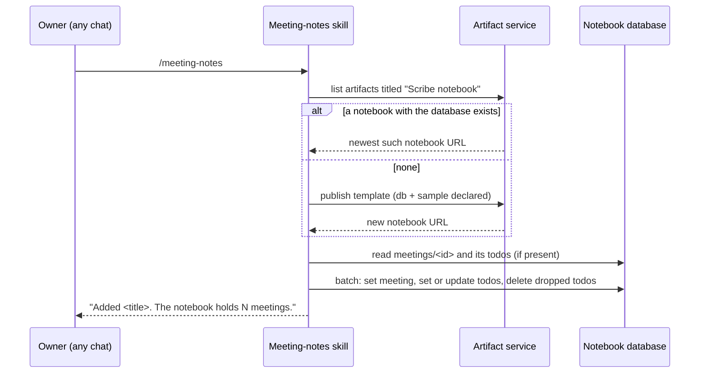
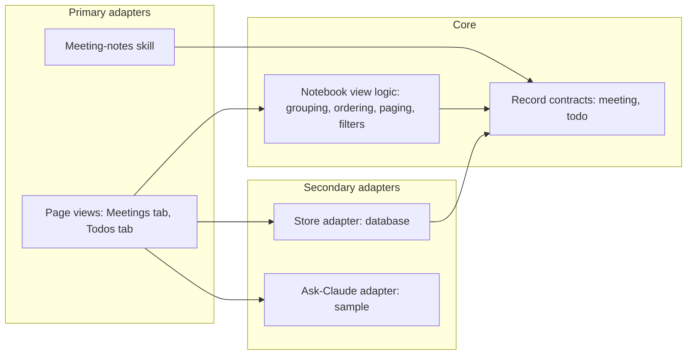
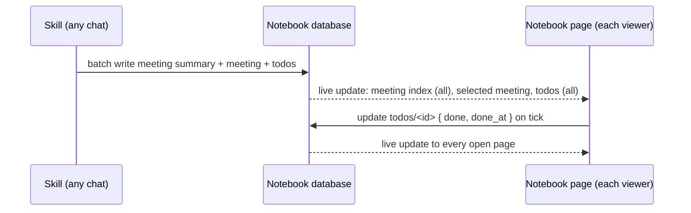

# Spec: Keep every meeting's notes and todos in one database-backed Scribe notebook

> Owned by: Sapan Parikh  ·  Started: 2026-10-21  ·  Last revised: 2026-10-21  ·  Spec UUID: d0922bbc-4934-4cef-b35c-07e9cc016c5f
> Anthara spec — slice-decomposed, categorically-framed. Feeds /anthara:create-ticket and /anthara:plan-implementer.

---

## At a glance

| | |
|---|---|
| **In one line** | Meeting notes from any chat land in one published Scribe notebook whose meetings and todos live in the artifact's database, with a Todos tab across all meetings, paging past 20 meetings, and Incubyte's look. |
| **Slices** | 7, built in the order listed in [§5](#5-slices) |
| **Architectural style** | Hexagonal, inherited from `docs/ARCHITECTURE.md`, applied inside the notebook page, see [§7.2](#72-architectural-style) |
| **Active packs** | Org-wide engineering standards (Clean Code · Incubyte Engineering Standards · SonarJS · Design Standards, with WCAG 2.2 AA) |
| **Open questions** | 1 — whether Claude Desktop and Cowork give the skill the artifact tools it needs |

## 1. Overview & business context

**The problem.** Each chat that runs `/meeting-notes` creates its own "Scribe notebook" artifact, because the skill only looks for a notebook in the current conversation and keeps every meeting inside the page itself. The user already has two notebooks from one day, todos are only reachable one meeting at a time, and ticked todos are lost on reload in published artifacts [3, 5].

**Who it is for.** The [notebook owner](#31-kinds-of-users) who records calls with Scribe and wants one place to read every meeting and work through every follow-up. Secondarily, people the owner shares the notebook with [5].

**What this spec commits to.** One published notebook per owner whose meetings and todos are records in the artifact's database, written by the meeting-notes skill from any chat. The page gains Meetings and Todos tabs: the Todos tab lists every todo grouped by owner (the owner's own first), links each back to its meeting, and filters open and done. The meeting list shows 20 meetings and loads 20 more on request. The page wears Incubyte's palette and fonts in light and dark modes [5].

**Deliberately out of scope.** Search and date filters, due-date parsing and reminders, editing notes or todos in the page, chat artifacts (artifacts that live inside one conversation), and changes to the Scribe app or its MCP server. See [§9](#9-deferred-follow-ups-and-accepted-limits) for the limits this accepts.

## 2. Sources

| ID | Type | Contributor | Date | Description |
|---|---|---|---|---|
| 1 | Public docs (artifact runtime contract 0.2.88: `db`, `sample`, `user` type definitions) | Claude Code bundle | 2026-10-21 | Document store paths, access rules by share level, 256 KiB document cap, 25,000 documents per artifact, `onSnapshot`, `orderBy`/`limit`; `sample` for asking Claude from the page |
| 2 | Public site (incubyte.co homepage HTML) | Web | 2026-10-21 | Brand colours `#014D43`, `#EBFFF6`, `#D3FE73`, `#40A578`; fonts Fraunces and Inclusive Sans from Google Fonts; screenshot shared by the user |
| 3 | Codebase (this repo) | n/a | 2026-10-21 | `plugins/scribe/skills/meeting-notes/notebook.html` and `SKILL.md`; `docs/ARCHITECTURE.md` (hexagonal, read-only MCP); `docs/plans/005-scribe-claude-plugin-plan.md` decision 4 (one notebook per conversation), superseded here |
| 4 | Org Memory (search_memories: "Scribe notebook meeting notes artifact plugin") | Fabric | 2026-10-21 | Meeting-notes reads the transcript then screenshots; AI actions vary by call type; notes should read as a human would write them |
| 5 | Live spec-writing session with Sapan Parikh | Sapan Parikh | 2026-10-21 | Decisions on tabs, grouping, shared done state, paging, title matching, import, published-only, theme |
| 6 | Artifact tool contract (this session) | Claude Code | 2026-10-21 | `list` by title, `read`, publish with `url` to update in place, conflict handling on concurrent publish; the database survives republishes |

## 3. Type ontology

### 3.1 Kinds of users

- **Notebook owner** — the person whose calls Scribe records and who runs `/meeting-notes`; owns the artifact and can write everything [5].
- **Contributor** — someone the owner shares the notebook with at Contributor level or above; reads everything and can tick todos [1].
- **Viewer** — someone shared at Viewer or Commenter level; reads only [1].
- **Meeting-notes skill** — Claude running the skill in any chat; writes meetings and todos on the owner's behalf [3].

### 3.2 Kinds of data

- **Notebook** — the one published artifact titled "Scribe notebook" that declares the database; its page is the template, its data is in the database [5, 6].
- **Legacy notebook** — a "Scribe notebook" artifact made before this spec, holding meetings in the page and declaring no database [3].
- **Meeting record** — one call's notes: title, start time, duration, type, summary, speakers, blocks. Keyed by the transcript id [3].
- **Todo record** — one follow-up from a meeting: text, owner, due phrase, AI actions, done state, plus the meeting's id, title and start time so the Todos tab needs no second lookup [5].
- **Meeting summary** — one index row per meeting, at `meeting_index/<transcript id>`, with title, start time, duration and type; the skill writes it alongside each meeting. The page reads the whole index for the list, the exact count and paging, and opens a full meeting record only when that meeting is selected [1].
- **Notebook marker** — the one record at `notebook/meta`, with the schema version and creation time, written once when the notebook is created. The skill identifies the notebook by reading it, and legacy notebooks are skipped because the database tool refuses them [1].
- **Owner group** — how the Todos tab buckets todos: **Mine** (owner `Me`), **Waiting on others** (a named owner, sub-grouped by name), **Unassigned** [5].
- **Theme** — the Incubyte palette and type, with light and dark variants [2].

Indicative record shapes (contracts, not code):

```json
meetings/2026-10-21-112155
{ "title": "Anthara stand-up on PRs and packs", "started_at": "2026-10-21T11:21:55+05:30",
  "duration_seconds": 1293, "type": "Product stand-up", "summary": "...",
  "speakers": [ { "label": "Me", "name": "", "confidence": "stated", "evidence": "..." } ],
  "blocks": [ { "kind": "decision", "text": "...", "by": "Me" } ],
  "todo_ids": ["t1", "t2"] }

meeting_index/2026-10-21-112155
{ "title": "Anthara stand-up on PRs and packs", "started_at": "2026-10-21T11:21:55+05:30",
  "duration_seconds": 1293, "type": "Product stand-up" }

todos/2026-10-21-112155--t1
{ "meeting_id": "2026-10-21-112155", "meeting_title": "Anthara stand-up on PRs and packs",
  "meeting_started_at": "2026-10-21T11:21:55+05:30", "todo_id": "t1",
  "text": "...", "owner": "Awni", "due": "",
  "actions": [ { "label": "Create ticket", "prompt": "..." } ],
  "done": false, "done_at": null }

notebook/meta
{ "schema": 1, "created_at": "2026-10-21T11:00:00+05:30" }
```

### 3.3 Kinds of events

- **Meeting written** — the skill creates or replaces a meeting record, its meeting summary and its todo records [3].
- **Todo ticked** / **Todo unticked** — a Contributor or the owner changes a todo's done state from either tab [5].
- **Older meetings requested** — the viewer asks for the next 20 meetings [5].
- **Notebook imported** — the skill copies meetings from legacy notebooks into the notebook [5].
- **Notebook upgraded** — the skill republishes the current template to the notebook's URL, keeping its data [6].

### 3.4 Kinds of states

- **Todo: open** / **Todo: done** — the todo's `done` field [5].
- **Notebook view: ready** — the database answered and records render.
- **Notebook view: empty** — the database answered with no meetings.
- **Notebook view: unavailable** — the page cannot reach the database (signed out, not granted, or opened outside Claude) [1].
- **AI actions: available** / **unavailable** — whether the page can ask Claude [1].

## 4. Invariants

**4.1 One notebook per owner** — every run of the meeting-notes skill, from any chat, writes to the same notebook while one exists.
A notebook is created only when the owner has none that declares the database. Sources: [5, 6].

**4.2 A meeting has exactly one record** — a meeting record's id is its transcript id, so writing the same call again replaces it rather than adding a second.
Sources: [3].

**4.3 Every todo belongs to exactly one meeting** — a todo record's id is its meeting id joined to its todo id, and it names that meeting.
Sources: [5].

**4.4 Rewriting a meeting keeps done state** — when a meeting is written again, a todo that keeps its todo id keeps its done state, and a todo no longer present is removed.
Sources: [5].

**4.5 Earlier meetings are never touched by a new one** — writing one meeting changes only that meeting's record and its own todo records.
Sources: [3, 5].

**4.6 Done state is shared** — a todo's done state is the same for every viewer and for Claude, and it reads the same in the meeting view and the Todos tab.
Sources: [5].

**4.7 Record content is data, never markup** — text from records reaches the page only as text, never as HTML, and an AI action runs only on a viewer's click.
Sources: [1, 3].

## 5. Slices

Outside-in, independently testable, sequenced for build. This table is the build order — `/anthara:plan-implementer` executes it top to bottom — and its last two columns are the wiring contract.

- **Entry** — the outermost user-reachable thing the slice exposes.
- **Reached from** — the Host that contains the Entry: an earlier slice's Entry verbatim with its slice number, or `root`.

| # | Slice | What the user can do once it lands | Entry | Reached from |
|---|---|---|---|---|
| 5.1 | Show meetings from the notebook's database | Open the notebook and read every meeting it holds, as today, with new meetings appearing live | Notebook page | `root` |
| 5.2 | Add a meeting to the one notebook from any chat | Run `/meeting-notes` in any chat and see the call land in the same notebook | `/meeting-notes` command | `root` |
| 5.3 | Wear the Incubyte theme | See the notebook in Incubyte's colours and fonts, light and dark | Notebook page (5.1) | Notebook page (5.1) |
| 5.4 | Tick a todo done for everyone | Tick a todo and have it stay ticked after reload and for everyone | Todo checkbox in the meeting view | Notebook page (5.1) |
| 5.5 | See every todo in a Todos tab | Open a Todos tab grouped by owner, filter open and done, jump to the meeting | Todos tab | Notebook page (5.1) |
| 5.6 | Show older meetings 20 at a time | Load 20 more meetings once the list passes 20 | "Show older meetings" button | Notebook page (5.1) |
| 5.7 | Import old notebooks and upgrade the page | Ask Claude to bring the old notebooks' meetings in, and to refresh the notebook page | Import or upgrade request to the meeting-notes skill | `/meeting-notes` command (5.2) |

### 5.1 Show meetings from the notebook's database

The owner opens the notebook and sees the same layout as today, a meeting list beside the selected meeting's speakers, summary, blocks and todos, but the meetings come from the artifact's database instead of data baked into the page. The newest meeting is selected on open. A meeting written from another chat appears in the list without a reload. When the database has no meetings, the page says how to add one; when the page cannot reach the database, it says so instead of showing an empty notebook.

*Types: Notebook, Meeting record, Todo record, Notebook view states · Invariants: [4.7](#4-invariants).*

```
+---------------------------------------------------------------+
| [mark] Scribe notebook                            8 meetings   |
+----------------------+----------------------------------------+
| Meetings             | Iteration ceremonies and QA bottleneck |
| > Iteration cere...  | (Team coaching) Oct 21, 3:14 PM, 60 min|
|   Anthara stand-up   | Speakers  Summary  Blocks...           |
|   Case study track.. | Todos                                  |
|   ...                |  [ ] text  Owner: Me  [Action ->]      |
+----------------------+----------------------------------------+
```

**Acceptance criteria**

- [x] **5.1.1** The page lists every meeting record newest first by start time and selects the newest on open.
- [x] **5.1.2** The selected meeting shows its speakers, summary, every supported block kind and its todos, matching today's rendering of the same data.
- [x] **5.1.3** A meeting record created or replaced while the page is open appears or updates in the list within one refresh cycle, without a reload, and the selection is kept.
- [x] **5.1.4** With no meeting records, the page shows "No meetings yet" and how to add one.
- [x] **5.1.5** When the database is unavailable to this view, the page shows a one-line explanation and no meeting list, and logs no uncaught errors.
- [x] **5.1.6** Every piece of record text is rendered as text; a record whose text contains markup shows the markup literally.
- [x] **5.1.7** AI action buttons run through the page's ask-Claude capability and stay disabled, with the existing one-line reason, when it is unavailable.

### 5.2 Add a meeting to the one notebook from any chat

The owner runs `/meeting-notes` in any chat. The skill finds the owner's notebook by its title, writes the meeting and its todos into that notebook's database, and replies with one line naming the meeting and how many meetings the notebook holds. If the owner has no notebook yet, the skill publishes the template once, declaring the database and ask-Claude capabilities, and writes the meeting into it. Writing a call that is already in the notebook replaces it and keeps the done state of todos that survive.

*Types: Notebook, Legacy notebook, Meeting record, Todo record, Meeting written · Invariants: [4.1](#4-invariants), [4.2](#4-invariants), [4.3](#4-invariants), [4.4](#4-invariants), [4.5](#4-invariants).*



**Acceptance criteria**

- [x] **5.2.1** Running the skill in two separate chats writes both meetings into the same notebook, and no second notebook is created.
- [x] **5.2.2** With no notebook that declares the database, the skill publishes the template titled "Scribe notebook" with the database and ask-Claude capabilities and writes the meeting into it.
- [x] **5.2.3** A legacy notebook is never chosen as the write target, even when it is the most recently opened.
- [x] **5.2.4** The meeting and its todos are written in one batch; a meeting with 6 todos is one meeting record and 6 todo records.
- [x] **5.2.5** Writing a meeting already in the notebook replaces its record; todos that keep their todo id keep their done state, and todos no longer present are deleted.
- [x] **5.2.6** Writing one meeting leaves every other meeting record and todo record unchanged.
- [x] **5.2.7** When a write is refused because the record changed since it was read, the skill re-reads and writes again once, and reports a failure in one line if the retry is also refused.
- [x] **5.2.8** When the notebook is full (document or size cap), the skill says so in one line and writes nothing partial.
- [x] **5.2.9** When the skill cannot publish artifacts or write the database in this Claude, it gives the notes as markdown and says the notebook needs a Claude that can publish artifacts.
- [x] **5.2.10** The skill's reply is one line naming the meeting and the notebook's meeting count, plus the notebook link when it was just created.

### 5.3 Wear the Incubyte theme

The notebook takes on Incubyte's look: a deep green header band, mint page background, Fraunces headings over Inclusive Sans body text, lime pill buttons with a round arrow on AI actions, and rounded cards with thin borders. A deep-green dark mode follows the system setting. Layout, content and behaviour stay as they are; only tokens, type and component styling change.

*Types: Theme · Invariants: none.*

| Token role | Light | Dark |
|---|---|---|
| Page surface | `#EBFFF6` mint | `#062925` |
| Header band, headings | `#014D43` deep green | `#0C3A34` band, `#EBFFF6` headings |
| Body text | `#1A1D23` | `#EBFFF6` |
| Muted text | `#4A5A55` | `#A8CFC4` |
| Primary button | `#D3FE73` lime fill, `#014D43` text | `#D3FE73` fill, `#014D43` text |
| Risk | `#B3261E` | `#FF8A80` |
| Decorative accent only | `#40A578` | `#40A578` |

**Acceptance criteria**

- [ ] **5.3.1** In light mode the page uses the light token column and in dark mode (system setting) the dark column, with the page background set explicitly in both.
- [ ] **5.3.2** Headings use Fraunces and body text Inclusive Sans, loaded from Google Fonts, falling back to system serif and sans fonts when they do not load.
- [ ] **5.3.3** Every text and control pairing meets WCAG 2.2 AA contrast (4.5:1 text, 3:1 large text and UI parts); `#40A578` is never used for text or for a control's only boundary.
- [ ] **5.3.4** AI action buttons are lime pills with a round arrow icon that is hidden from assistive technology.
- [ ] **5.3.5** Focus rings, forced-colours styling, reduced-motion and reduced-transparency handling, and the under-640px layout all still work.

### 5.4 Tick a todo done for everyone

Ticking a todo in the meeting view marks it done in the database. The tick survives a reload, shows the same for every viewer and is readable by Claude. Unticking reopens it. Viewers who cannot write see the checkbox state but cannot change it.

*Types: Todo record, Todo ticked, Todo unticked, Todo: open/done · Invariants: [4.6](#4-invariants).*

**Acceptance criteria**

- [ ] **5.4.1** Ticking a todo sets its record's `done` to true and `done_at` to the tick time; unticking sets `done` to false and clears `done_at`.
- [ ] **5.4.2** After a reload, and in another viewer's open page, the todo shows the same state.
- [ ] **5.4.3** A viewer without write access sees disabled checkboxes with an accessible reason, and no write is attempted.
- [ ] **5.4.4** When a tick fails to save, the checkbox returns to its saved state and a one-line message says the change was not saved.
- [ ] **5.4.5** Repeated ticks on one todo send one write at a time; the last state the viewer chose is the one saved.

### 5.5 See every todo in a Todos tab

The header gains two tabs, Meetings and Todos, with the open-todo count on the Todos tab. The Todos tab lists every todo across meetings in three groups: Mine, Waiting on others (sub-grouped by person) and Unassigned. Inside each group the newest meeting comes first. A filter switches between Open (the default), Done and All. Each todo shows its text, due phrase, AI actions and a link to its meeting; following the link opens the Meetings tab on that meeting and highlights the todo.

*Types: Todo record, Owner group, Todo: open/done · Invariants: [4.3](#4-invariants), [4.6](#4-invariants), [4.7](#4-invariants).*

```
+---------------------------------------------------------------+
| [mark] Scribe notebook        ( Meetings )  ( Todos 14 )       |
+---------------------------------------------------------------+
| Todos                                  Open | Done | All      |
|                                                               |
| MINE (5)                                                      |
| [ ] Message Harshit on LinkedIn asking for a few intros       |
|     Choosing LinkedIn outreach over Clay >  Oct 21            |
|     ( Draft LinkedIn message -> )                             |
|                                                               |
| WAITING ON OTHERS (7)                                         |
|   Awni (3)                                                    |
| [ ] Open Anthara PRs on 10 to 20 issues ...                   |
|     Anthara stand-up on PRs and packs >  Oct 21               |
|                                                               |
| UNASSIGNED (2)                                                |
+---------------------------------------------------------------+
```

**Acceptance criteria**

- [ ] **5.5.1** The header shows Meetings and Todos tabs as an accessible tab list; the Todos tab label carries the number of open todos across all meetings.
- [ ] **5.5.2** The Todos tab groups todos as Mine (owner `Me`), Waiting on others (named owners, one sub-group per name in alphabetical order) and Unassigned, each with its count; an empty group is not shown.
- [ ] **5.5.3** Inside each group, todos from the newest meeting come first, then by their order within the meeting.
- [ ] **5.5.4** The filter defaults to Open and offers Done and All; the choice is remembered for this viewer on this device.
- [ ] **5.5.5** Each todo shows its text, due phrase when present, its AI actions and its meeting's title and date as a link.
- [ ] **5.5.6** Following the meeting link opens the Meetings tab on that meeting, including one not yet loaded in the list, scrolls its todo into view, highlights it briefly and moves keyboard focus to its checkbox.
- [ ] **5.5.7** Ticking or unticking a todo in either tab updates the other tab and the open count without a reload.
- [ ] **5.5.8** With no todos matching the filter, the tab says so in one line ("No open todos").
- [ ] **5.5.9** Under 640px wide, the tabs stay in the header and the todo list uses the full width.

### 5.6 Show older meetings 20 at a time

The meeting list shows the newest 20 meetings. When more exist, a "Show older meetings" button at the end of the list loads the next 20, as many times as needed. The mobile meeting picker follows the same paging.

*Types: Meeting record, Older meetings requested · Invariants: none.*

**Acceptance criteria**

- [ ] **5.6.1** With more than 20 meetings, the list shows the newest 20 and a "Show older meetings" button.
- [ ] **5.6.2** Each press adds the next 20 older meetings to the end of the list and keeps the current selection and scroll position.
- [ ] **5.6.3** The button is absent when every meeting is shown, including at exactly 20 meetings.
- [ ] **5.6.4** The meeting count in the header shows the total number of meetings, not the number loaded.
- [ ] **5.6.5** The under-640px meeting picker lists the loaded meetings and offers the same "Show older meetings" step.

### 5.7 Import old notebooks and upgrade the page

The owner asks Claude to import their old Scribe notebooks. The skill reads each legacy notebook's meetings and writes any the notebook does not already hold, de-duplicated by meeting id, then reports how many it added and skipped. Separately, when the owner asks to update their notebook, the skill republishes the current template to the notebook's URL; the database, and so every meeting and tick, is kept.

*Types: Legacy notebook, Notebook, Notebook imported, Notebook upgraded · Invariants: [4.1](#4-invariants), [4.2](#4-invariants), [4.5](#4-invariants).*

**Acceptance criteria**

- [ ] **5.7.1** Importing both legacy notebooks writes each distinct meeting once; a meeting id found in both, or already in the notebook, is skipped, and the skill reports the added and skipped counts.
- [ ] **5.7.2** Imported todos start open, because legacy notebooks never saved ticks on published artifacts.
- [ ] **5.7.3** The skill never deletes a legacy notebook on its own; it offers to, and deletes only the ones the owner confirms.
- [ ] **5.7.4** Updating the notebook republishes the current template to the same URL with the same capabilities, and every meeting and done state is still there afterwards.
- [ ] **5.7.5** An import that runs into the notebook's caps stops, reports what was added, and leaves earlier writes in place.

## 6. NFRs & regulatory compliance

No regulated pack applies: the change touches meeting notes, not PHI, cardholder data or authentication. The org-wide engineering standards apply.

### 6.1 Accessibility (Design Standards, WCAG 2.2 AA)

**6.1.1 The re-themed page meets WCAG 2.2 AA at every component and call site** — derived from rule: "Verify accessibility at the component and again at every call site". Cited control: WCAG SC 1.4.3, 1.4.11, 2.4.7, 4.1.2. Sources: [standards].

**6.1.2 Tabs, filter and paging are keyboard operable with visible focus** — derived from the same rule. Cited control: WCAG SC 2.1.1, 2.4.3. Sources: [standards].

### 6.2 Security (Incubyte Engineering Standards, SonarJS)

**6.2.1 Record text is never parsed as HTML** — derived from rule: "disabled-auto-escaping: do not disable template auto-escaping". Database rows are written by Claude and by viewers and are untrusted. Sources: [standards, 1].

**6.2.2 Access follows least privilege** — meeting records are writable only at Editor level and above; todo records at Contributor and above, so Contributors can tick but not rewrite notes. Sources: [1].

**6.2.3 AI action prompts run only on a viewer's click** — prompts come from records and are untrusted input to Claude. Sources: [1].

### 6.3 Clean code and tests (Clean Code, Incubyte Engineering Standards)

**6.3.1 Grouping, ordering and paging are covered by automated tests with business-language names and real assertions; the rewrite-keeps-done rule is met by construction and checked by a scripted manual run of the skill** — derived from rules: "assertions-in-tests", "Write test names in business language". The rule lives in skill prose, not page code, so no automated test reaches it. By construction, the skill's updates for surviving todos never send `done` or `done_at` (AC 5.2.5). Sources: [standards].

**6.3.2 Database access sits behind one store adapter in the page** — rendering and grouping logic never call the database directly. Derived from rule: "Small and focused classes" and the hexagonal style in [§7.2](#72-architectural-style). Sources: [standards, 3].

### 6.4 Control coverage matrix

| Control | Pack | Slices | Evidence committed |
|---|---|---|---|
| WCAG SC 1.4.3 / 1.4.11 contrast | Design Standards | 5.3, 5.5 | AC 5.3.3; token table in 5.3 checked at 4.5:1 and 3:1 |
| WCAG SC 2.1.1 / 2.4.3 / 4.1.2 keyboard, focus, roles | Design Standards | 5.4, 5.5, 5.6 | AC 5.4.3, 5.5.1, 5.5.6 |
| Output escaping | Incubyte Engineering Standards | 5.1, 5.5 | AC 5.1.6 |
| Least-privilege access | Incubyte Engineering Standards | 5.2, 5.4 | AC 5.4.3; database access rules declared at publish (5.2.2) |
| Tests with assertions, business names | Clean Code | 5.2, 5.4, 5.5, 5.6 | NFR 6.3.1; scripted manual run of the skill for rewrite-keeps-done (5.2) |

## 7. Architecture

### 7.1 Tech stack

| Layer | Choice | Rationale |
|---|---|---|
| Page runtime | One static HTML file, vanilla JavaScript, no build step | The skill publishes the template as one file from any Claude; today's notebook already works this way [3]. |
| Database | The published artifact's database (`db` capability) | One store per artifact that any chat can write through the artifact data tool, survives republishes, pushes changes live, and has share-level access rules [1]. |
| Hosting | claude.ai published artifact | Already where notebooks live; chat artifacts are out of scope [5, 6]. |
| Auth | claude.ai sign-in and the artifact's share levels | Owner and Editors write notes; Contributors tick; Viewers read [1]. |
| Other | `sample` capability for AI actions; Google Fonts for Fraunces and Inclusive Sans | Same AI action path shipped in commit 8339713; Google Fonts is the only stylesheet host artifacts allow [1, 2]. |

### 7.2 Architectural style

**Style:** *Hexagonal*, inherited from `docs/ARCHITECTURE.md` and applied inside the notebook page.

**Why this style here:** The notebook now has two edges that will change on their own: the database, and the ask-Claude capability. A pure core (grouping todos by owner, ordering, paging, filtering) can be tested without either. The skill and the page are two primary adapters over the same records, mirroring how the tray app writes sessions and `scribe-mcp` reads them.

**Dependency direction:** renderers and the skill depend on the record contracts in [§3.2](#32-kinds-of-data); the core view logic depends only on those contracts; the store adapter and the ask-Claude adapter are the only code that touches the runtime.

**Anti-patterns the style forbids:** renderers calling the database directly; grouping or ordering logic inside DOM code; a write issued from a render or snapshot callback.

### 7.3 Module decomposition



### 7.4 Data flow



The page keeps one live subscription to the whole meeting index, which feeds the list, the exact total and paging by slicing what is loaded; one to the selected meeting record only; and one to the whole todos collection. The database has no count query and scans without indexes, so the index is the cheapest way to get a total and a page. At the expected hundreds of meetings and low thousands of todos, those scans stay fast [1].

## 8. Open questions

**8.1 Do Claude Desktop and Cowork give the skill the artifact tools it needs?** The design relies on listing artifacts by title, publishing to an existing URL, and writing the artifact's database. These are confirmed in Claude Code only. Awaiting: a manual run of `/meeting-notes` in Claude Desktop and in Cowork after slice 5.2.

## 9. Deferred follow-ups and accepted limits

**9.1 Ticks made in legacy notebooks are lost — accepted.** Legacy notebooks saved ticks to an in-page storage that published artifacts never provided, so there is nothing to import. Imported todos start open (AC 5.7.2). Sources: [3].

**9.2 Chat artifacts are not supported — accepted.** A Claude that can only make artifacts inside a chat gets the notes as markdown. Keeping a second, self-contained data path in the template was rejected to keep one code path. Sources: [5].

**9.3 Notebook pages are not upgraded automatically — accepted.** A notebook keeps the template it was published with until the owner asks for an update (slice 5.7). Checking the page version on every run was rejected because it means reading the whole page each time. Sources: [5, 6].

**9.4 Finding the notebook by title can pick the wrong one — accepted.** If the owner hand-makes another database-backed artifact titled "Scribe notebook", the newest one wins. Having the Scribe app store the notebook URL was rejected because `scribe-mcp` is read-only by design. Sources: [3, 5].

**9.5 The template stays one file above the file-size guideline — accepted.** Splitting it into separate CSS and script files would make every publish multi-file from every Claude. The page's internal modules ([§7.3](#73-module-decomposition)) carry the separation instead. Sources: [3].

**9.6 Todo AI actions are frozen at write time — accepted.** Prompts are written when the meeting is written. Regenerating an action after the facts change needs the meeting to be written again. Sources: [3].

## 10. Established behaviour — documented, not changed

**10.1 Any Contributor's tick is everyone's tick.** Done state lives on the todo record, so a Contributor ticking a todo closes it for the owner too. Confirmed intended: Sapan Parikh, so the notebook has one source of truth that Claude can also read. Sources: [5].

**10.2 Due dates are shown as written, never parsed.** Due values are phrases from the call ("next few days", "November 1"), so the Todos tab does not sort or group by date. Confirmed intended: Sapan Parikh. Sources: [5].

---

## Changelog

- 2026-10-21 — Sapan Parikh — Initial spec from a live session. Supersedes plan 005 decision 4 (one notebook per conversation) [3, 5].
- 2026-10-21 — Sapan Parikh — Deviation on slices 5.1, 5.2, 5.6: [§3.2](#32-kinds-of-data) listed two record kinds and [§7.4](#74-data-flow) subscribed to the paged meeting list → [§3.2](#32-kinds-of-data) lists four, adding the meeting summary (`meeting_index/<id>`) and notebook marker (`notebook/meta`), and the page subscribes to the whole index for the list, exact total and paging, opening `meetings/<id>` only for the selected meeting. Reason: the database has no count query and scans without indexes, so an index is the cheapest way to meet AC 5.6.3 and 5.6.4, and the marker avoids reading each candidate page ([§9](#9-deferred-follow-ups-and-accepted-limits), 9.3). Affects: AC 5.1.3, 5.6.3, 5.6.4 (wording unchanged); [§3.2](#32-kinds-of-data), [§3.3](#33-kinds-of-events), [§7.4](#74-data-flow).
- 2026-10-21 — Sapan Parikh — Deviation on NFR 6.3.1: "grouping, ordering, paging and the rewrite-keeps-done rule are covered by automated tests" → grouping, ordering and paging are covered by automated tests, and the rewrite-keeps-done rule is met by construction and checked by a scripted manual run of the skill. Reason: the rule lives in skill prose, not page code, so no automated test can assert it. Affects: NFR 6.3.1, [§6.4](#64-control-coverage-matrix), AC 5.2.5 (wording unchanged).
