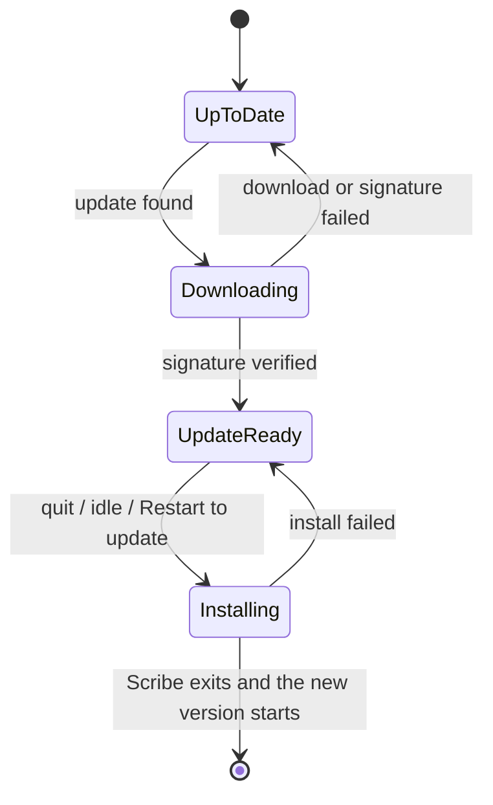
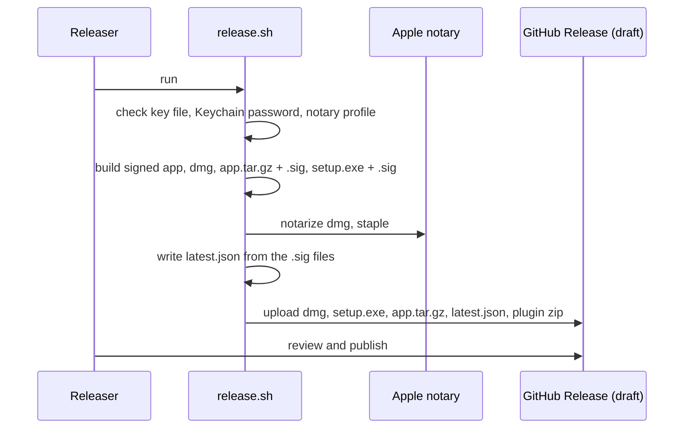
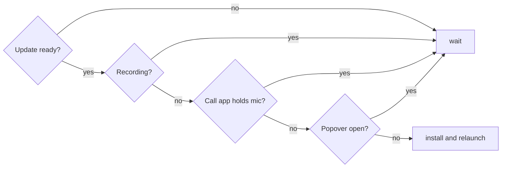
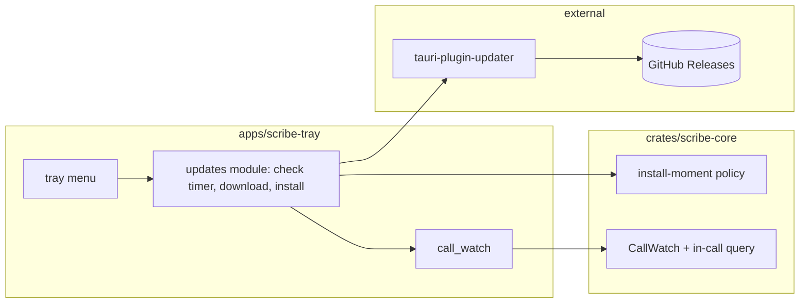

# Spec: Keep Scribe up to date on its own, the way Chrome does, without ever interrupting a call

> Owned by: Sapan Parikh  ·  Started: 2026-10-22  ·  Last revised: 2026-10-22  ·  Spec UUID: 72fde7d0-4a8a-48f8-a9ea-28b402819342
> Anthara spec — slice-decomposed, categorically-framed. Feeds /anthara:create-ticket and /anthara:plan-implementer.

---

## At a glance

| | |
|---|---|
| **In one line** | Every published release reaches every installed Scribe on its own: Scribe checks hourly, downloads and verifies the update in the background, and installs it by relaunching itself silently when idle, never during a recording or a call. Quitting and a "Restart to update" item are fallbacks; nobody has to quit to get an update. |
| **Process tier** | full · Risk HIGH (a defective updater can strand installs that can no longer receive the fix; losing the update-signing key ends updates for every installed copy) |
| **Slices** | 5.1 release manifest → 5.2 check and download → 5.3 install on quit → 5.4 Windows sidecar unlock → 5.5 silent install when idle → 5.6 "Restart to update" item |
| **Style** | Hexagonal, as in [§7.2](#72-architectural-style): the install decision is a pure policy in `scribe-core`; the Tauri updater plugin is used only by the app shell |
| **Out of scope** | Update channels, an off switch, delta updates, downgrades, signed Windows builds, updating the Claude plugin |

## 1. Overview & business context

Scribe is a tray app that runs for days. Today a new version reaches it only when its user downloads a `.dmg` or installer from GitHub and reinstalls by hand, so installs drift behind releases [1]. This spec makes Scribe update itself the way Chrome does: it checks for a new release, fetches and verifies it in the background, and swaps versions at a moment nobody notices [1]. Scribe has an advantage Chrome lacks: with the popover closed it has no visible window, so it can relaunch itself while idle without anyone seeing it [1]. The one thing it must never do is install during a recording or a call, because that would lose the meeting it exists to capture [1, 2].

Two prerequisites landed on 2026-10-22: the repository is public, so GitHub Releases can serve update files without a token, and macOS builds are signed with a Developer ID and notarized, which keeps macOS privacy permissions across updates [3, 8]. Sapan is the only user for now, so the first install of an updater-enabled version is a one-time manual step [1].

## 2. Sources

| ID | Type | Contributor | Date | Description |
|---|---|---|---|---|
| 1 | Live spec-writing session with Sapan | Sapan Parikh | 2026-10-22 | Decisions: Tauri updater over Velopack, Sparkle and Omaha; fully silent idle install; no off switch; hourly checks; key in Keychain with a password-manager backup; slice order |
| 2 | Codebase (this repo) | n/a | 2026-10-22 | `apps/scribe-tray/src-tauri/src/{lib,tray,menu_action,call_watch,recording,popover,mcp_config,privacy}.rs`, `src/privacy/PrivacyStatement.tsx`, `crates/scribe-core/src/call/call_watch.rs`, `src-tauri/windows/hooks.nsh`, `scripts/release.sh` |
| 3 | `docs/ARCHITECTURE.md` | Sapan Parikh | 2026-10-22 | Hexagonal style (ADR 1), local releases (ADR 4), Windows unsigned (ADR 5), VC++ runtime hook (ADR 6), Developer ID and notarization (ADR 8) |
| 4 | Public docs (v2.tauri.app/plugin/updater) | Web | 2026-10-22 | Signed updates that cannot be disabled; `latest.json` static format with `OS-ARCH` keys; only newer versions install; Windows `installMode` and app exit during install; `updater:default` permission |
| 5 | Public docs (v2.tauri.app/distribute/windows-installer) | Web | 2026-10-22 | NSIS installs per user by default; `NSIS_HOOK_PREINSTALL` runs before files are copied |
| 6 | Public docs (v2.tauri.app/distribute/sign/macos) | Web | 2026-10-22 | `APPLE_SIGNING_IDENTITY`; notarization credentials |
| 7 | Session verification against github.com | Claude | 2026-10-22 | With the v0.4.1 draft present, `releases/latest` and `releases/latest/download/<asset>` still resolve to v0.4.0, so drafts are invisible to the update URL |
| 8 | Public docs (developer.apple.com TN3127) | Web | 2026-10-22 | Privacy grants follow the designated requirement; ad-hoc signatures change it every build |
| 9 | Org Memory (search: "Scribe auto-update release signing Tauri updater") | Fabric | 2026-10-22 | No prior auto-update decisions; one outdated note that Scribe's macOS builds are ad-hoc signed |

## 3. Type ontology

### 3.1 Kinds of users
- **Scribe user** — the person running the tray app on macOS or Windows; never asked anything about updates [1].
- **Releaser** — the person who runs `scripts/release.sh` on the release Mac and publishes the draft GitHub Release; the only holder of the update-signing key [1, 3].

### 3.2 Kinds of data
- **Update-signing key pair** — the private key (password protected, in `~/.tauri` on the release Mac, password in the macOS Keychain, both backed up in the releaser's password manager) and its public key (embedded in every build) [1, 4].
- **Update archive** — the per-platform file the updater installs: `Scribe.app.tar.gz` on macOS, the NSIS `-setup.exe` on Windows, each with a detached signature [4].
- **Update manifest** — `latest.json` attached to a GitHub Release: version, notes, publish date and, per platform key (`darwin-aarch64`, `windows-x86_64`), the archive URL and its signature [4].
- **Staged update** — a downloaded archive whose signature has verified and that waits in memory for an install moment [4].

None of these is user data. No audio, transcript, screenshot or identifier ever enters them.

### 3.3 Kinds of events
- **Update check** — at launch and every hour after; one HTTPS GET of the manifest [1].
- **Update found** — the manifest names a version newer than the running one [4].
- **Update staged** — the archive downloaded and its signature verified.
- **Install moment** — Scribe quits, Scribe becomes idle with an update staged, or the user picks "Restart to update".
- **Update installed** — the new version replaced the old one and Scribe relaunched (idle or restart item) or stayed closed (quit).

### 3.4 Kinds of states
- **Up to date** — the last check found nothing newer, or no check has completed.
- **Downloading** — an update was found and its archive is being fetched.
- **Update ready** — an update is staged and waits for an install moment.
- **Installing** — the archive is being applied; Scribe exits as part of it.



## 4. Invariants

**4.1 Never interrupt a meeting** — Scribe never installs or relaunches for an update while it is recording or while a call app holds the microphone; an update that becomes ready during either waits. Sources: [1, 2].

**4.2 Only signed updates install** — an archive installs only when its signature verifies against the public key built into the running version; anything else is discarded. Sources: [4].

**4.3 Only published releases reach users** — the update URL is `https://github.com/incubyte/scribe/releases/latest/download/latest.json`, which never resolves to a draft, so publishing the draft is the release decision. Sources: [7].

**4.4 Updates only move forward** — Scribe installs only a version newer than the one running; a bad release is fixed by publishing a higher version, never by a downgrade. Sources: [4].

**4.5 The updater can always fetch its own fix** — update checks start before, and do not depend on, the recorder, speech-model setup, screenshots or call watching, so a release with a defect elsewhere still receives the next release. Sources: [1, 2].

**4.6 Update traffic carries no user data** — checks and downloads are plain HTTPS GETs of public GitHub URLs with no query parameters, headers or bodies that describe the user, their calls or their files; the in-app statement "Nothing — audio or text — is sent to any server" stays true. Sources: [1, 2].

**4.7 Builds without the private key still work** — local `tauri dev`, `tauri build` by teammates and CI never need the update-signing private key; only `scripts/release.sh` produces signed update archives. Sources: [1, 3].

## 5. Slices

### 5.1 Publish a signed update manifest with every release

When the releaser runs `scripts/release.sh`, the draft GitHub Release now carries, alongside the `.dmg`, installer and plugin zip, a `Scribe.app.tar.gz`, the Windows installer's signature and a `latest.json` that points at both. The script signs the archives with the update-signing private key, reading its password from the Keychain, and stops before building when the key or password is missing. Nothing reaches users until the releaser publishes the draft.

- **Touches types:** Update-signing key pair, Update archive, Update manifest, Releaser.
- **Preserves invariants:** [4.2](#4-invariants), [4.3](#4-invariants), [4.7](#4-invariants).
- **Affected modules:** `scripts/release.sh`, `apps/scribe-tray/src-tauri/tauri.conf.json` (public key and endpoint), a release-only Tauri config overlay, `docs/ARCHITECTURE.md`, `CLAUDE.md`.
- **Active packs:** Security, Incubyte Engineering Standards.
- **Reachability:** `root → scripts/release.sh`.



**Acceptance criteria**

- [ ] **5.1.1** A release run uploads `Scribe_<version>_aarch64.app.tar.gz` (or Tauri's equivalent macOS updater archive name) and `latest.json` to the draft release, next to the existing assets.
- [ ] **5.1.2** `latest.json` has `version` equal to `tauri.conf.json`'s version, and `platforms.darwin-aarch64` and `platforms.windows-x86_64`, each with a `url` that downloads the matching asset of that release and a `signature` equal to the contents of the matching `.sig` file.
- [x] **5.1.3** Each archive's signature verifies against the public key in `tauri.conf.json`, checked by the script before upload.
- [ ] **5.1.4** The macOS app inside the updater archive is the same signed build that was notarized in the `.dmg`, and Gatekeeper reports it as "Notarized Developer ID" when the script checks it after extracting.
- [x] **5.1.5** When the key file is missing, or the Keychain has no password for it, the script stops before building and names what to set up, the same way it does for the notary profile.
- [x] **5.1.6** `npm run tauri build` without the private key in the environment still produces a working bundle (invariant 4.7), and CI stays green.
- [x] **5.1.7** The private key, its password and the `.sig` contents are never written to the repository or printed in full to the terminal.
- [x] **5.1.8** An ADR in `docs/ARCHITECTURE.md` records the updater choice, the key's location and backup, and that losing the key ends updates for existing installs; `CLAUDE.md`'s Releasing section lists the key as a prerequisite.

**Verification (slice complete when these pass):**

1. **Tests.** Run the full test suite — all tests green. Tests broken by this slice's changes get fixed inside this slice, not deferred.
2. **Release dry run.** Run the release script for a throwaway version against a draft, confirm the assets and `latest.json` shape in the draft, then delete that draft and its tag.

### 5.2 Scribe checks for updates hourly and downloads a verified update in the background

Once a user is on an updater-enabled version, Scribe checks the manifest at launch and every hour. When a newer version is listed, it downloads that platform's archive in the background and verifies its signature; the update is then ready and waits. The user sees and is asked nothing. Failures are logged and retried at the next check. The README's network statement now says Scribe also checks GitHub for updates.

- **Touches types:** Update manifest, Update archive, Staged update, Update check, Update found, Update staged, Up to date, Downloading, Update ready.
- **Preserves invariants:** [4.2](#4-invariants), [4.4](#4-invariants), [4.5](#4-invariants), [4.6](#4-invariants).
- **Affected modules:** `apps/scribe-tray/src-tauri/src/lib.rs` (plugin and start order), a new updates module in the app shell, `apps/scribe-tray/src-tauri/Cargo.toml`, `README.md`.
- **Active packs:** Security, Clean Code.
- **Reachability:** `root → Scribe launch`.

**Acceptance criteria**

- [ ] **5.2.1** Within a minute of launch, and then every hour while Scribe runs, Scribe requests the manifest from the URL in [invariant 4.3](#4-invariants).
- [ ] **5.2.2** When the manifest lists a newer version, Scribe downloads that platform's archive and verifies it; afterwards it is in the Update ready state and logs the version.
- [ ] **5.2.3** When the manifest lists the running version or an older one, nothing is downloaded.
- [ ] **5.2.4** When the network is down, the manifest returns 404 or is malformed, or a download is cut off, Scribe logs one line with the reason, keeps running as before and tries again at the next hourly check.
- [ ] **5.2.5** When an archive's signature does not verify, it is discarded, the failure is logged as an error naming the version, and nothing installs.
- [x] **5.2.6** While an update is Downloading or Update ready, later checks do not start a second download of the same version.
- [x] **5.2.7** Update checks start in `start_scribe` before the recorder, screenshots and call watching, and a failure in any of those does not stop the checks (invariant 4.5).
- [x] **5.2.8** The requests carry no query parameters or custom headers, and the popover's webview has no updater permission; only the Rust shell can check, download or install.
- [x] **5.2.9** The README's sentence that the speech-model download is the only network traffic now also names the hourly update check to GitHub and says it sends nothing about the user or their calls.

**Verification (slice complete when these pass):**

1. **Tests.** Run the full test suite — all tests green.
2. **Manual check.** Run a build older than a published release, watch the log show the check, the download and Update ready, and confirm with a proxy or packet capture that only GitHub hosts are contacted.

### 5.3 Quitting Scribe installs a downloaded update

Quitting is a fallback install moment, not the main one: the main one is Scribe relaunching itself silently when idle, after which nobody needs to quit to update. Install on quit is built first because it is the simplest install moment, so it proves the install path before Scribe ever relaunches itself. With an update ready, choosing **Quit Scribe** from the tray menu installs it before Scribe exits; the next time Scribe starts, it is the new version. With no update ready, quitting behaves exactly as today.

- **Touches types:** Staged update, Install moment, Installing, Update installed.
- **Preserves invariants:** [4.1](#4-invariants), [4.2](#4-invariants).
- **Affected modules:** `apps/scribe-tray/src-tauri/src/tray.rs` (quit), the updates module.
- **Active packs:** Clean Code.
- **Reachability:** `Scribe launch (5.2) → "Quit Scribe" tray item`.

**Acceptance criteria**

- [ ] **5.3.1** With an update ready on macOS, Quit Scribe replaces the installed `Scribe.app` with the new version and exits; launching Scribe afterwards runs the new version with its Microphone, System Audio Recording and Screen Recording grants intact.
- [ ] **5.3.2** With an update ready on Windows, Quit Scribe runs the installer in `quiet` mode, with no UAC prompt and no installer window, and Scribe exits; the next launch runs the new version.
- [x] **5.3.3** Quitting while recording stops and saves the recording exactly as today before any install starts.
- [ ] **5.3.4** When the install fails, Scribe still exits, the old version stays usable, the failure is logged, and the next run downloads the update again.
- [x] **5.3.5** With no update ready, Quit Scribe exits immediately as today.

**Verification (slice complete when these pass):**

1. **Tests.** Run the full test suite — all tests green.
2. **Manual check.** On macOS, install an older signed build, publish a newer one, wait for Update ready, quit, relaunch, confirm the version and that recording works without a new permission prompt.

### 5.4 The Windows installer stops a running scribe-mcp so updates complete

Claude Desktop and Claude Code run `scribe-mcp.exe` straight from Scribe's install folder, and Windows refuses to overwrite a running program. Before copying files, the installer stops any `scribe-mcp.exe` running from that folder, so an update (or a manual reinstall) always completes. Claude starts the server again the next time it needs Scribe's tools.

- **Touches types:** Update archive, Installing.
- **Preserves invariants:** [4.1](#4-invariants).
- **Affected modules:** `apps/scribe-tray/src-tauri/windows/hooks.nsh`.
- **Active packs:** Clean Code.
- **Reachability:** `"Quit Scribe" tray item (5.3) → Windows installer pre-install step`.

**Acceptance criteria**

- [ ] **5.4.1** With Claude Desktop connected and `scribe-mcp.exe` running, an update installed on quit finishes, and the install folder holds the new `scribe-mcp.exe`.
- [ ] **5.4.2** Only `scribe-mcp.exe` processes started from Scribe's install folder are stopped; nothing else is touched.
- [ ] **5.4.3** When no `scribe-mcp.exe` is running, the installer behaves as today, including the Visual C++ runtime step from ADR 6.
- [ ] **5.4.4** After the update, Claude Desktop lists Scribe's five tools again, either on its own or after Claude restarts; which of the two it is gets recorded in the README.

**Verification (slice complete when these pass):**

1. **Tests.** Run the full test suite — all tests green.
2. **Manual check.** On a real Windows PC with Claude Desktop connected, run an update and confirm 5.4.1 and 5.4.4.

### 5.5 Scribe installs and relaunches silently when idle

With an update ready, Scribe installs it and relaunches itself as soon as it is idle: not recording, no call app holding the microphone, and the popover closed. Nothing is shown before or after. If a recording or call starts while an update is ready, it waits until that ends and Scribe is idle again.

- **Touches types:** Staged update, Install moment, Installing, Update installed.
- **Preserves invariants:** [4.1](#4-invariants), [4.2](#4-invariants).
- **Affected modules:** `crates/scribe-core` (a pure install-moment policy and an in-call query on `CallWatch`), `apps/scribe-tray/src-tauri/src/call_watch.rs`, the updates module, `popover.rs`.
- **Active packs:** Clean Code.
- **Reachability:** `Scribe launch (5.2) → idle install`.



**Acceptance criteria**

- [ ] **5.5.1** With an update ready and Scribe idle, it installs and relaunches within two minutes, shows no window or notification, and comes back with the tray icon in its normal state.
- [ ] **5.5.2** While recording, no install starts; once the recording stops and Scribe is otherwise idle, the install follows within two minutes.
- [ ] **5.5.3** While a call app holds the microphone, including the 30-second grace after it lets go, no install starts, even when Scribe is not recording.
- [ ] **5.5.4** While the popover is open, no install starts.
- [ ] **5.5.5** An install that fails leaves Scribe running the old version with the update still ready, and is retried at most once per hourly check.
- [ ] **5.5.6** The decision "install now or wait" is a pure function of recorder state, call state, popover visibility and update readiness, with tests named in business language for each waiting reason and for the install case.

**Verification (slice complete when these pass):**

1. **Tests.** Run the full test suite — all tests green.
2. **Manual check.** With an update ready, start a recording and confirm nothing happens; stop it with the popover closed and confirm Scribe relaunches as the new version.

### 5.6 Show "Restart to update" while an update waits

While an update is ready, the tray menu shows **Restart to update** above **Quit Scribe**. Choosing it installs and relaunches straight away, unless Scribe is recording, in which case the item is disabled. The item disappears once the new version runs.

- **Touches types:** Update ready, Install moment.
- **Preserves invariants:** [4.1](#4-invariants).
- **Affected modules:** `apps/scribe-tray/src-tauri/src/tray.rs`, `menu_action.rs`, the updates module.
- **Active packs:** Clean Code.
- **Reachability:** `Scribe launch (5.2) → "Restart to update" tray item`.

```
┌────────────────────────────┐
│ Start recording            │
│ ────────────────────────── │
│ Open transcripts folder    │
│ Copy MCP config            │
│ Connect to Claude Desktop  │
│ Privacy                    │
│ Restart to update          │  ← only while an update is ready
│ Quit Scribe                │
└────────────────────────────┘
```

**Acceptance criteria**

- [ ] **5.6.1** The item is absent while Scribe is Up to date or Downloading, and appears within a few seconds of Update ready.
- [ ] **5.6.2** Choosing it installs and relaunches; Scribe comes back as the new version without the item.
- [ ] **5.6.3** While recording, the item is shown disabled.
- [ ] **5.6.4** The item works the same on macOS and Windows.

**Verification (slice complete when these pass):**

1. **Tests.** Run the full test suite — all tests green.
2. **Manual check.** With an update ready and the popover open (so the idle install waits), open the tray menu, choose the item and confirm the relaunch.

## 6. NFRs & regulatory compliance

No regulated pack applies: no regulated data is touched.

### 6.1 Security

**6.1.1 Updates are authenticated end to end** — every archive is signature-checked against the embedded public key before install, and the manifest and archives are fetched over HTTPS only (`dangerousInsecureTransportProtocol` stays off). Derived from: Security pack, fail fast at boundaries. Slices: 5.1, 5.2.

**6.1.2 Least privilege for the updater** — only the Rust shell holds the updater; the webview gets no `updater:*` permission. Derived from: Security pack. Slice: 5.2.

**6.1.3 Secrets stay out of the repository and logs** — the private key, its password and the Apple credentials live only in the release Mac's Keychain and the releaser's password manager. Derived from: Security pack. Slice: 5.1.

**6.1.4 The key is recoverable** — a copy of the key file and its password sits in the releaser's password manager, because losing the key ends updates for every existing install. Derived from: session decision [1]. Slice: 5.1.

### 6.2 Clean Code and Incubyte Engineering Standards

**6.2.1** The install-moment policy lives in `scribe-core` as a pure function and is unit-tested; the app shell only wires the plugin and state into it. Derived from: separation of concerns, dependency direction. Slice: 5.5.

**6.2.2** Functions stay under 20 lines with cyclomatic complexity of at most 5; tests are named in business language. Derived from: small functions, complexity limit, test naming. All slices.

**6.2.3** Commits follow Conventional Commits. Derived from: Incubyte Engineering Standards. All slices.

### 6.3 Reliability

**6.3.1** Update failures never crash Scribe or block a recording; each failure is a single log line and a retry at the next hourly check. Slices: 5.2, 5.3, 5.5.

**6.3.2** Checks cost one small request an hour; downloads happen once per release. Slice: 5.2.

### 6.4 Control coverage matrix

| Control | Pack | Slices | Evidence committed |
|---|---|---|---|
| Signed updates only | Security | 5.1, 5.2 | AC 5.1.3, 5.2.5 |
| HTTPS only, no user data sent | Security | 5.2 | AC 5.2.8, 5.2.9 |
| No secrets in repo | Security | 5.1 | AC 5.1.7 |
| Pure, tested install policy | Clean Code | 5.5 | AC 5.5.6 |

## 7. Architecture

### 7.1 Tech stack

| Layer | Choice | Rationale |
|---|---|---|
| Updater | `tauri-plugin-updater` (Tauri 2) | Already in the stack; signed updates are mandatory; works with the existing `.app` and NSIS builds [4]. Velopack, Sparkle with WinSparkle, and Omaha were rejected for scope [1]. |
| Hosting | GitHub Releases on the public repo | `releases/latest/download/latest.json` is stable, needs no token and ignores drafts [7]. |
| Windows install mode | NSIS per user, updater `quiet` | Per user is Tauri's default, so `quiet` installs with no UAC prompt [4, 5]. |
| Release tooling | `scripts/release.sh` on the release Mac | Keeps ADR 4; the update key joins the Developer ID and notary profile in the Keychain [3]. |

### 7.2 Architectural style

**Style:** *hexagonal*, inherited from ADR 1 [3].

**Why this style here:** the only non-trivial logic in this feature is deciding when it is safe to install, which depends on recorder state, call state, popover visibility and update readiness. That decision belongs in the core as a pure policy so it can be tested without Tauri; the plugin, the menu and the timers are edges that live in the app shell.

**Dependency direction:** `apps/scribe-tray` depends on `scribe-core`; `scribe-core` knows nothing of Tauri or the updater plugin.

**Anti-patterns the style forbids:** the updater plugin imported anywhere but the app shell; install decisions made inline in event handlers instead of through the policy; the frontend triggering installs.

### 7.3 Module decomposition



| Module | Responsibility | Depends on |
|---|---|---|
| `crates/scribe-core` install-moment policy | Decides install now or wait | nothing |
| `crates/scribe-core` `CallWatch` | Adds a query for "a call is in progress" | nothing |
| `apps/scribe-tray` updates module | Hourly checks, download, staged update, install and relaunch | policy, plugin, recording, call watch, popover |
| `apps/scribe-tray` tray | Install on quit, "Restart to update" item | updates module |
| `scripts/release.sh` | Signs archives, writes and uploads `latest.json` | Keychain, Tauri CLI, `gh` |

### 7.4 Threat model seed

- **Forged update** — an attacker serving a different archive (compromised GitHub account, DNS or TLS interception) is stopped by the signature check, so the private key is the real trust root. Keeping it off the repository and CI is the main defence.
- **Compromised release Mac** — the key, Developer ID and notary credentials share one machine; this is accepted while there is a single releaser and recorded in the ADR.
- **Malicious manifest pointing elsewhere** — the archive URL can name any host, but the signature still has to verify, so an unexpected host fails closed.

## 8. Codebase impact map

| Module | Slices that touch it | Likely change shape |
|---|---|---|
| `scripts/release.sh` | 5.1 | Key checks, updater artifacts, `latest.json`, signature and Gatekeeper checks, upload |
| `apps/scribe-tray/src-tauri/tauri.conf.json` + release-only overlay | 5.1 | Updater public key and endpoint; updater artifacts only in the overlay |
| `apps/scribe-tray/src-tauri/src/lib.rs` | 5.2 | Register the plugin; start update checks first in `start_scribe` |
| `apps/scribe-tray/src-tauri/src/` updates module (new) | 5.2, 5.3, 5.5, 5.6 | Check timer, staged update, install and relaunch |
| `apps/scribe-tray/src-tauri/src/tray.rs`, `menu_action.rs` | 5.3, 5.6 | Install on quit; new menu item |
| `apps/scribe-tray/src-tauri/src/call_watch.rs` | 5.5 | Share in-call state with the updates module |
| `crates/scribe-core/src/call/call_watch.rs` | 5.5 | In-call query |
| `crates/scribe-core` (new update policy) | 5.5 | Pure install-moment policy and tests |
| `apps/scribe-tray/src-tauri/windows/hooks.nsh` | 5.4 | Pre-install step that stops `scribe-mcp.exe` |
| `README.md`, `docs/ARCHITECTURE.md`, `CLAUDE.md` | 5.1, 5.2, 5.4 | Network statement, ADR, release prerequisites |

## 9. Open questions

**9.1 Does Claude Desktop restart a stopped `scribe-mcp` server on its own?** Decides the README wording in AC 5.4.4. Awaiting: a test on real Windows hardware, which ADR 6 also still needs.

**9.2 Does `tauri build` fail or skip signing when `createUpdaterArtifacts` is on and no private key is set?** Tauri's docs do not say [4]. The release-only overlay in 5.1 avoids depending on the answer; the planner should confirm it with a build at the start of 5.1.

**9.3 Moving to an Incubyte Apple account.** Changing the signing identity resets macOS permissions once for every install (ADR 8). Awaiting: Incubyte account owners.

**9.4 The Windows release fallback.** `.github/workflows/release.yml` does not have the update key, so a release built there would have no Windows `latest.json` entry. Out of scope while releases are built locally; awaiting a decision if CI releases come back.

---

## Changelog

- 2026-10-22 — Sapan Parikh with Claude — Initial spec from the auto-update research and spec-writing session [1].
- 2026-10-23 — Sapan Parikh with Claude — Made clear that idle install is the main update path and quitting is a fallback.
