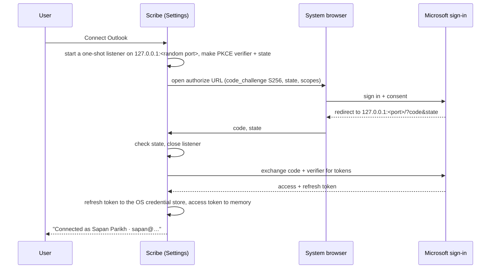
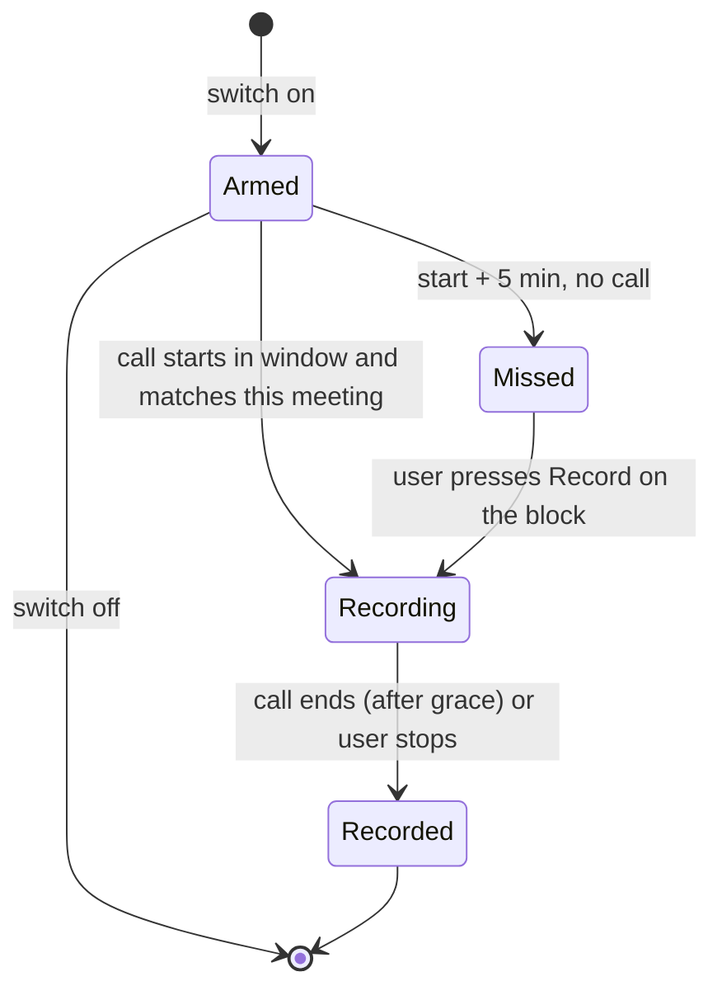
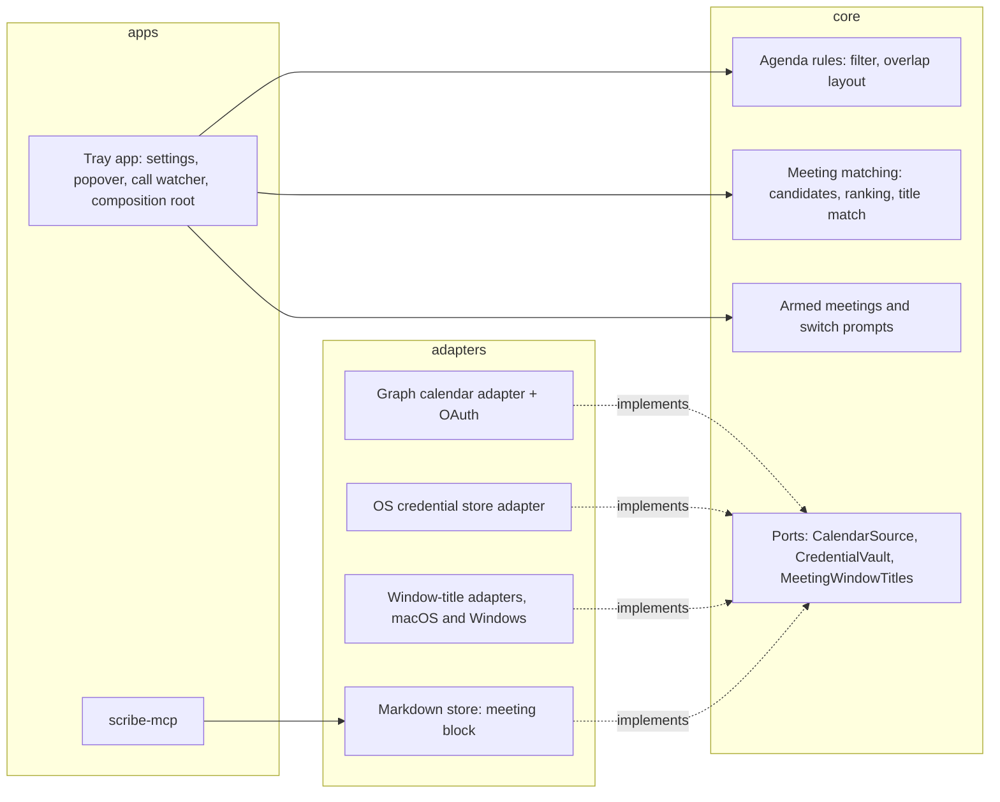

# Spec: Link Scribe to the user's Outlook calendar so each recording knows which meeting it belongs to

> Owned by: Sapan Parikh  ·  Started: 2026-10-25  ·  Last revised: 2026-10-25  ·  Spec UUID: 39fbd1fa-158e-4b57-8678-588067443927
> Anthara spec — slice-decomposed, categorically-framed. Feeds /anthara:create-ticket and /anthara:plan-implementer.

---

## At a glance

| | |
|---|---|
| **In one line** | After signing in with a work Outlook account, the popover shows today's meetings, each transcript records which meeting it was and who was invited, and a switch per meeting records its Teams call automatically. |
| **Slices** | 7, built in the order listed in [§5](#5-slices) |
| **Architectural style** | Hexagonal, inherited from `docs/ARCHITECTURE.md`, see [§7.2](#72-architectural-style) |
| **Active packs** | Org-wide engineering standards (Clean Code · Incubyte Engineering Standards · Design Standards with WCAG 2.2 AA); no regulated packs |
| **Open questions** | 4. The one that matters most: whether Incubyte's and client tenants let users consent to `Calendars.ReadBasic` ([§8.1](#8-open-questions)) |

## 1. Overview & business context

**The problem.** Scribe records calls locally and knows only that "a Teams call started". It does not know which meeting the call is, so every transcript gets a date-based title and no attendee list, and Claude has to guess who was in the room [3, 5]. The user also has to remember to press Record for the meetings they care about [5].

**Who it is for.** A [Scribe user](#31-kinds-of-users) who lives in Outlook and Teams. They want the popover to show the day's meetings, want transcripts to carry the meeting's name and invitees, and want chosen meetings to record without touching Scribe [5].

**What this spec commits to.**
- A one-account Outlook sign-in in Settings.
- A time-grid of today's meetings that replaces "Recent sessions" while the user is signed in.
- Matching of each call to the meeting it belongs to: anchored on when the call started, sharpened by the Teams window title, and confirmed by the user when it is ambiguous.
- An optional `meeting` block in the transcript's front matter.
- A per-meeting auto-record switch whose state lives in `settings.json`.

**Deliberately out of scope.** Personal Microsoft accounts, several accounts at once, Google Calendar, meetings outside Teams (Zoom, Meet, in-person), days other than today, and writing anything back to Outlook. See [§9](#9-deferred-follow-ups-and-accepted-limits).

## 2. Sources

| ID | Type | Contributor | Date | Description |
|---|---|---|---|---|
| 1 | Public docs (learn.microsoft.com/graph/api/user-list-calendarview) | Web | 2026-10-25 | `GET /me/calendarView?startDateTime&endDateTime` returns occurrences, exceptions and single instances. The least-privileged delegated permission is `Calendars.ReadBasic`; times come back in UTC unless `Prefer: outlook.timezone` is sent |
| 2 | Public docs (learn.microsoft.com/entra/identity-platform/reply-url) | Web | 2026-10-25 | Desktop public clients may use a loopback redirect. The port is ignored for matching, `127.0.0.1` is preferred over `localhost`, and an `http` loopback URI must be added through the app manifest |
| 3 | Codebase (this repo) | n/a | 2026-10-25 | `CallWatch` + `CALL_END_GRACE` (30 s) in the core call module. Tray `call_watch.rs` opens the popover on a call start unless recording. `store-markdown` `format.rs` front-matter contract. `settings_file.rs` (`settings.json`). `RecentSessions.tsx`. Popover is 360×440. Notification buttons exist only on Windows (`notifications.rs`). ARCHITECTURE §5 privacy rule and ADRs 1–9 |
| 4 | Public forum (developer.apple.com/forums/thread/839069) | Web | 2026-10-25 | On macOS, `kCGWindowName` (another app's window title) is filled only when the reading app holds Screen Recording permission. Without it, the call succeeds with titles left blank |
| 5 | Live spec-writing session with Sapan Parikh | Sapan Parikh | 2026-10-25 | Feasibility review and decisions: Graph OAuth, work/school accounts only, one account, time-grid layout, recents removed when signed in, window-title matching, auto-record on call detection, notify on a missed armed meeting, ask before switching meetings, stop on call end |
| 6 | Org Memory (search: "Scribe calendar Outlook meeting call detection Teams popover") | Fabric | 2026-10-25 | Prior art: your-steno-desktop listed upcoming meetings through a server-side calendar function. Scribe has no server, so Scribe fetches directly from the desktop |
| 7 | `docs/specs/004-auto-stop-on-silence-context.md`, `docs/specs/006-teams-call-auto-open-context.md` | Codebase | 2026-10-25 | Auto-stop after 5 minutes of quiet. The Teams call latch (rising edge, grace period, probe errors are not a release) and the popover opening without toggling |

## 3. Type ontology

### 3.1 Kinds of users

- **Scribe user (signed out)**: uses Scribe exactly as today, with Recent sessions in the popover [3].
- **Scribe user (connected)**: has linked one work or school Microsoft account. The popover shows today's meetings instead of Recent sessions [5].

### 3.2 Kinds of data

- **Outlook connection**: the one linked account: display name, email, tenant, and a refresh token held only in the OS credential store (macOS Keychain, Windows Credential Manager) [1, 2, 5].
- **Access token**: a short-lived Graph bearer token. It lives in memory only and is re-obtained from the refresh token [2].
- **Meeting**: Scribe's read-only view of one Graph event occurrence today: event id, subject, start, end, organizer, attendees, a Teams-meeting flag, a recurring flag, the user's response, and show-as [1].
- **Today's agenda**: the meetings from local midnight to midnight that qualify for display. Not all-day, not cancelled, not declined by the user, and show-as not `free` [1, 5].
- **Call**: the existing `CallWatch` latch, plus the instant it rose ("call start"). A call ends when the mic has been released for `CALL_END_GRACE` [3, 7].
- **Match anchor**: the instant a transcript is matched against: the call start if a call is in progress when recording starts, otherwise the recording start [5].
- **Teams window title**: the title of a visible window owned by the Teams process. When Scribe can read it, it often contains the meeting subject [4, 5].
- **Meeting candidate**: a meeting in today's agenda whose window, from 10 minutes before its start to its end, contains the match anchor [5].
- **Meeting link**: the optional `meeting` block in a transcript's front matter [3, 5]. Indicative shape (a contract, not code):

  ```yaml
  meeting:
    event_id: "AAMkAD…"
    subject: "DXC Review"
    starts_at: 2026-10-26T11:00:00+05:30
    ends_at: 2026-10-26T11:45:00+05:30
    organizer: { name: "Sneha Rao", email: "sneha@example.com" }
    attendees:
      - { name: "Sapan Parikh", email: "sapan@example.com" }
    attendee_count: 12
  ```

- **Armed meetings**: the event ids the user switched on for auto-record, each with its date, stored under one key in `settings.json` [3, 5].

### 3.3 Kinds of events

- **Signed in / signed out**: the user completes or removes the Outlook connection in Settings [5].
- **Reconnect needed**: refreshing the token fails because consent was revoked, the password changed or the token expired [2].
- **Agenda refreshed**: a successful `calendarView` fetch. It fires on sign-in, every 5 minutes, on wake and when the popover opens [1, 5].
- **Call started / call ended**: the existing `CallWatch` rising edge, and the moment the mic has been released for longer than the grace [3].
- **Meeting started**: the clock reaches a meeting's start time [5].
- **Teams title changed**: a Teams window title now matches a different meeting's subject [4, 5].

### 3.4 Kinds of states

- **Connection**: `Disconnected` · `Connecting` · `Connected` · `ReconnectNeeded` [5].
- **Match**: `Matched` (one meeting chosen, by the user or by a clear winner) · `Ambiguous` (two or more candidates, none clearly first) · `Unmatched` (no candidates) [5].
- **Armed meeting**: `Armed` · `Recording` · `Recorded` · `Missed` (5 minutes past start with no call detected) [5].

## 4. Invariants

**4.1 Signed-out Scribe is unchanged.** With no Outlook connection, the popover, call detection, recording and front matter behave exactly as they did before this spec. Sources: [3, 5].

**4.2 Scribe only reads the calendar.** Scribe requests `Calendars.ReadBasic` and `offline_access` (plus the OpenID scopes sign-in needs), and never sends a write to Graph. Sources: [1, 5].

**4.3 Tokens never leave the credential store or memory.** The refresh token lives only in the OS credential store and the access token only in memory. Neither, nor any meeting subject or attendee, is ever written to a log or to `settings.json`. Sources: [3].

**4.4 Calendar trouble never blocks recording.** If Graph is unreachable, the token is invalid or matching fails, Scribe still records and saves the transcript, without a `meeting` block. Sources: [3, 5].

**4.5 A transcript links to at most one meeting, chosen by its match anchor.** The wall-clock time when the link is written never decides the meeting. A call that runs over stays with the meeting it started in. Sources: [5].

**4.6 Old transcripts still parse.** The `meeting` block is optional. Files without it parse as before, and `scribe-mcp` keeps reading both. Sources: [3].

**4.7 Scribe never records on its own without a detected Teams call.** Every automatic start shows a notification naming the meeting. Sources: [5].

**4.8 A recording is split into a new transcript only when the user says so.** Sources: [5].

**4.9 Armed state is local, per day, and self-cleaning.** It lives only in `settings.json`, keyed by event id and date, and entries from previous days are pruned on the first read each day. Sources: [3, 5].

## 5. Slices

| # | Slice | What the user can do once it lands | Entry | Reached from |
|---|---|---|---|---|
| 5.1 | Connect an Outlook work account | Sign in to and out of one work account from Settings | "Connect Outlook" control in Settings | `root` |
| 5.2 | See today's meetings in the popover | See a time-grid of today's meetings in place of Recent sessions | Today agenda in the popover | "Connect Outlook" control in Settings (5.1) |
| 5.3 | Save the meeting's name and invitees with each transcript | Find the meeting subject, organizer and attendees in the transcript and through the MCP server | Transcript front matter `meeting` block | `root` (the popover's Record button)<br>Today agenda in the popover (5.2) |
| 5.4 | Recognise the meeting from the Teams window title | Get the right meeting when meetings overlap, provided Screen Recording access is granted | Teams-title signal in matching | Transcript front matter `meeting` block (5.3) |
| 5.5 | Confirm or correct the meeting when a call starts | See which meeting a starting call is, pick between candidates, and change it until the recording stops | Meeting line in the call-start popover | `root` (the call-start popover)<br>Transcript front matter `meeting` block (5.3) |
| 5.6 | Arm a meeting to record by itself | Switch a meeting on; its Teams call records and stops by itself, and a missed meeting is reported | Auto-record switch on an agenda block | Today agenda in the popover (5.2) |
| 5.7 | Switch to the next meeting without leaving the call | When the next meeting is armed or the Teams title moves to it, choose to finish the current transcript and start the next | "Switch to <meeting>?" prompt in the popover | Meeting line in the call-start popover (5.5) |

Effort and risk: 5.1 is large and high risk (OAuth, tenant consent, credential store on two OSes). 5.2 is medium/medium (time-grid layout in 360×440). 5.3 is medium/medium (front-matter contract). 5.4 is small but high risk (title formats unverified, permission-gated). 5.5–5.7 are medium/medium. The highest-risk slice already comes first, so the order surfaces failures early.

### 5.1 Connect an Outlook work account

Settings gains an "Outlook calendar" row. Signed out, it shows a **Connect Outlook** button. Pressing it opens the system browser on Microsoft's sign-in page. After sign-in and consent, the browser shows "You can close this tab", and Settings shows the account's name and email with a **Disconnect** button. If Microsoft refuses, because an admin must approve the app or the user cancels, Settings explains in one line and stays signed out.

*Types: Outlook connection, Access token · Invariants: [4.1](#4-invariants), [4.2](#4-invariants), [4.3](#4-invariants).*



**Acceptance criteria**

- [x] **5.1.1** Signed out, Settings shows "Connect Outlook". After a successful sign-in it shows the account's display name and email, and a "Disconnect" button.
- [x] **5.1.2** Sign-in uses the authorization-code flow with PKCE (S256) and a random `state`. A redirect whose `state` doesn't match is rejected, and the connection stays `Disconnected`.
- [x] **5.1.3** The redirect listener binds to `127.0.0.1` only, accepts one request, and closes after that request or after 5 minutes, whichever comes first.
- [x] **5.1.4** The requested scopes are exactly `openid profile offline_access Calendars.ReadBasic`, and sign-in accepts work and school accounts only.
- [x] **5.1.5** The refresh token is stored in the macOS Keychain or Windows Credential Manager under the Scribe service name. It never appears in `settings.json`, the logs or the webview.
- [x] **5.1.6** After restarting Scribe, the connection is still `Connected` without a new sign-in.
- [x] **5.1.7** "Disconnect" deletes the stored token, returns Settings to "Connect Outlook", and the popover shows Recent sessions again.
- [x] **5.1.8** When Microsoft returns an error such as admin approval required, consent declined or a cancelled sign-in, Settings shows "Outlook didn't connect: <reason in plain words>" and stays `Disconnected`.
- [x] **5.1.9** If a token refresh is refused, the connection becomes `ReconnectNeeded`, and Settings shows "Reconnect Outlook". Recording is unaffected ([4.4](#4-invariants)).
- [x] **5.1.10** The Connect button, account text and Disconnect button are keyboard-operable, have accessible names, and meet 4.5:1 contrast in light and dark themes.
- [x] **5.1.11** The privacy statement and ARCHITECTURE §5 name the two new destinations, `login.microsoftonline.com` and `graph.microsoft.com`, and what is fetched from each.

### 5.2 See today's meetings in the popover

While connected, the popover replaces Recent sessions with **Today**, a scrollable time-grid. It has an hour column on the left and meeting blocks sized by duration. Overlapping meetings sit side by side. Each block shows the subject, a "Teams" tag when it is a Teams meeting, and a recurring icon. A red "now" line crosses the grid, and the grid opens scrolled so "now" sits in its top third. Past meetings are dimmed. Clicking a block does nothing yet.

*Types: Meeting, Today's agenda · Invariants: [4.1](#4-invariants), [4.4](#4-invariants).*

```
┌──────────── 360 ────────────┐
│ ● Ready            ⚙        │
│ [ Record ]                  │
│ Today · Mon 26              │
│      │                      │
│11 AM ├──────────┬───────────│
│      │DXC Revi… │Anthara S… │
│      │Teams ⟳   │Teams ⟳    │
│      │          │           │
│12 PM ├──────────┴───────────│
│ ─────┼──── now 12:10 ───────│
│      │All Team Stand Up ⟳   │
│ 1 PM ├──────────────────────│
│      │AMA with Sapan        │
└─────────────────────────────┘
```

**Acceptance criteria**

- [x] **5.2.1** While `Connected`, the popover shows "Today · <weekday> <day>" with today's agenda in place of Recent sessions. While signed out it shows Recent sessions, unchanged ([4.1](#4-invariants)).
- [x] **5.2.2** The agenda contains every occurrence from local midnight to midnight, recurring ones included. It leaves out all-day events, cancelled events, events the user declined, and events shown as `free`.
- [x] **5.2.3** Block top and height follow start and duration on the hour scale, in the computer's time zone. A meeting shorter than 15 minutes is drawn at the 15-minute minimum height.
- [x] **5.2.4** Overlapping meetings share the row width in equal columns. With more than two overlapping, the third and later collapse into a "+N" chip, which lists them when clicked.
- [x] **5.2.5** Each block shows the subject (truncated with an ellipsis, with the full subject in its accessible name), a "Teams" tag for Teams meetings, and a recurring icon for series occurrences.
- [x] **5.2.6** On open, the grid scrolls so the current time sits in its top third, a "now" line marks the current minute, and blocks that have ended are dimmed.
- [x] **5.2.7** The agenda refreshes on sign-in, every 5 minutes, after the computer wakes and each time the popover opens. Changes in Outlook appear within 5 minutes.
- [x] **5.2.8** With no qualifying meetings, Today shows "No meetings today".
- [x] **5.2.9** When a refresh fails, the last fetched agenda stays visible with "Updated <time>". If nothing has been fetched yet, Today shows "Couldn't load your calendar" with a Retry button.
- [x] **5.2.10** Graph requests use `$select` for only the fields in [§3.2 Meeting](#32-kinds-of-data) and never request the event body.
- [x] **5.2.11** The agenda is a list for assistive tech: each block is announced as "<subject>, <start>–<end>", plus "Teams meeting" and "recurring" where they apply. Keyboard focus moves through blocks in time order, and colour is never the only cue for "past".

### 5.3 Save the meeting's name and invitees with each transcript

When a recording starts while connected, Scribe takes the match anchor and finds the meeting candidates. If there is exactly one candidate, or one ranks clearly first, the transcript is linked to it: the title becomes the meeting subject, and the front matter gains a `meeting` block. The link is written when the recording finalises, so any later choice of meeting made before then replaces it. The MCP server returns the meeting block, so Claude knows who was invited.

*Types: Match anchor, Meeting candidate, Meeting link · Invariants: [4.4](#4-invariants), [4.5](#4-invariants), [4.6](#4-invariants).*

Ranking among candidates, highest first:
1. A Teams meeting over a non-Teams meeting.
2. The user's response: organizer or accepted, then tentative, then none.
3. Smallest gap between the meeting start and the match anchor.

A candidate "ranks clearly first" when it beats the next one on rule 1 or rule 2. If only rule 3 separates them, the match is `Ambiguous`.

**Acceptance criteria**

- [ ] **5.3.1** A call that starts at 10:58 for an 11:00–11:30 Teams meeting produces a transcript titled "DXC Review" with a `meeting` block for that event.
- [ ] **5.3.2** A call that started at 11:05 in the 11:00–11:30 meeting and is still recording at 11:40 stays linked to the 11:00 meeting, even though an 11:30 meeting has begun ([4.5](#4-invariants)).
- [ ] **5.3.3** A recording started with no meeting candidates gets no `meeting` block and keeps today's date-based title.
- [ ] **5.3.4** When the match is `Ambiguous`, the transcript keeps the date-based title and gets no `meeting` block, unless the user picks a meeting.
- [ ] **5.3.5** The `meeting` block has `event_id`, `subject`, `starts_at`, `ends_at`, `organizer`, `attendees` and `attendee_count`, and is written as valid YAML. `attendees` lists at most 50 people and `attendee_count` gives the full number.
- [ ] **5.3.6** Transcripts written before this spec, and new transcripts without a `meeting` block, parse unchanged in the tray and in `scribe-mcp` ([4.6](#4-invariants)).
- [ ] **5.3.7** The `scribe-mcp` transcript listing and transcript read include `meeting` (subject, organizer, attendees) when it is present.
- [ ] **5.3.8** If the agenda is stale or empty because Graph is unreachable, recording proceeds and the transcript is saved without a `meeting` block ([4.4](#4-invariants)).
- [ ] **5.3.9** Logs record only that a match happened and its state (`Matched`, `Ambiguous` or `Unmatched`), never the subject, names or emails ([4.3](#4-invariants)).

### 5.4 Recognise the meeting from the Teams window title

When a call starts and Scribe can read window titles, it reads the titles of the Teams process's visible windows. If exactly one candidate's subject appears in a title, that candidate wins outright, ahead of the ranking in [slice 5.3](#53-save-the-meetings-name-and-invitees-with-each-transcript). This settles cases like DXC Review against Anthara Standup. When titles can't be read, Scribe falls back silently to the ranking.

*Types: Teams window title, Meeting candidate · Invariants: [4.4](#4-invariants), [4.5](#4-invariants).*

**Acceptance criteria**

- [ ] **5.4.1** With two overlapping candidates, a Teams window titled "Anthara Standup | Microsoft Teams" links the transcript to Anthara Standup.
- [ ] **5.4.2** Subjects are compared case-insensitively, ignoring surrounding whitespace and Teams' own suffixes. A title that contains two candidates' subjects doesn't decide the match.
- [ ] **5.4.3** On macOS without Screen Recording permission, titles read as blank, matching falls back to the ranking, and no permission prompt or notification appears.
- [ ] **5.4.4** Only windows owned by the Teams process count: the same bundle id and exe rules the call probe already uses. Browser tabs and other apps' titles are never read for matching.
- [ ] **5.4.5** Window titles are read at most once per call start, and on later Teams-title checks only while a call is in progress. They are never stored or logged.

### 5.5 Confirm or correct the meeting when a call starts

The popover that opens when a Teams call starts now shows a meeting line under the status. "DXC Review · 11:00–11:45 ▾" when matched, "Which meeting is this?" when ambiguous, and nothing when unmatched. Opening the line lists the candidates and "Not a calendar meeting". The same line appears in the live view while recording, so the user can correct the meeting until they press Stop.

*Types: Meeting candidate, Meeting link, Match states · Invariants: [4.5](#4-invariants), [4.8](#4-invariants).*

```
┌─────────────────────────────┐
│ ● Teams call detected       │
│ Which meeting is this?    ▾ │
│  ◉ DXC Review   11:00–11:45 │
│  ○ Anthara Standup 11:15–…  │
│  ○ Not a calendar meeting   │
│ [ Record ]                  │
└─────────────────────────────┘
```

**Acceptance criteria**

- [ ] **5.5.1** On call start, while connected and not recording, the popover shows the matched meeting's subject and time range. When the match is `Ambiguous`, it shows "Which meeting is this?" with the top-ranked candidate preselected.
- [ ] **5.5.2** Recording from that popover links the transcript to the selected meeting. Choosing "Not a calendar meeting" saves it without a `meeting` block.
- [ ] **5.5.3** While recording, changing the meeting in the live view updates the transcript's title and `meeting` block when the recording finalises. The most recent choice wins.
- [ ] **5.5.4** When the match is `Unmatched`, the call-start popover is exactly as it was before this spec.
- [ ] **5.5.5** The meeting selector is a labelled radio group, operable by keyboard, with visible focus, and announces the selected meeting.

### 5.6 Arm a meeting to record by itself

Each agenda block for a meeting that hasn't ended carries a switch. When an armed meeting's Teams call starts, between 10 minutes before the meeting and its end, Scribe starts recording without opening the popover. It shows "Recording DXC Review" and links the transcript to that meeting. When the call ends, the recording finalises and a "Saved DXC Review" notification appears. If 5 minutes pass after the start with no call, Scribe notifies "DXC Review is set to record, but no Teams call was detected", and the block shows a Record button.

*Types: Armed meetings, Call, Meeting link · Invariants: [4.7](#4-invariants), [4.9](#4-invariants), [4.4](#4-invariants).*



**Acceptance criteria**

- [ ] **5.6.1** Blocks for meetings that haven't ended show a switch named "Record <subject> automatically". Blocks for ended meetings show no switch.
- [ ] **5.6.2** Turning a switch on writes the event id and today's date to `settings.json`. It survives a Scribe restart, and entries from earlier days are pruned on the first read each day ([4.9](#4-invariants)).
- [ ] **5.6.3** When a Teams call starts in an armed meeting's window and matching resolves to that meeting, recording starts without the popover, a "Recording <subject>" notification shows, and the transcript is linked. When an armed meeting is one of several candidates and no window title decides, the armed one wins.
- [ ] **5.6.4** An automatically started recording finalises when the call ends (`CALL_END_GRACE` after Teams releases the mic), and a "Saved <subject>" notification shows. Manually started recordings keep today's stop behaviour.
- [ ] **5.6.5** Five minutes after an armed meeting's start with no call detected, a notification says the meeting was set to record but no Teams call was detected. The block shows "No call detected" with a Record button, which starts a recording linked to that meeting.
- [ ] **5.6.6** Scribe never starts a recording from an armed switch without a detected Teams call ([4.7](#4-invariants)).
- [ ] **5.6.7** If recording can't start (model not ready or permission denied), the existing "Scribe couldn't start recording" notification shows, naming the meeting, and the meeting becomes `Missed`.
- [ ] **5.6.8** If the computer wakes after an armed meeting's call has already started, the next poll after wake still starts the recording, as long as the meeting hasn't ended.
- [ ] **5.6.9** The switch is a native switch role with an on/off state announced, operable by keyboard, with a target of at least 24×24 px, and meets 3:1 boundary contrast.

### 5.7 Switch to the next meeting without leaving the call

Sometimes a recording linked to meeting A continues while meeting B starts in the same unbroken call: back-to-back meetings within the 30-second grace, or A running over. If B is armed, or the Teams window title now matches B, Scribe opens the popover with "Still recording DXC Review. Switch to Anthara Standup?" and two buttons. **Switch** finalises A and starts a new recording linked to B. **Keep recording** dismisses the prompt, and A continues. Doing nothing is the same as Keep recording.

*Types: Meeting link, Armed meetings, Teams window title · Invariants: [4.5](#4-invariants), [4.8](#4-invariants).*

**Acceptance criteria**

- [ ] **5.7.1** While recording a transcript linked to A, when armed meeting B starts, the popover opens with the switch prompt naming both meetings.
- [ ] **5.7.2** While recording a transcript linked to A, when the Teams title changes to match B (a candidate at that moment), the same prompt appears. It appears once per meeting B.
- [ ] **5.7.3** "Switch" finalises A's transcript (linked to A) and starts a new recording linked to B, with no more than 2 seconds of audio lost between them.
- [ ] **5.7.4** "Keep recording" or no response leaves A recording and linked to A, and the prompt does not return for B ([4.8](#4-invariants)).
- [ ] **5.7.5** No prompt appears when B is neither armed nor matched by the Teams title.
- [ ] **5.7.6** On macOS the prompt lives in the popover, because Scribe's macOS notifications carry no buttons. The prompt's buttons are keyboard-operable, and focus moves to the prompt when it opens.

## 6. NFRs & regulatory compliance

No regulated packs are active. The NFRs below come from the org-wide standards and from Scribe's own architecture rules (ARCHITECTURE §5), which this spec extends.

### 6.1 Security and privacy (ARCHITECTURE §5, extended)

**6.1.1 Outbound traffic is limited to two Microsoft hosts, and only over HTTPS.** Derived from: ARCHITECTURE §5 "no outbound traffic except…". This is amended by the new ADR in [§7.2](#72-architectural-style). Sources: [3].

**6.1.2 OAuth follows RFC 8252 for native apps.** PKCE S256, a validated `state`, a `127.0.0.1` loopback redirect, and no client secret shipped in the app. Sources: [2].

**6.1.3 Secrets stay in the OS credential store.** Derived from: ARCHITECTURE §5 "File safety" and "Logging". Sources: [3].

**6.1.4 Least privilege.** `Calendars.ReadBasic` only, with `$select` limited to the fields Scribe uses. Derived from: rule "YAGNI" and the Graph least-privilege guidance. Sources: [1].

**6.1.5 Validate at the boundary.** Graph responses and front-matter `meeting` blocks are parsed into typed values. A malformed event is skipped and doesn't fail the agenda, and a malformed `meeting` block makes the transcript parse without a meeting. Derived from: rule "Fail fast at boundaries". Sources: [3].

### 6.2 Design Standards (WCAG 2.2 AA)

**6.2.1 Agenda, selector, switch and prompt meet WCAG 2.2 AA in light and dark themes.** That covers contrast (SC 1.4.3, 1.4.11), keyboard (2.1.1), focus visible (2.4.7), target size (2.5.8), and name, role, value (4.1.2). Derived from: rule "Verify accessibility at the component and again at every call site". Sources: [org standards].

### 6.3 Clean Code / Incubyte Engineering Standards

**6.3.1 Decision logic is pure and lives in the core.** That means agenda filtering, candidate ranking, title matching, armed-meeting state and the overlap layout. Each takes time as a parameter, so it is tested without clocks and covered by mutation testing on Linux CI. Derived from: rules "Separation of concerns" and "Dependency direction", and ADR 2. Sources: [3, 7].

**6.3.2 Frontend tests end in `.spec.ts(x)`, and `mockIPC` backends answer every new command.** Derived from: rule "Test files must end with .spec.ts" and CLAUDE.md CI notes. Sources: [3].

### 6.4 Control coverage matrix

| Control | Source | Slices | Evidence committed |
|---|---|---|---|
| Outbound traffic limited to named hosts | ARCHITECTURE §5 + new ADR | 5.1, 5.2 | AC 5.1.11, 5.2.10 |
| OAuth native-app safeguards (PKCE, state, loopback) | RFC 8252 / Entra docs [2] | 5.1 | AC 5.1.2, 5.1.3, 5.1.4 |
| Secrets never in files or logs | ARCHITECTURE §5 | 5.1, 5.3, 5.4 | AC 5.1.5, 5.3.9, 5.4.5 |
| Read-only calendar access | Least privilege [1] | 5.1, 5.2 | AC 5.1.4, 5.2.10 |
| Backward-compatible storage contract | ARCHITECTURE §5 "Migrations: none" | 5.3 | AC 5.3.6 |
| WCAG 2.2 AA | Design Standards | 5.1, 5.2, 5.5, 5.6, 5.7 | AC 5.1.10, 5.2.11, 5.5.5, 5.6.9, 5.7.6 |
| No unattended recording without a call, and notice on auto-start | This spec [5] | 5.6 | AC 5.6.3, 5.6.6 |

## 7. Architecture

### 7.1 Tech stack

| Layer | Choice | Rationale |
|---|---|---|
| App shell | Tauri 2 tray + React popover (existing) | Unchanged [3] |
| Calendar API | Microsoft Graph v1.0 `calendarView` | One call returns today's expanded occurrences, with the least-privileged scope [1] |
| Auth | Entra ID multi-tenant public client: auth code + PKCE, loopback redirect | No server, no client secret, desktop-native [2] |
| HTTP | A Rust HTTPS client in the tray process | Tokens never cross into the webview, and the call watcher (Rust) needs the agenda |
| Secrets | OS credential store: macOS Keychain, Windows Credential Manager | Encrypted at rest by the OS, and per user |
| Window titles | macOS window list (needs Screen Recording); Windows top-level window enumeration | Reuses permission Scribe already asks for screenshots [4] |
| Persistence | `settings.json` (armed meetings), transcript front matter (meeting link) | No database, as the user asked [5] |

### 7.2 Architectural style

**Style:** *Hexagonal (ports and adapters)*, inherited from ADR 1.

**Why this style here:** the calendar is one more edge that differs by provider and OS: Graph today, maybe Google later, and two credential stores and two window-title sources. The decisions that matter are filtering, ranking, title matching, armed state and switching. They are pure domain rules that belong in the portable core, where Linux CI and mutation testing reach them. Graph, the credential store and window titles plug in behind ports.

**Dependency direction:** the tray composes adapters and depends on the core. Adapters implement core ports. The core depends on nothing OS-, provider- or Tauri-specific. `scribe-mcp` keeps depending only on the core and the Markdown store, and reads the `meeting` block from front matter.

**Anti-patterns the style forbids:** Graph or OAuth types in the core; `#[cfg(target_os)]` in the core; tokens passed to the webview; `scribe-mcp` depending on the calendar adapter; reading the clock inside ranking or arming logic; a new `RecordingEvent` variant for calendar happenings (calendar events aren't recording events, per spec 006).

**New ADR (to add to `docs/ARCHITECTURE.md` as ADR 10).** "Scribe talks to Microsoft Graph when the user connects Outlook." It passes the three-criterion test:
- Hard to reverse: it changes the privacy promise and the app registration.
- Surprising: it contradicts §5 as written today.
- A real trade-off: Graph was chosen over macOS EventKit, which stays offline but is Mac-only.

### 7.3 Module decomposition



### 7.4 Data flow

```mermaid
sequenceDiagram
  participant CW as Call watcher (2 s poll)
  participant AG as Agenda (last fetch)
  participant WT as Teams window titles
  participant M as Matching (core)
  participant R as Recorder
  CW->>CW: rising edge, call start = t0
  CW->>AG: candidates around t0
  CW->>WT: titles (blank if no permission)
  CW->>M: candidates + titles + armed set
  alt matched and armed
    M-->>CW: Matched(armed)
    CW->>R: start, linked; notify "Recording …"
  else matched, ambiguous or unmatched
    M-->>CW: result
    CW->>CW: open popover with meeting line
  end
  CW->>CW: falling edge after grace
  CW->>R: finalise if the recording was auto-started
```

### 7.5 Threat model seed

- **Authorization-code interception on loopback.** Another local process could race for the port or the redirect. Mitigation: PKCE plus a `state` check, a single-use listener on 127.0.0.1, and a 5-minute timeout.
- **Token theft at rest.** Mitigation: the OS credential store only; tokens are never in `settings.json`, logs or the webview.
- **Data spreading through synced folders.** Attendee names and emails land in transcripts, which may sit in a OneDrive or iCloud folder. Accepted: transcripts already hold full call text. Logs stay free of them.
- **Spoofed window titles.** Another app can't spoof a title, because only windows owned by the Teams process are read.

## 8. Open questions

**8.1 Will users be able to consent to `Calendars.ReadBasic` themselves in the Incubyte tenant and in client tenants?** If not, an admin must approve, per tenant. Settle this with a test app registration before building slice 5.1. Awaiting: a sign-in test by Sapan and Incubyte IT's consent policy.

**8.2 Does a `Calendars.ReadBasic` token return `attendees` and `organizer`?** Microsoft documents only that body, attachments and extensions are withheld. If attendees are withheld too, the scope becomes `Calendars.Read`. Awaiting: the same test as 8.1.

**8.3 Who owns the Entra app registration and publisher verification?** Verification needs a Microsoft partner (MPN) ID, and without it users see an "unverified" consent screen. Awaiting: Incubyte IT.

**8.4 Do new Teams meeting window titles include the meeting subject on macOS and Windows?** Awaiting: a check on real hardware during slice 5.4.

## 9. Deferred follow-ups and accepted limits

**9.1 Meetings outside Teams are never detected — accepted.** The call probe watches only Teams, so Zoom, Meet in a browser and in-person meetings never start a call. An armed one reports `Missed` with a Record button ([slice 5.6](#56-arm-a-meeting-to-record-by-itself)). Rejected: starting a recording at the calendar start time, which records silence when the user joins late and trips the 5-minute auto-stop [5, 7].

**9.2 One work or school account — accepted.** Several accounts (Incubyte plus a client tenant) would need merged agendas and per-account token storage. Personal accounts would add a second consent path. Both can be added later without changing the core ports [5]. Google sign-in and Google Calendar are on the [roadmap](../roadmap.md).

**9.3 Ad-hoc Teams calls carry no meeting — accepted.** A call with no calendar candidate is recorded exactly as today [5].

**9.4 Recent sessions vanish while connected — accepted.** The transcripts folder, the MCP server and Claude still reach every transcript [5].

## 10. Established behaviour — documented, not changed

**10.1 Two Teams calls less than 30 seconds apart count as one call.** `CALL_END_GRACE` keeps the latch through mutes and device switches, so a quick hop between meetings doesn't end the call. [Slice 5.7](#57-switch-to-the-next-meeting-without-leaving-the-call) handles that case with a prompt rather than shortening the grace. Confirmed intended: spec 006 and Sapan Parikh, 2026-10-25 [5, 7].

**10.2 macOS notifications carry no buttons.** Only the Windows toast adds buttons (`notifications.rs`), so every choice in this spec lives in the popover. Confirmed intended: Sapan Parikh, 2026-10-25 [3, 5].

---

## Changelog

- 2026-10-25 — Sapan Parikh — Initial spec from a feasibility review and a live session [5].
